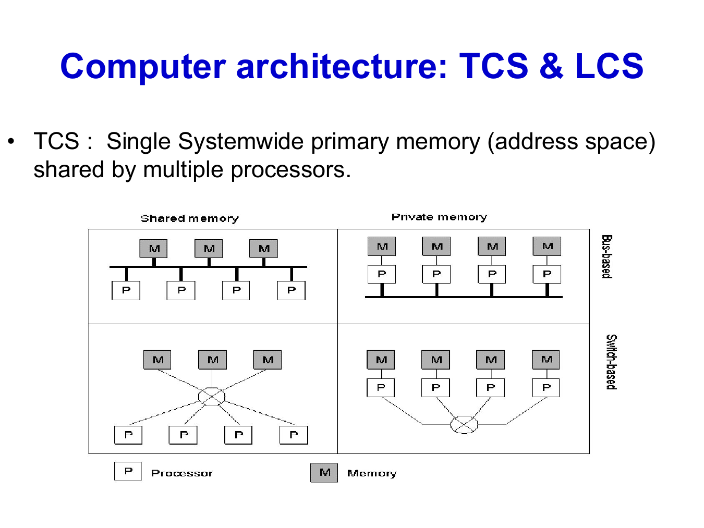
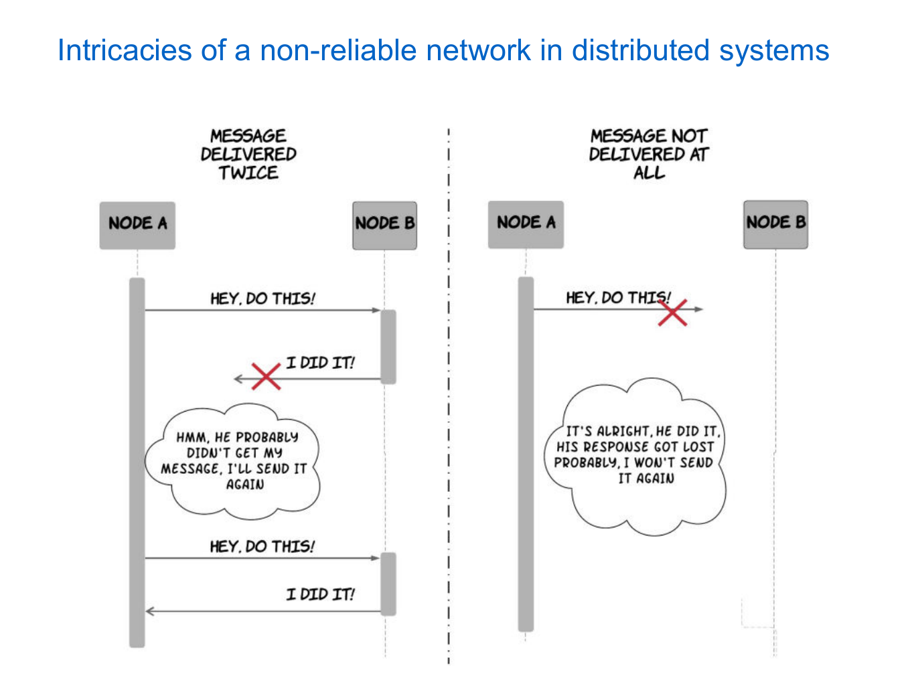

# 1. Fundamental concepts

A **distributed system** is a collection of independent computers whose processes communicate over a network to provide a service or perform a common task. **Distributed computing** studies how those processes coordinate their work. A banking service, for example, may need to accept a withdrawal at one branch and make the new balance visible at another.

## Why distribute computation?

| Goal | What distribution provides | Example |
|---|---|---|
| Resource sharing | Several machines can use a common service. | Campus computers share a file server. |
| Parallel work | Independent parts of a task can run at the same time. | Workers process separate partitions of a dataset. |
| Geographic reach | Computation can run close to users or data. | Regional servers serve local requests. |
| Fault tolerance | Redundant components can take over after a failure. | A replica serves reads when a server crashes. |
| Scalability | Capacity can grow as users or data increase. | A service adds workers as request volume grows. |

**Parallel computing** divides a computation into work that runs simultaneously. **Distributed computing** coordinates work across networked computers, which may run tasks in parallel. A multicore program can be parallel within one machine. An ATM network is distributed even when a given withdrawal is processed sequentially.

## System organization

| Hardware | Communication | Example |
|---|---|---|
| Tightly coupled | Processors read and write shared memory. | Multicore server. |
| Loosely coupled | Machines have private memory and send messages. | Networked server cluster. |

| Software | What it presents |
|---|---|
| Distributed operating system | Several machines managed as one system, with system-wide resource and process management. |
| Network operating system | Separate machines with explicit access to remote resources, such as an SSH host or network share. |
| Middleware | Shared naming, messaging, RPC, or transaction interfaces above the operating systems. |

**Openness** comes from published interfaces and standard protocols that let independently developed components interoperate. **Transparency** comes from hiding selected aspects of distribution.

## Transparency

| Type | Detail hidden | Example |
|---|---|---|
| Access | Differences in how resources are accessed | The same read operation works for local and remote files. |
| Location | Where a resource is hosted | A file name stays valid after the file moves servers. |
| Replication | How many copies exist | A replicated database has one logical address. |
| Failure | Some component failures and recovery actions | A standby replica takes over a request. |
| Migration | Movement of a resource or process | A service moves hosts under the same name. |
| Concurrency | Interleaving caused by simultaneous users | Two withdrawals preserve the correct account balance. |
| Performance | Reconfiguration to handle changing load | A load balancer sends traffic to less busy servers. |
| Scaling | Changes made as the system grows | New storage servers can join without a client rewrite. |

Growth can be in **size**, **geographic distance**, or **administrative domains**. Centralized metadata can bottleneck a large system. WAN delay can make a protocol designed for a LAN impractical. Independent organizations can impose different access policies. Distribution of work, hierarchy, caching, and replication address different pressures. Replicas also introduce the coordination problem of keeping copies consistent.

The Google File System (GFS) illustrates three ways to scale storage. Splitting files into chunks distributes storage and I/O. Replicating chunks tolerates individual machine failures. Keeping metadata separate from bulk data traffic limits the work of the central coordinator. These choices match large, streaming workloads, where aggregate throughput matters more than fast access to many small files.

## Communication, timing, and failure models

| Dimension | Questions to state before analysing an algorithm |
|---|---|
| Communication | Do processes use private memory and message passing, or access atomic shared objects? |
| Network | Is the topology a ring, tree, complete graph, or arbitrary graph? Are links directed, reliable, or FIFO? |
| Knowledge | Are identifiers unique? Do processes know their neighbours, system size, or diameter? |
| Timing | Are bounds on processing and message delay known? |
| Failure | Can a process crash, restart, omit actions, or behave arbitrarily? Can a link fail? |

An **atomic shared-memory operation** appears to take effect as a single indivisible step. A **FIFO channel** delivers messages sent on that channel in sending order. Reliability and FIFO ordering are separate guarantees.

### Asynchronous shared memory

In this model, processes take steps at arbitrary relative speeds and communicate through shared registers. A **single-writer** register has one designated writer, while a **multi-writer** register admits several. The read and write restrictions are independent. SRSW means single-reader/single-writer, MRSW means multi-reader/single-writer, and MRMW means multi-reader/multi-writer. The safe and regular guarantees below are for the standard single-writer register model.

| Register guarantee | What a read may observe |
|---|---|
| Safe | A read with no overlapping write returns the last written value. An overlapping read may return any allowed value. |
| Regular | An overlapping read returns the preceding value or a value from an overlapping write. |
| Atomic | All operations can be ordered as instantaneous steps that respect the real-time order of completed operations. |

### Timing assumptions

| Timing model | Assumption | Meaning of a timeout |
|---|---|---|
| Synchronous | Known bounds on processing and delivery. | Missing a known deadline can rule out ordinary delay. |
| Asynchronous | No known upper bound on these delays. A reliable channel still delivers eventually. | The peer may be slow or crashed. |
| Partially synchronous | Suitable bounds apply eventually or hold with an initially unknown value. | A timeout can become reliable once the bounds apply and the threshold is large enough. |

**Worked example.** If a message takes at most 8 ms in either direction and processing takes at most 4 ms, a request to a healthy server on reliable links should return in at most $8+4+8=20$ ms. With unbounded delays, silence for 20 ms carries no such guarantee. In the fully asynchronous crash model, this uncertainty also underlies the FLP impossibility of guaranteeing deterministic consensus termination.

A **crash-stop** process halts permanently. A **fail-stop** model additionally makes the halt detectable. A **crash-recovery** process can restart. An **omission** is a missed action or lost message. A **Byzantine** fault allows arbitrary behaviour. State which faults a proof allows.

A lost reply is ambiguous because the server may already have applied the request. A client can retry with the same request ID. For a non-idempotent operation such as a withdrawal, the server must associate that ID with the result as part of the same durable update as the balance change. Otherwise a crash between applying the update and remembering the ID can still produce a double withdrawal. The usual network fallacies assume reliability, zero latency, unlimited bandwidth, security, fixed topology, one administrator, zero transport cost, or uniform infrastructure. Each assumption should be made explicit when it matters.

## Complexity and correctness

| Measure | What to count |
|---|---|
| Messages | Total sends under the stated execution model. |
| Bits | Total transmitted data, including metadata. |
| Rounds | Synchronous communication steps until completion. |
| Dependent hops | Length of the longest chain of dependent message deliveries. |
| Space | Local or total state, as specified. |

For a tree broadcast on $n$ nodes, exactly $n-1$ messages carry the data along the tree edges. A tree of depth $d$ needs $d$ delivery steps with synchronous unit-delay links. Asynchronous delivery gives a dependency chain of length $d$ and permits arbitrary wall-clock delay.

- **Safety** says an execution never violates a rule, such as two processes being in one critical section together.
- **Liveness** says an expected event eventually occurs under stated progress assumptions, such as a waiting process getting its turn.
- **Termination** is a liveness property that says the algorithm eventually finishes.

To prove an invariant, show it holds initially, check that every possible operation preserves it, and derive safety from it. For liveness, use fair scheduling, eventual delivery, or a progress measure appropriate to the model.

## Course material

- [Introduction to Distributed Computing, pp. 2–16](sources/01_Introduction-DC.pdf#page=2) develops the system definition, motivation, organization, and goals.
- [Introduction to Distributed Computing, pp. 17–39](sources/01_Introduction-DC.pdf#page=17) covers transparency, scaling, network assumptions, models, costs, and the motivation for GFS.
