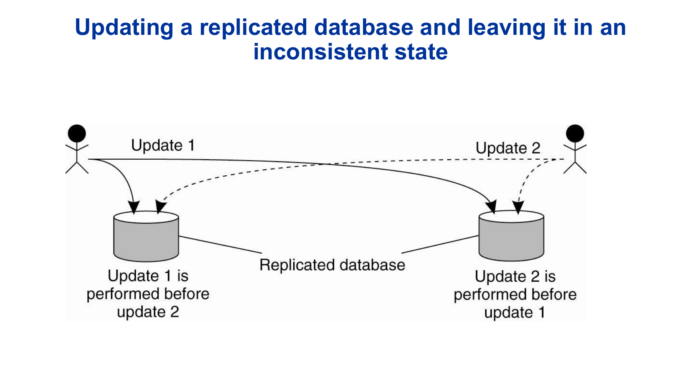
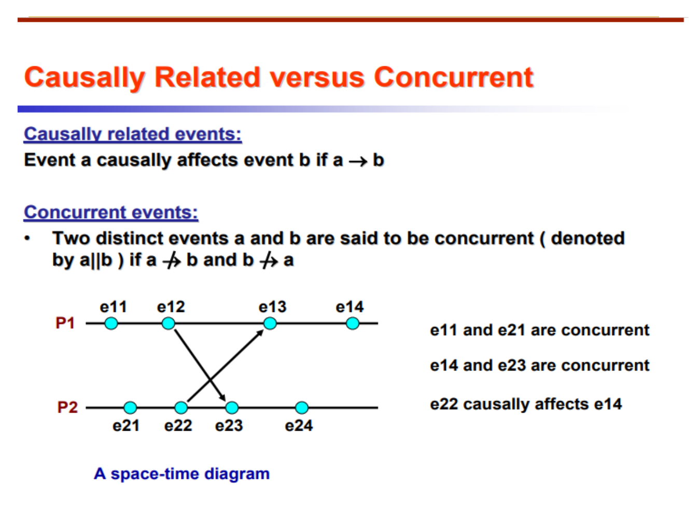
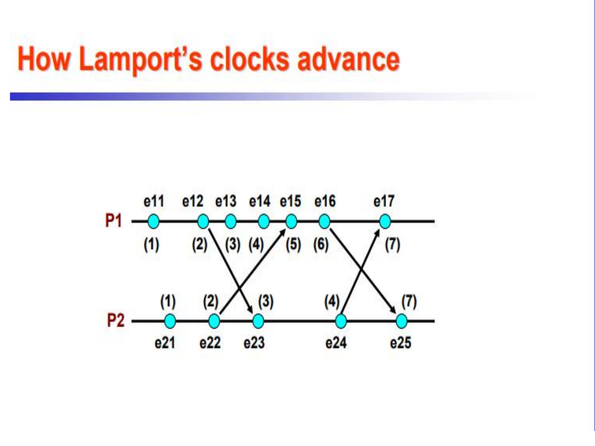
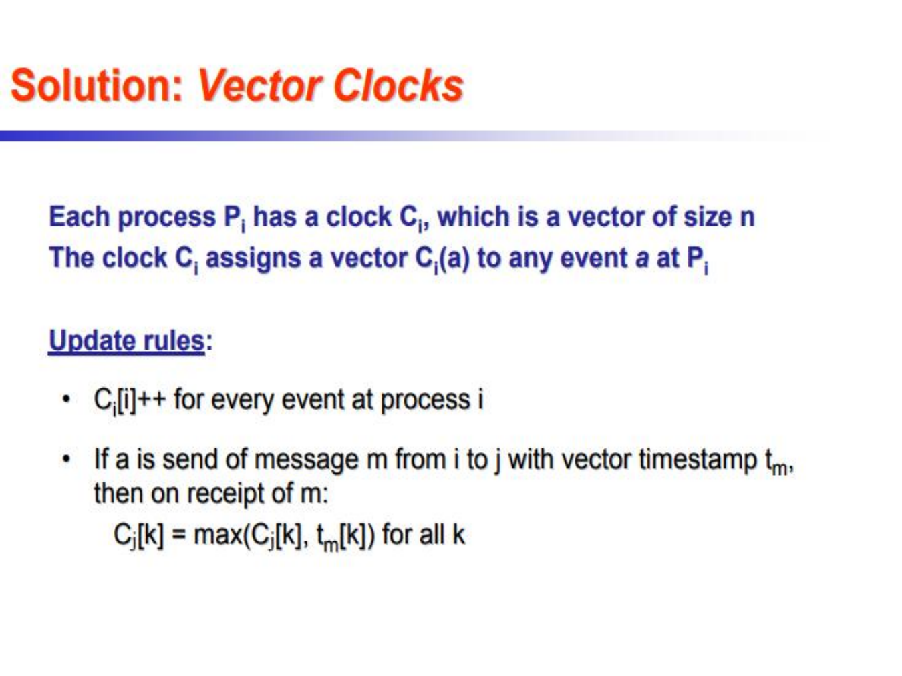
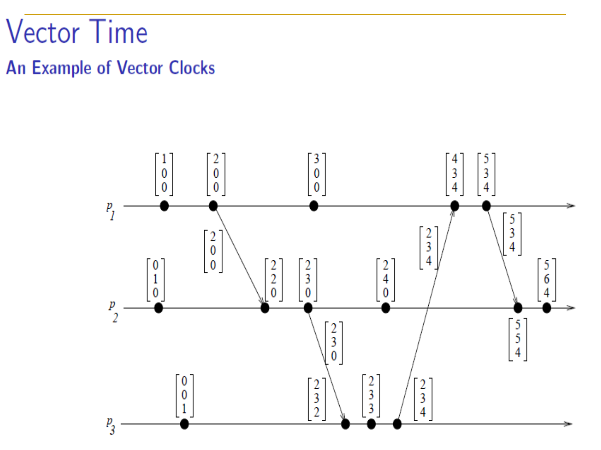
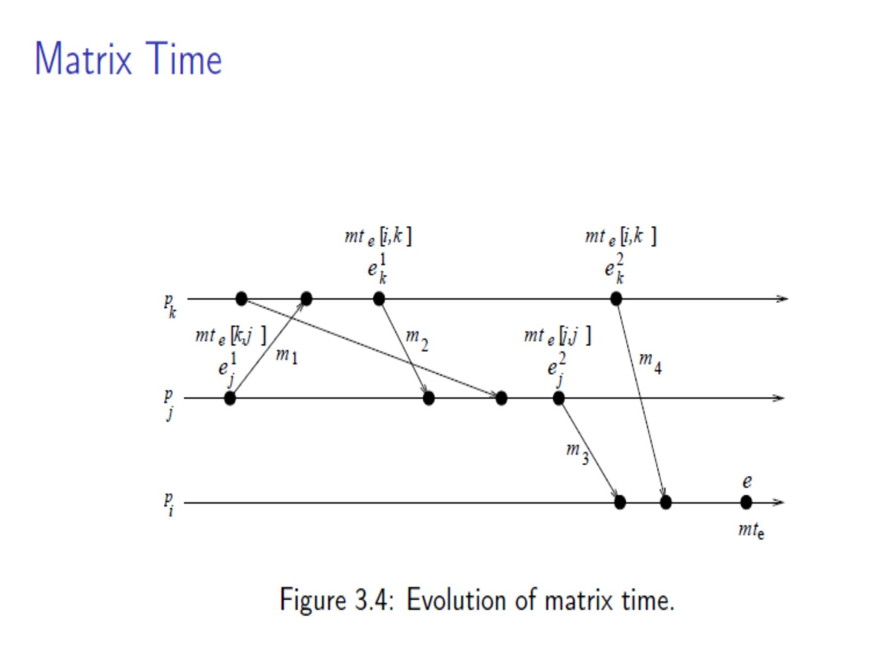
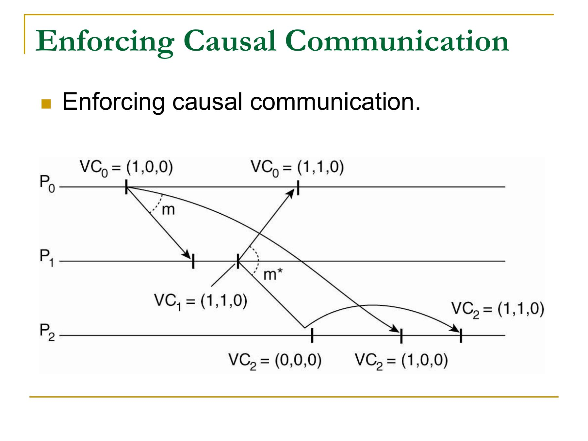
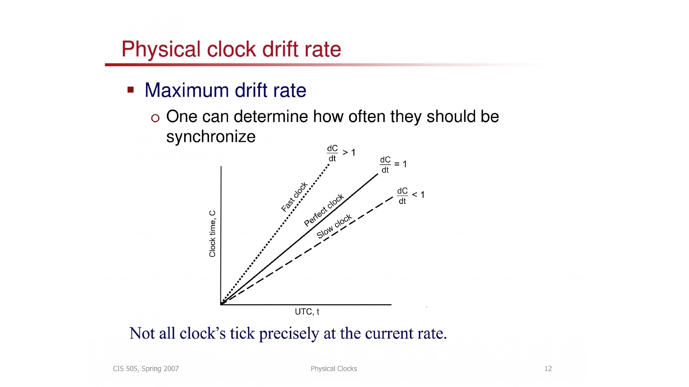
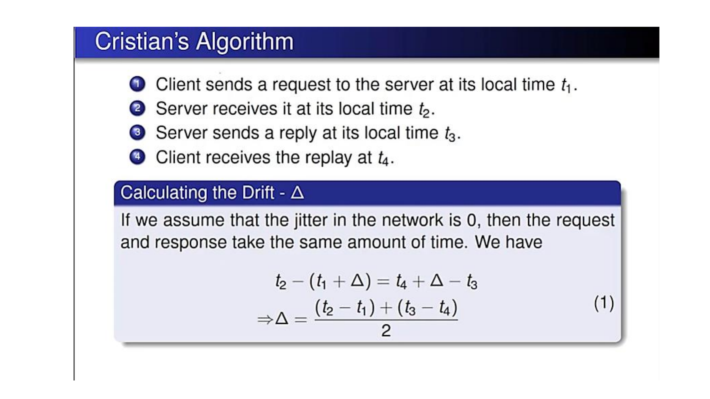

# 2. Clocks and event ordering

A clock can answer two different questions. A physical clock estimates when an event occurred. A logical clock captures ordering constraints between events. Replicas need an ordering rule when applying the same updates in different orders could leave them in different states.



## Happened-before and concurrency

Lamport's relation $\rightarrow$ is the smallest relation satisfying:

1. If $a$ and $b$ occur in the same process and $a$ occurs first, then $a\rightarrow b$.
2. If $a$ sends a message and $b$ receives it, then $a\rightarrow b$.
3. If $a\rightarrow b$ and $b\rightarrow c$, then $a\rightarrow c$.

Events are **concurrent**, written $a\parallel b$, when neither $a\rightarrow b$ nor $b\rightarrow a$.

- Happened-before is transitive and irreflexive.
- Concurrency is symmetric but not transitive.
- A causal path represents a possible flow of information.



*Events with no directed path in either direction are concurrent.*

To list concurrent pairs in an exam trace, draw process order to the right and each message arrow from send to delivery. Check reachability in both directions for each cross-process pair. For example, let $a_1\to a_2$, $b_1\to b_2$, and let the only message go from $a_1$ to $b_2$. The concurrent pairs are $(a_1,b_1)$, $(a_2,b_1)$, and $(a_2,b_2)$. The pair $(a_1,b_2)$ is causal because of the message arrow.

## Lamport scalar clocks

Each process $P_i$ stores an integer $L_i$.

```text
Initially: Li := 0
Before each local or send event: Li := Li + 1
Send m with timestamp Li
On receiving m with timestamp t:
    Li := max(Li, t) + 1
```

Lamport clocks satisfy

$$a\rightarrow b\implies L(a)<L(b).$$

The converse is false because concurrent events can receive different scalar timestamps. To give every event a unique timestamp, pair its scalar clock value with its process ID. Compare clock values first and IDs second. If two events have timestamp 6 at processes 1 and 2, the pairs $(6,1)$ and $(6,2)$ are unique and order process 1's event first. This tie-break orders otherwise unordered events without establishing a causal link.



*In the diagram, $P_2$ is at time 4 and receives timestamp 6 from $P_1$, so it advances to $\max(4,6)+1=7$.*

## Vector clocks

With $n$ processes, $P_i$ stores $V_i[1..n]$. The entry $V_i[j]$ is $P_i$'s knowledge of the progress of $P_j$.

```text
Initially: Vi := [0, ..., 0]
On each local or send event: Vi[i] := Vi[i] + 1
A send attaches a copy of Vi
On receiving a vector Vm at Pi:
    for every k: Vi[k] := max(Vi[k], Vm[k])
    Vi[i] := Vi[i] + 1
```



Vectors are compared componentwise:

$$V<W\iff(\forall k:V[k]\le W[k])\land(\exists j:V[j]<W[j]).$$

For event timestamps,

$$a\rightarrow b\iff V(a)<V(b).$$

Incomparable vectors represent concurrent events. This equivalence is called **strong consistency of logical timestamps**. With unit increments, $V(a)[j]$ counts the events of $P_j$ in the causal history of $a$, including $a$ itself if it occurred on $P_j$. Therefore $\sum_j V(a)[j]-1$ counts the events strictly before $a$.

### Short trace

1. $P_1$ sends $m_1$ with $[1,0,0]$.
2. $P_2$ performs a local event and reaches $[0,1,0]$.
3. On receiving $m_1$, $P_2$ merges to $[1,1,0]$ and increments its own entry to get $[1,2,0]$.
4. $P_2$ sends $m_2$ with $[1,3,0]$.
5. $P_3$ independently sends $m_3$ with $[0,0,1]$.

$m_2$ and $m_3$ are concurrent because their vectors are incomparable.



## Differential vector clocks and matrix time

In the worst case, exact causality represented by componentwise-ordered vectors needs $n$ components for $n$ processes. This lower bound concerns the full logical timestamp. A sender can sometimes transmit fewer components if the receiver can reconstruct it.

### Singhal-Kshemkalyani differential technique

Successive messages to the same destination often differ in only a few vector entries. A sender therefore transmits only changed pairs $(index,value)$ instead of the complete vector.

Process $P_i$ maintains:

- $LS_i[j]$: the value of $V_i[i]$ when it last sent to $P_j$;
- $LU_i[k]$: the value of $V_i[i]$ when component $V_i[k]$ was last updated; in other words, when $P_i$ last learned newer information about $P_k$.

On a send to $P_j$, first increment $V_i[i]$ and set $LU_i[i]$ to the new local time. Send pairs $(k,V_i[k])$ only for $LS_i[j]<LU_i[k]$, then set $LS_i[j]$ to the new local time. On delivery, the recipient takes the componentwise maximum for the transmitted entries and increments its own component. Record the recipient's new local time in its $LU$ entry for every component that changed, including its own.

**Example.** $P_i$ sent $[4,1,2]$ to $P_j$ previously and now sends at $[6,1,3]$, with $P_i=P_1$. Only $(1,6)$ and $(3,3)$ need to travel. FIFO delivery ensures $P_j$ already merged the unchanged entry 1 from the earlier message. The two auxiliary arrays and the vector use $O(n)$ space per process, and a message still carries up to $n$ entries in the worst case.

### Matrix time

Process $P_i$ maintains an $n\times n$ matrix $mt_i$:

- $mt_i[i,i]$ is $P_i$'s local logical clock;
- $mt_i[i,*]$ is $P_i$'s ordinary vector-clock view; its entry $mt_i[i,j]$ is the latest time of $P_j$ known directly to $P_i$; and
- $mt_i[j,k]$ means that $P_i$ believes $P_j$ knows about $P_k$ up to time $mt_i[j,k]$.

Vector time records what $P_i$ knows. Matrix time also records what $P_i$ knows that other processes know.

#### Updating the matrix

For a local or send event, $P_i$ advances its own clock (usually $d=1$):

$$
mt_i[i,i] := mt_i[i,i]+d, \qquad d>0.
$$

Every message carries the sender's matrix $mt$. On receiving it from $P_j$, $P_i$ does two things. First, it merges $P_j$'s row into its own row: what $P_j$ knew is now also known to $P_i$.

$$
mt_i[i,k] := \max(mt_i[i,k], mt[j,k]) \qquad (1\le k\le n).
$$

Second, it takes the maximum of every matrix entry, so it also learns what the sender knew about other processes' knowledge:

$$
mt_i[k,l] := \max(mt_i[k,l], mt[k,l]) \qquad (1\le k,l\le n).
$$

It then advances its diagonal entry and delivers the message.

In the example below, event $e$ occurs at $P_i$ after messages from $P_j$ and $P_k$ arrive.



At $e$, row $i$ says that $P_i$ knows $P_k$ up to $e_k^2$ and $P_j$ up to $e_j^2$. The cross entries say more: $mt_e[j,k]=x_k^1$ means $P_i$ knows that $P_j$ has seen $P_k$ only up to $e_k^1$; similarly, $mt_e[k,j]=x_j^1$ describes what $P_k$ knows about $P_j$. Those cross entries are what a vector clock cannot store.

#### Basic property

For a fixed process $P_l$, examine column $l$. If

$$
\min_k(mt_i[k,l])\ge t,
$$

then $P_i$ knows that every process knows $P_l$ has reached time $t$. An algorithm can use this to discard information from $P_l$ with timestamp at most $t$. The cost is $O(n^2)$ space.

## Causal message delivery

Causal delivery requires that if `send(m1) -> send(m2)` and a process delivers both messages, it delivers $m_1$ before $m_2$. Concurrent messages may be delivered in either order.

### Birman-Schiper-Stephenson broadcast

For BSS, $V_i[k]$ counts causal broadcasts from $P_k$ known at $P_i$; it is not the all-events vector used in the previous section. Receiving another process's broadcast does not independently increment the receiver's own component.

The following example shows what happens when a dependent message arrives first.



1. $P_0$ broadcasts $m$ with timestamp $[1,0,0]$.
2. $P_1$ receives $m$, so it knows $P_0$'s first broadcast. It then broadcasts $m^*$ with timestamp $[1,1,0]$. Therefore `send(m) -> send(m*)`.
3. Network delays allow $m^*$ to reach $P_2$ before $m$. At this point $V_2=[0,0,0]$.
4. For $m^*$, the sender condition passes because $T[1]=1=V_2[1]+1$. However, the dependency condition fails because $T[0]=1>V_2[0]=0$: the timestamp says that $m^*$ depends on a broadcast from $P_0$ that $P_2$ has not delivered.
5. $P_2$ buffers $m^*$. When $m$ arrives, it delivers $m$ and reaches $[1,0,0]$. The buffered message now satisfies both conditions, so $P_2$ delivers $m^*$ and reaches $[1,1,0]$.

Before $P_i$ broadcasts $m$, it increments $V_i[i]$ and attaches $T=V_i$. Process $P_j$, where $j\ne i$, may deliver $m$ only when:

1. $T[i]=V_j[i]+1$ - it is the next broadcast expected from $P_i$;
2. $T[k]\le V_j[k]$ for every $k\ne i$ - every other causal predecessor is already known.

Otherwise, $P_j$ buffers the message. After delivery it updates its vector componentwise and rechecks the buffer.

### Schiper-Eggli-Sandoz protocol

SES applies causal order to **point-to-point** messages. A process tracks the timestamps of earlier sends it knows about, indexed by destination, and passes that knowledge along with messages. The receiver checks the entry for itself and buffers the message if it has yet to deliver a required predecessor. Delivery updates the receiver's knowledge and may unblock buffered messages.

**Example.** $P_1$ sends $a$ to $P_3$ and then sends $b$ to $P_2$. After delivering $b$, $P_2$ sends $c$ to $P_3$. The dependency information carried through $b$ and $c$ tells $P_3$ to deliver $a$ first. $P_3$ does not wait for $b$, which was addressed to $P_2$. See [the original SES paper](https://doi.org/10.1007/3-540-51687-5_45).

A **version vector** uses one counter per replica to represent the updates included in an object version. A dominating vector identifies a version that includes the other's update history. Incomparable versions may contain concurrent updates and need an application-specific merge. Under eventual consistency, replicas converge when updates stop and all updates propagate, provided reconciliation is deterministic or otherwise convergent.

## Physical clocks and synchronization

Let $C_i(t)$ be process $i$'s clock reading at real time $t$.

- **Offset** (also called *skew* here): difference between two clock readings at one instant.
- **Drift rate:** difference between a clock's rate and the reference rate. A rate difference makes the offset change over time.
- **External synchronization:** $|C_i(t)-UTC(t)|\le D$.
- **Internal synchronization:** $|C_i(t)-C_j(t)|\le D$ for all $i,j$.

External synchronization within $D$ implies pairwise disagreement of at most $2D$. Internal synchronization alone gives no guarantee about UTC.



*A rate error accumulates, so clock offset grows between synchronizations.*

A **local clock** is maintained by one node. A **global time reference** is a shared scale, such as UTC, that nodes can only estimate with synchronization. If $A$ is 3 ms ahead of UTC and $B$ is 2 ms behind, their local clocks disagree by 5 ms. Logical clocks supply coordination when a physical reference is absent or insufficiently precise.

### Sources of physical time

A quartz oscillator gives a machine regular ticks, with a small rate error that accumulates as drift. Atomic clocks use a stable atomic frequency as a reference. GPS receivers compare arrival times of signals carrying satellite positions and send times. In the basic model, four signals supply equations for three position coordinates and the receiver's clock offset.

If each clock's fractional rate error is at most $\rho$, two clocks that start aligned can diverge by up to $2\rho t$ after elapsed time $t$. To hold pairwise skew below $D$ from an ideal alignment, resynchronize within $D/(2\rho)$.

### Cristian's method

A client sends a request at local time $t_0$, receives the server's timestamp $T_s$ at $t_1$, and assumes roughly equal forward and reverse delays. With negligible server processing, it estimates the server time as

$$T_s+\frac{t_1-t_0}{2}.$$

The estimate is uncertain because the two network delays need not be equal.



### Four-timestamp exchange

The four-timestamp exchange shown with Cristian's method and used in NTP records client send $t_1$, server receive $t_2$, server send $t_3$, and client receive $t_4$:

$$\delta=(t_4-t_1)-(t_3-t_2),$$

$$\theta=\frac{(t_2-t_1)+(t_3-t_4)}{2}.$$

$\delta$ removes server processing time from the observed round trip. The offset $\theta$ averages the forward and reverse estimates under the symmetry assumption.

**Worked example.** With $(t_1,t_2,t_3,t_4)=(100,116,120,124)$ ms, network round trip is $24-4=20$ ms and the estimated server offset relative to the client is $(16-4)/2=6$ ms. An unequal delay on the two paths biases this estimate.

### Berkeley method

A master polls the members, estimates their offsets, removes faulty outliers, computes an average, and sends each member a relative adjustment. Berkeley synchronization aligns the group internally; it does not require UTC.

### Network Time Protocol

NTP servers are arranged in **strata**, or hierarchy levels, according to their distance from an accurate reference clock. Clients exchange timestamps, filter samples, and estimate delay and offset. They normally discipline the clock rate to correct small errors. Large offsets can require stepping the clock. [NTPv4 specification](https://www.rfc-editor.org/rfc/rfc5905.html)

### Ordering with synchronised clocks

With ideal synchronized clocks and delivery bounded by $\Delta$, buffer a message stamped $t$ until $t+\Delta$. By then all earlier-stamped messages have had time to arrive. With imperfect clocks, allow for the stated pairwise skew in the hold-back bound. With unbounded delay, this physical-time rule cannot guarantee that an earlier-stamped message has arrived. For example, a service may accept a signed request only if its timestamp is within five minutes of server time. A server clock far behind UTC can accept a replay that should have expired. Authentication establishes who supplied a timestamp, and synchronization lets the receiver apply the intended freshness window.

## Choosing a clock

| Property           | Physical clock                          | Lamport clock                            | Vector clock                                 |
| ------------------ | --------------------------------------- | ---------------------------------------- | -------------------------------------------- |
| Meaning            | Approximate wall time                   | Causality-consistent scalar              | Exact causality in the model                 |
| Size               | One timestamp                           | One integer                              | $n$ integers                                 |
| Detect concurrency | No                                      | No                                       | Yes                                          |
| Ordering           | Numerical order may be wrong under skew | Total order needs a process-ID tie-break | Partial order; total order needs a tie-break |
| Main use           | Deadlines, leases, logs                 | Arbitration and ordering                 | Causal delivery and dependency tracking      |

## Course material

- [Logical clocks, pp. 2–49](sources/02_Logical-Clocks-and-Event-Ordering.pdf#page=2)
- [Clock synchronization, pp. 2–26](sources/03_Synchronization-of-Clocks.pdf#page=2)
