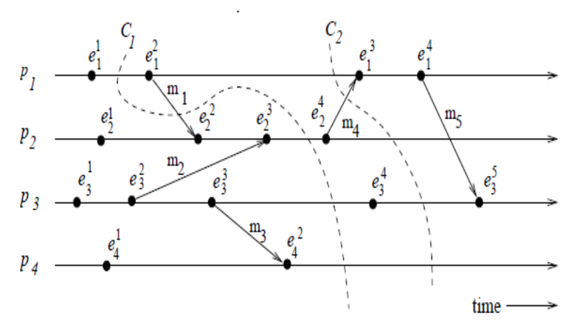
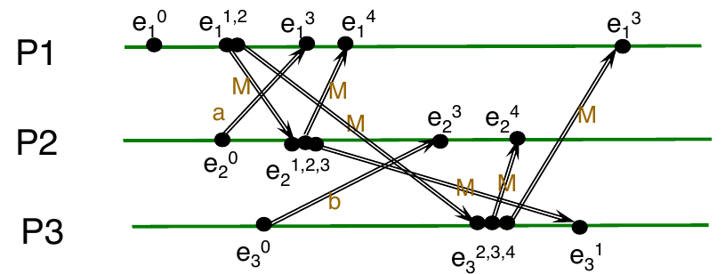
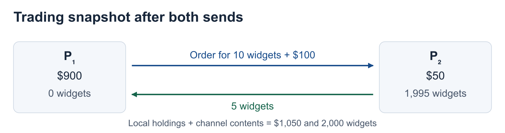

# 3. Global State and Snapshots

A **distributed snapshot** records what each process is doing and which messages are in transit, while the system continues running.

## Global state

Processes communicate by sending messages. Each process has its own memory and runs at its own pace. The snapshot must work without a shared clock that tells everyone when to record.

**Bank transfer.** Server A stores Alice’s balance of ₹500. Server B stores Bob’s balance of ₹300. To transfer ₹50, A deducts the amount and sends a message to B. B credits Bob when it receives the message.

| Point in the transfer | Alice at A | Bob at B | In transit | Total |
|---|---:|---:|---:|---:|
| Before A sends | ₹500 | ₹300 | ₹0 | ₹800 |
| A has sent and B is still waiting | ₹450 | ₹300 | ₹50 | ₹800 |
| After B receives | ₹450 | ₹350 | ₹0 | ₹800 |

- **Mixed readings.** Alice’s balance before the send plus Bob’s balance after the receive gives ₹500 + ₹350 = **₹850**. Both readings include the same ₹50.
- **Snapshot between send and receive.** Count ₹450 at A, ₹300 at B, and ₹50 in transit. The total is **₹800**.

- **Process history** $h_i$ lists the events at $P_i$ in order. An event is a local action, a send, or a receive.
- **Prefix** is the part of that history up to a chosen point.
- **Global history** $H$ combines all process histories. Local event order and message dependencies constrain the order across the system. Concurrent events have no required order.

| Term | Meaning | In the bank example |
|---|---|---|
| **Local state** $LS_i$ | The variables and program position of process $P_i$ at its chosen point. | Alice’s balance at A or Bob’s balance at B. |
| **Channel** $C_{ij}$ | A one-way path for messages from $P_i$ to $P_j$. | The path that carries the transfer from A to B. |
| **Channel state** $SC_{ij}$ | Messages that $P_i$ has sent by its chosen point and $P_j$ has yet to receive by its chosen point. | The ₹50 transfer after A sends and before B receives. |

The **global state** contains one local state for every process and one channel state for every channel. If a diagram shows only the local states, use the send and receive events to work out which messages are in transit.

$$GS = (\text{all local states},\;\text{all channel states})$$

Delivery rules matter because they determine what a process can infer from the order in which messages arrive.

| Delivery model | Guarantee |
|---|---|
| FIFO | Messages sent on the same channel arrive in sending order. |
| Non-FIFO | Messages sent on the same channel may arrive out of order. |
| Causal | If the send of one message happened before the send of another, a process that delivers both delivers the first one first. |

## Consistent cuts

- A **cut** picks a prefix from each process history.
- The **frontier** contains the last event of each nonempty prefix. If the cut takes two events from $P_1$ and one from $P_2$, the frontier contains the second event at $P_1$ and the first at $P_2$.

A cut is **consistent** if <u>every receive in the cut has its send in the cut</u>. More generally, if an event is included, every event that happened before it must also be included.

$$e\in C\land f\rightarrow e \implies f\in C$$

| Send included | Receive included | Snapshot result |
|---|---|---|
| Yes | Yes | The delivery is reflected in the receiver’s local state. |
| Yes | No | **In transit.** Put the message in the channel state. |
| No | Yes | **Inconsistent cut.** The receive is missing its send. |
| No | No | The message is outside the snapshot. |



*Read each process from left to right. The events on the left of its dashed cut are included. Cut $C_1$ includes the receive of $m_1$ without its send. Cut $C_2$ is consistent and includes $m_4$ as a message in transit.*

The conditions **C1** and **C2** govern how the snapshot accounts for each message.

- **C1.** If the send is included, account for the message exactly once. It appears either in the receiver’s local state or in the channel state.
- **C2.** If the send is outside the cut, exclude the receive and the channel entry too.

| Event ordering | Order it preserves |
|---|---|
| **Run** | The order of events within each process history in $H$. |
| **Linearization** | Process order and all message dependencies. The ₹50 send goes before its receive. An unrelated event can go on either side of the send. |

A linearization describes the execution one event at a time, from $S_0$ to $S_1$, then to $S_2$, and so on. Every prefix gives a consistent cut. Conversely, any consistent cut can be the prefix of some linearization. If one cut contains every event of another cut and adds new events, its snapshot is later in this ordering. The recorded states can come from different physical times.

## Chandy–Lamport on FIFO channels

**Issues in recording a global snapshot**

1. **Deciding which messages to record.** Include every message sent **before** its sender recorded. If the receiver had already received it at its recording point, the delivery is part of its local state. Otherwise, record the message in the channel state. A send **after** the sender recorded belongs outside the snapshot.
2. **Deciding when each process should record.** The receiver must <u>record before processing any message sent after its sender recorded</u>. Otherwise, the snapshot could include a receive whose send is outside the cut.

Chandy–Lamport solves both problems with a **marker**, a control message sent after local recording and before any further application message on that channel. FIFO keeps earlier sends ahead of the marker and later sends behind it. The processes can keep working while they record. A global pause would also need to be coordinated and would interrupt the application.

**Assumptions**

- Channels are one-way. Each message arrives exactly once and in sending order.
- Processes and channels keep working during the snapshot.
- The initiator must be able to reach every process. This holds with direct channels between every pair, or with indirect paths through a strongly connected network.
- Application messages continue to flow while the snapshot is recorded.

**Starting the snapshot**

1. Save the initiator’s local state.
2. Start logging arriving application messages on each incoming channel.
3. Send a `MARKER(snapshot-id)` on each outgoing channel before sending any further application message on that channel.

When a marker arrives on channel $c$, the receiver checks whether it has already recorded its local state for this snapshot.

| Receiver’s state | What it does |
|---|---|
| **Local state still to record** | Save the local state. **Record $c$ as empty.** Start logging the other incoming channels. Send a marker on each outgoing channel before further application messages. |
| **Local state already recorded** | **Stop logging $c$.** Save the messages that arrived on $c$ between the local recording and this marker. |

The initiator uses the second rule even for the first marker it receives, since it recorded its state when it started the snapshot.

When a marker triggers local recording, FIFO guarantees that every earlier message on that channel has arrived. The receiver’s local state already accounts for those deliveries, so the recorded channel is empty.

**Correctness**

Consider one application message and its marker on the same channel.

- **Sent before the sender records.** The message arrives before the marker. If the receiver has already recorded, it logs the message in the channel state. Otherwise, the delivery is part of its local state.
- **Sent after the sender records.** The marker arrives first. By the time the receiver handles the application message, it has already recorded its local state and stopped logging that channel. The receive therefore lies outside the cut.

Every recorded receive has a recorded send, and every in-transit message is accounted for. [Chandy and Lamport’s paper](https://lamport.azurewebsites.net/pubs/chandy.pdf)

**Completion and cost**

- **Completion.** A process finishes once it records its local state and receives a marker on every incoming channel.
- **Marker count.** One marker per directed channel, or $E$ markers for $E$ channels. The message cost is $O(E)$.
- **Recording time.** At most $D+1$ hop delays for directed diameter $D$, or $O(D)$ time with bounded delivery and processing per hop.

To assemble the snapshot, each process can send its record to the initiator. If every process needs a copy, it can forward each distinct record once on its outgoing channels. In a strongly connected network this spreads all records to everyone. Collection messages are counted separately from markers.

## Worked examples

### Marker exchange among three processes



*The diagram labels markers with M and application messages with a and b.*

1. $P_1$ records and sends markers to $P_2$ and $P_3$. They record on the marker from $P_1$, so the channel records $SC_{12}$ and $SC_{13}$ are empty.
2. $P_1$ logs $a$ before the marker from $P_2$ arrives. $P_2$ logs $b$ before the marker from $P_3$ arrives. Therefore $SC_{21}=\{a\}$ and $SC_{32}=\{b\}$.
3. The markers on $C_{23}$ and $C_{31}$ stop recording on those channels. Neither channel has a logged application message.

### Token counting in a ring

One token circulates along $P_1\to P_2\to P_3\to P_1$. The initiator $P_1$ passes the token to $P_2$ and then records. Each process passes the token on before recording its own state.

Reading the local counts independently can give three different results.

- **Three tokens** if each process counts just as the same token reaches it.
- **Zero tokens** if each process counts after the token leaves.
- **One token** if only one process happens to count while holding it.

Read the events on each line from left to right.

```text
P1  send token → record → send marker → receive token → receive marker
P2  receive token → send token → receive marker → record → send marker
P3  receive token → send token → receive marker → record → send marker
```

All three recorded local token counts are zero. The token returns to $P_1$ after $P_1$ records but before the marker from $P_3$, so it is logged on $C_{31}$.

| Channel | Token sends in the cut | Token receives in the cut | Tokens in transit |
|---|---:|---:|---:|
| $C_{12}$ | 1 | 1 | 0 |
| $C_{23}$ | 1 | 1 | 0 |
| $C_{31}$ | 1 | 0 | 1 |

Adding the local counts and the channel counts gives **one token**.

### A trading snapshot

$P_1$ starts with USD 1,000 and no widgets. It sends an order with USD 100 attached. $P_2$ starts with USD 50 and 2,000 widgets. It sends five widgets to $P_1$ before receiving the order.



*The figure shows the cut just after both sends, while both messages are still in transit.*

| Point in the exchange | $P_1$ holds | $P_2$ holds | In transit |
|---|---|---|---|
| Before either sends | USD 1,000, 0 widgets | USD 50, 2,000 widgets | Empty |
| After the order is sent | USD 900, 0 widgets | USD 50, 2,000 widgets | Order with USD 100 |
| After the widgets are sent | USD 900, 0 widgets | USD 50, 1,995 widgets | Order with USD 100, five widgets |
| After $P_1$ receives the widgets | USD 900, 5 widgets | USD 50, 1,995 widgets | Order with USD 100 |

The local holdings plus the channel contents add up to **USD 1,050 and 2,000 widgets** at each cut.

## Applications of snapshots

A **global predicate** is a condition you check using the state of the whole system. Both workers can be idle while a task message is still on its way. To tell whether the batch has finished, check <u>both conditions in the same snapshot</u>.

- **Local states.** Both workers are idle.
- **Channel states.** No task messages are in transit.

If no new work can enter the batch, “the batch has finished” stays true once reached. This is a **stable property**. A condition like “both workers are busy” can change while the snapshot is being collected.

| Application | What the snapshot helps track |
|---|---|
| Deadlock detection | Both processes waiting for each other’s locks, along with messages that might resolve those waits. |
| Distributed garbage collection | References held by processes or carried in messages. A reference in transit can still keep an object reachable. |
| Recovery and debugging | A consistent record of local states and pending messages. |

Counting camels across satellite zones has the same timing problem as counting tokens in a ring. If a camel moves from zone A to zone B, counting A before the move and B after it counts the camel twice.

## Extensions

**Overlapping snapshots**

Give each run an ID, such as `(initiator, sequence-number)`. Put that ID on every marker and report. Each process keeps a separate local record and channel log for each active run.

**Non-FIFO channels**

A marker can overtake a message that was sent before it. If the receiver stops recording at that marker, it can miss a message still in transit.

**Lai–Yang**

1. Each process starts **white** and turns **red** when it records. Each message carries the sender’s colour at send time.
2. If a red message arrives at a white process, the receiver records before delivering it.
3. Each process reports its white sends and receives up to the recording point. For each channel, the collector removes the recorded receives from the recorded sends. The messages left over were in transit.

**Example.** $P_1$ sends white message $a$, records, and sends red message $b$. If $b$ arrives first, $P_2$ records before delivering it. Neither receive is in the cut. The collector puts $a$ in the channel state because $P_1$ sent it before recording. A process that receives no red message must record on its own or receive another trigger. [Lai and Yang’s paper](https://www.cs.mcgill.ca/~lli22/575/distributedsnapshot.pdf)

**Causal delivery**

When application messages and markers use the same causal delivery service, a receiver delivers a marker before any later message that causally depends on it.

**Acharya–Badrinath**

1. The initiator multicasts one snapshot token to every process, including itself, through the causal delivery service.
2. On delivering the token, each process saves its local state and its sent and received application-message counts for each peer. It sends those records to the initiator.
3. On a channel with $s$ recorded sends and $r$ recorded receives, messages numbered $r+1$ through $s$ are in transit. Each sender–receiver stream uses its own sequence numbers. Retrieve the payloads from retained messages if the snapshot needs the contents.

A message sent after a process records depends on that process’s delivery of the token. A recipient therefore delivers its own copy of the token and records before it can deliver that message. Token delivery and the reply from each process use $O(n)$ control messages for $n$ processes, counting at the causal delivery interface. [Acharya and Badrinath’s paper](https://citeseerx.ist.psu.edu/document?doi=c0af95fcdacdf6f59701507d9a3ed2411ac4094f&repid=rep1&type=pdf)

**Finding a consistent cut with vector clocks**

1. Count the included events on each process to obtain $(c_1,\ldots,c_n)$.
2. Take the vector timestamp of the last included event on each process. Use the zero vector for an empty prefix.
3. Compare each timestamp with the cut counts, component by component. The cut is consistent if every timestamp is at most $(c_1,\ldots,c_n)$.

**Example.** Select one event on each of two processes, with frontier vectors $[1,0]$ and $[2,1]$. The second vector requires two events at $P_1$, while the cut includes only one. Extend $P_1$’s history to include that event and check again. You can also shorten $P_2$’s history to leave out the event that depends on it.
