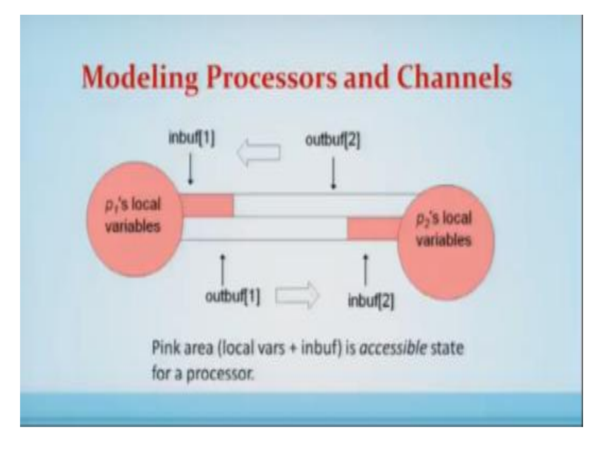
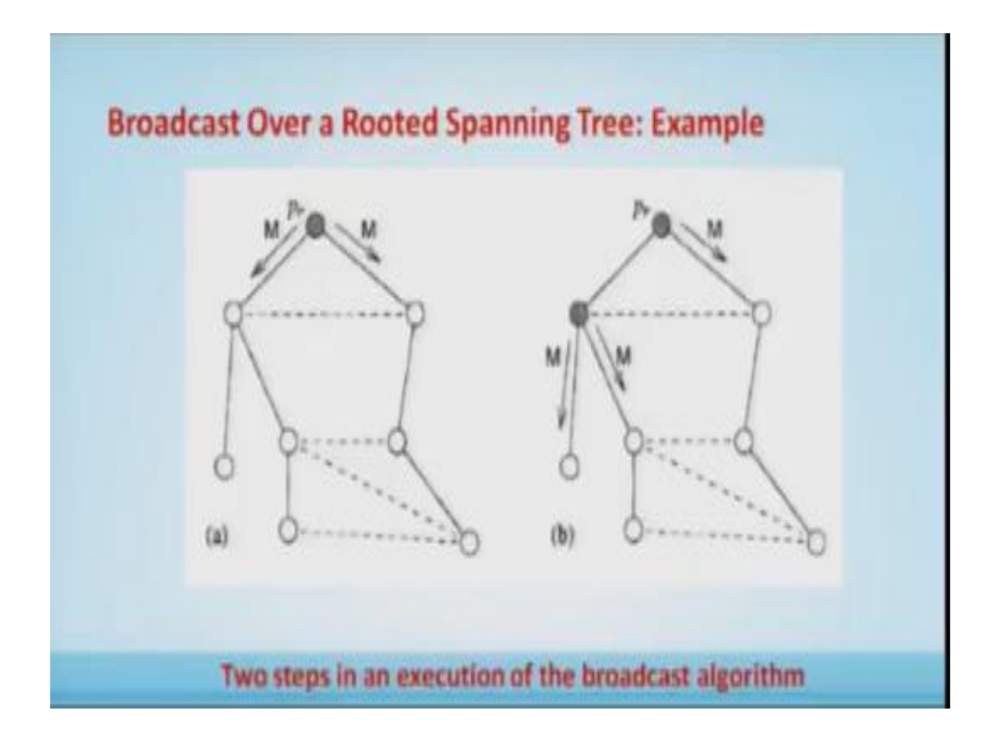
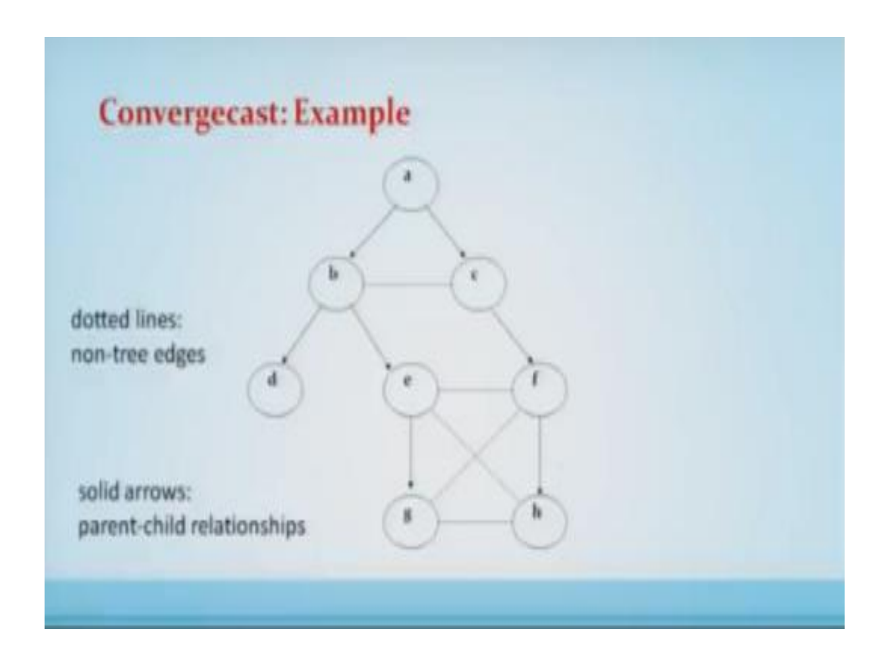
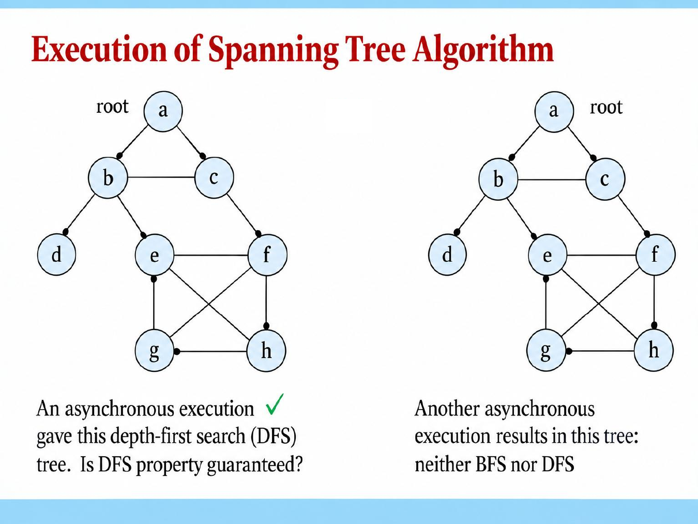
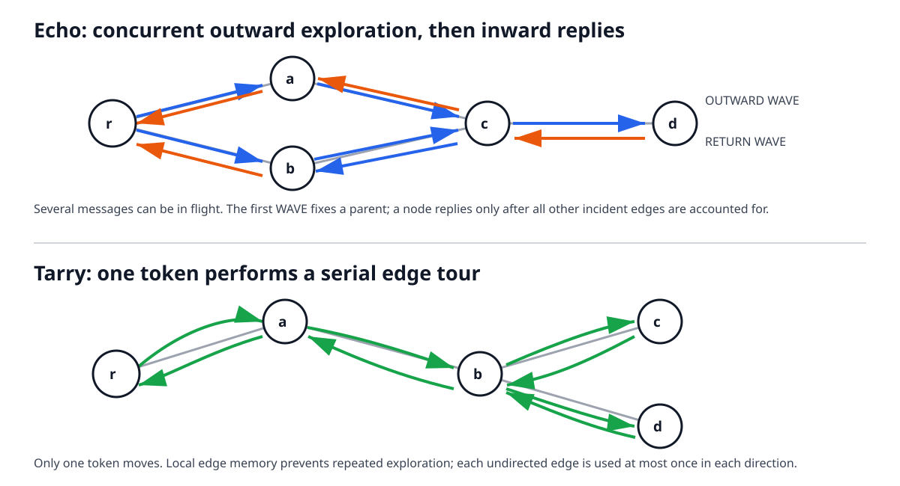
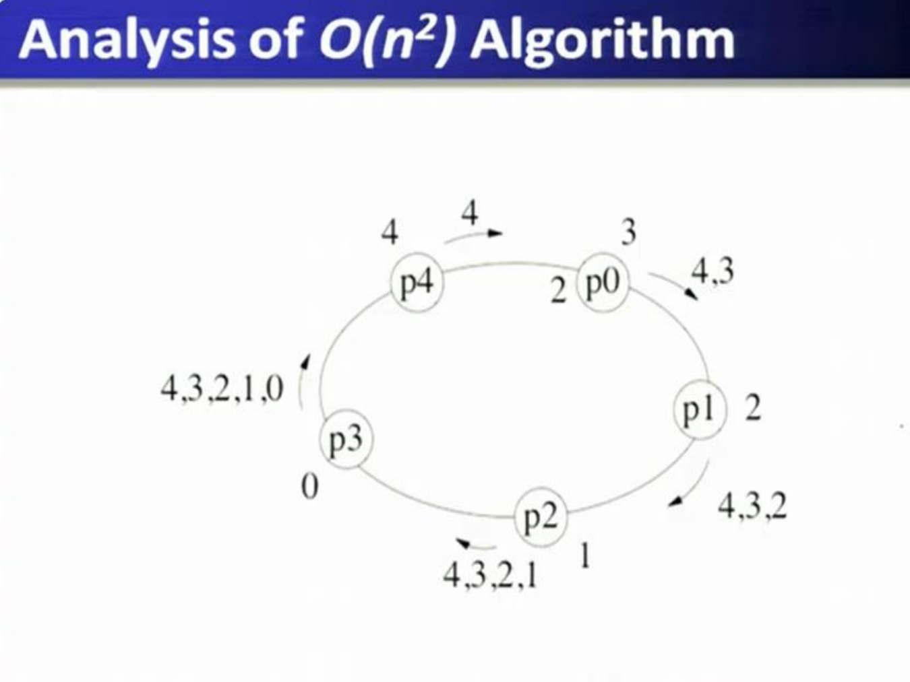
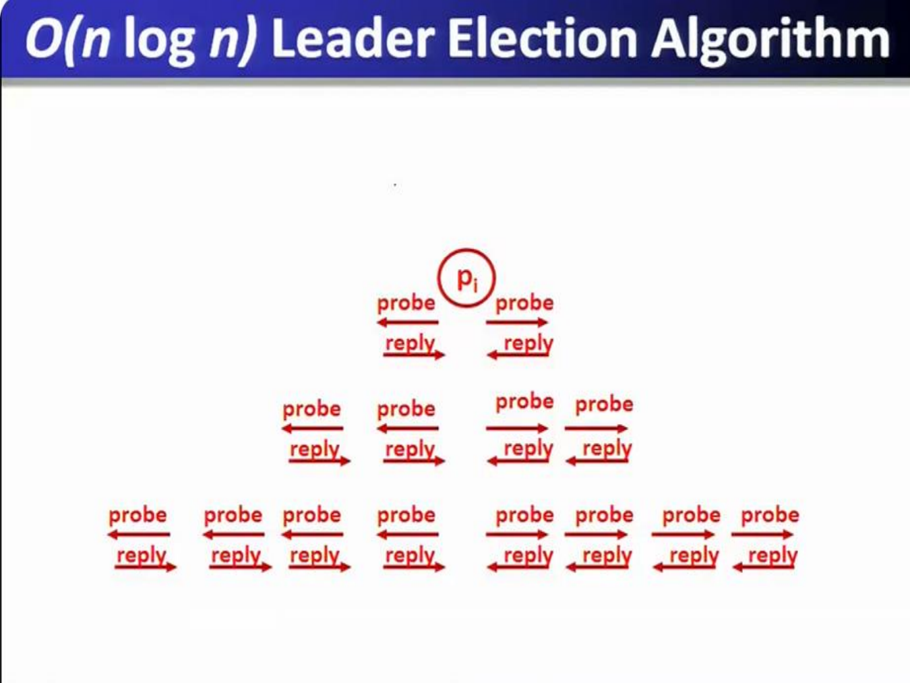
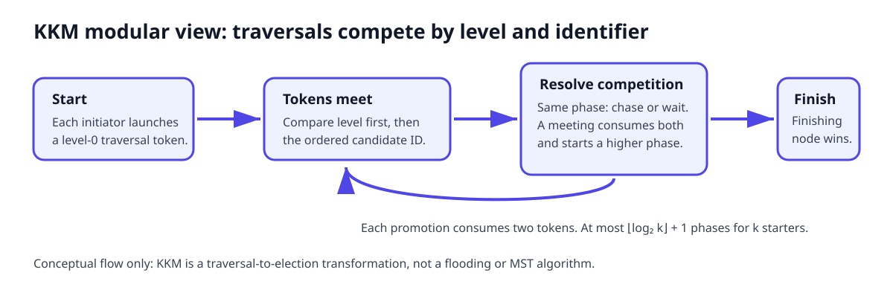
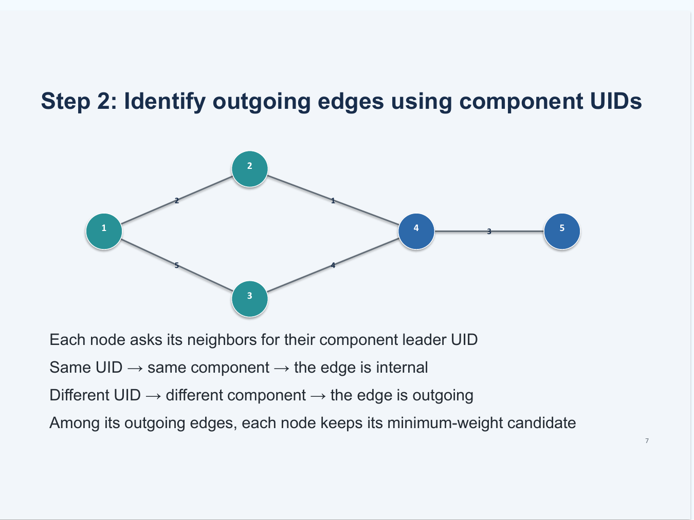
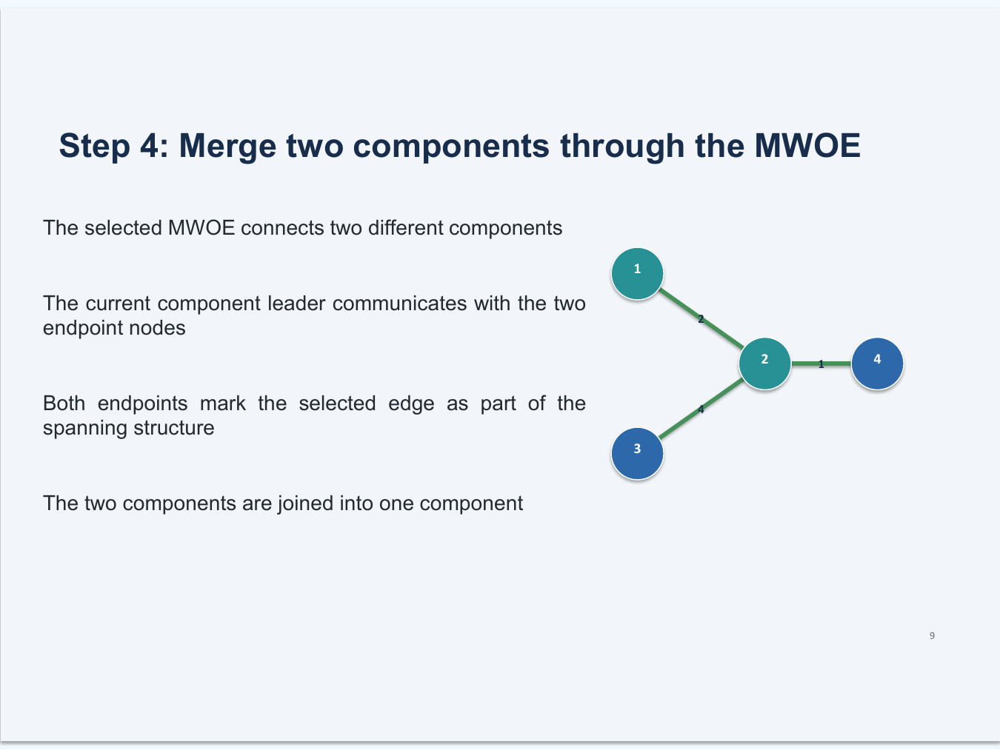

# 5. Message passing, traversal, and leader election

Flooding reaches the network, a wave confirms participation, and an election chooses a coordinator.

## Message-passing executions

For $G=(V,E)$, let $n=|V|$ processes and $m=|E|$ links. A **configuration** contains each process’s local state and input buffer, plus messages in transit. Each process acts on its own state and buffer.

| Event | Effect |
|---|---|
| Delivery | Moves a message from the channel to the receiving buffer. |
| Computation | Reads local state and buffered messages, updates state, and may send messages. |

For `ELECTION(7)` from $P_1$ to $P_2$, the message goes from the channel to $P_2$’s buffer before $P_2$ processes it.



Synchrony gives known bounds on computation and delivery. In fair asynchronous executions, correct processes keep taking steps and messages eventually arrive, with no known deadline.

## Rooted-tree communication primitives

A rooted spanning tree contains all $n$ processes, has $n-1$ edges, and gives every non-root process one parent.

### Broadcast and convergecast

In a **broadcast**, the root sends a value to its children and each non-root forwards it to its children. It uses $n-1$ messages and has causal depth equal to the tree height $h$.



In a **convergecast**, leaves send toward the root. An internal process waits for all children, combines their values, and sends one result to its parent. It also uses $n-1$ messages and has causal depth $h$.



Together, broadcast followed by convergecast is a tree wave with $2(n-1)$ messages and causal depth $2h$. Without a message-delay bound, its asynchronous wall-clock time is unbounded.

### Constructing a rooted tree

1. The root sends `EXPLORE` to every neighbour.
2. A process adopts the sender of its first `EXPLORE` as its parent, replies `PARENT`, and explores every other incident edge.
3. If a process already has a parent, it replies `ALREADY` to later explorations. Each requester classifies every explored neighbour from its reply. A leaf with no other neighbours can finish as soon as it acknowledges its parent.

Parent choices always point to earlier discoveries, so no cycle forms. Reliable delivery in a connected graph discovers every node. At most two explorations and two acknowledgements use an undirected edge, for $O(m)$ messages. A separate convergecast can tell the root when the entire tree is ready.

With equal one-edge-per-round propagation, the first arrival follows a shortest-hop path and the result is a BFS tree. In an asynchronous execution, a longer path may arrive first, so the tree need not be BFS or DFS.



## Wave and traversal algorithms

### Wave algorithm

A **wave** is a finite computation in which every process participates and causally influences a decision. Broadcast spreads information. Echo or convergecast returns evidence of participation to the decider.

### Echo on an arbitrary graph

Assumptions: one initiator, a connected undirected graph, reliable links, and no crashes during the wave.

```text
initiator sends WAVE on every incident edge

on first WAVE at v from p:
    parent[v] := p
    send WAVE on every other incident edge

record every later WAVE as that edge's response

after a WAVE has arrived on every non-parent edge:
    send WAVE back to parent[v]

initiator decides after every incident edge has replied
```

First arrivals form the rooted tree because each parent was reached before its child. Crossing WAVE messages account for non-tree edges. A child echoes only after accounting for all other incident edges, so the root’s decision confirms participation. At most two messages cross each undirected edge, for $2m$ total.

### Tarry's traversal algorithm

Echo explores many branches concurrently. **Tarry traversal** moves exactly one token, so process visits are serialized.

Each process records the edge by which the token first entered and which incident edges have already been used. It forwards the token on an unused edge; a non-initiator uses its entry edge for the return only after its other usable edges are exhausted. The initiator terminates when the token returns and no unused incident edge remains.

Two invariants give correctness:

- the token never crosses the same edge twice in the same direction;
- if an incident edge remains unused, the token cannot permanently finish at that process.

Thus every reachable node is visited, the token returns to the initiator, and each undirected edge is traversed at most once in each direction: at most $2m$ token messages. Tarry is not automatically DFS; a particular local edge-choice rule can make the tour DFS-like.



| Primitive | Communication pattern | Completion known where? | Messages |
|---|---|---|---:|
| Tree broadcast | Root to children | Not at the root by itself | $n-1$ |
| Tree convergecast | Children to root | At the root | $n-1$ |
| Echo wave | Concurrent exploration, then replies | At the initiator | at most $2m$ |
| Tarry traversal | One serial token | At the initiator | at most $2m$ |

## Leader-election specification

Leader election requires:

- **Validity:** the winner is an eligible member. Choosing the maximum eligible ID is an extra rule used by some algorithms, such as LCR.
- **Uniqueness/safety:** at most one winner is elected for an election epoch.
- **Agreement:** all correct processes output the same winner.
- **Termination/liveness:** every correct process eventually outputs a winner.

A deterministic algorithm cannot elect a leader in a perfectly symmetric anonymous ring: identical processes receive indistinguishable histories and make identical decisions. Unique IDs, randomness, a distinguished process, or sufficient topological asymmetry can break symmetry.

Useful ring terms:

- **oriented:** processes agree on clockwise/counter-clockwise;
- **anonymous:** processes have no unique IDs;
- **uniform:** the code does not depend on knowing $n$;
- **unidirectional/bidirectional:** messages use one/both ring directions.

Fault-free election is possible in an asynchronous network with reliable eventual delivery. In a crash-prone network with unbounded delays, a timeout alone cannot distinguish a crashed node from a slow one. This matters when an election must wait for a higher-ID process that may have failed. Protocols that recover using timeouts need additional assumptions, such as eventual bounds on delay or a failure detector.

## Synchronous complete-graph election

For a complete graph $K_n$ with unique IDs, every process sends its ID to all other processes in round 1. At the end of that round, every process has heard from all its neighbours and includes its own ID in the comparison. All therefore select the same maximum.

For $K_5$:

- directed sends in round 1: $5(5-1)=20$;
- information rounds: **1**;
- winner: the process with the maximum ID.

An optional `LEADER` broadcast adds 4 sends and a second round. It is redundant when every process already computed the maximum.

## Ring election

### LCR on a unidirectional ring

Assumptions: reliable oriented unidirectional ring, unique comparable IDs, no crashes, and every process initially participates.

```text
send value of own id to the left

when receive an id j (from the right):
    if j > id then
        forward j to the left (this processor has lost)
    if j = id then
        elect self (this processor has won)
    if j < id then
        do nothing
```

**Correctness.** The maximum ID can never meet a larger ID, so every process forwards it and it returns to its owner. Every smaller ID meets a larger ID before completing the ring and is discarded. Hence exactly the maximum declares; the subsequent announcement gives agreement.

In increasing ID order along the sending direction, all smaller candidates stop after one hop and the maximum travels $n$ hops. That gives $2n-1$ election transmissions. The worst ordering costs $\Theta(n^2)$; notification adds $n$ messages in either case. Under this counting convention, the decreasing-ID arrangement gives

$$n+\sum_{i=0}^{n-1}(i+1)=n+\frac{n(n+1)}2$$

transmissions including the final notification. Causal distance to declaration is $O(n)$, but asynchronous elapsed time is not finitely bounded.



### Hirschberg-Sinclair on a bidirectional ring

Assumptions: reliable bidirectional ring, unique comparable IDs, no crashes, and initially unknown ring size.

In phase $k=0,1,2,\ldots$, an active candidate probes up to $2^k$ hops in both directions. Each node drops an **outgoing** probe carrying an ID smaller than its own. At the radius, the receiver turns the probe into a reply that intermediate nodes relay back to its origin. A candidate receiving both replies starts the next phase. If one of its own probes returns as an outgoing probe after circling the ring, it declares itself the maximum and announces the result.



Survivors in phase $k$ are separated by distance at least $2^{k-1}$, so there are only $O(n/2^k)$ of them. Each generates $O(2^k)$ probe/reply traffic; therefore each phase costs $O(n)$ and the $O(\log n)$ phases cost

$$O(n\log n) \text{ messages}.$$

The matching $\Omega(n\log n)$ lower bound is for the relevant comparison-based election model on asynchronous rings of unknown size. It is not an unconditional bound for every stronger model; synchrony and non-comparison operations can change what is achievable.

## Failure-triggered election

### Failure-triggered ring protocol

The failure-triggered ring protocol starts after a coordinator is suspected. The counts below assume the live processes already form an intact oriented ring, membership stays stable during the run, and a single process initiates. Compare candidates using a total order, such as attribute followed by unique ID to break a tie.

1. The initiator marks itself as participating and sends `ELECTION` with its own candidate.
2. A receiver forwards a higher candidate. If it sees a lower candidate and has not yet participated, it replaces that candidate with its own and marks itself as participating. If already participating, it drops a lower candidate.
3. A process whose exact candidate returns becomes leader. It circulates `ELECTED`; each member records the result and forwards it until it returns to the leader. Reset participation for the completed run.

Count the election and announcement together:

- eventual leader starts: $2n$ messages (one election circulation and one announcement);
- worst initiator position: $3n-1$ messages.

For ten live processes, even when the initiator has ID 2, the maximum can be nine hops away in the sending direction. It then sends a fresh maximum-ID candidate around all ten links. This takes up to **19 messages before declaration**, then ten more to tell everyone, for **29 messages including notification**. LCR starts with every process participating and has a separate count.

With concurrent initiators, this version carries the initiator’s ID separately from the current candidate’s ID. Processes suppress lower-initiator runs. The winning run still elects the highest eligible candidate. For fairness, distinguish participation from choice: each live process lies on the same ring and its candidate is compared with the incoming one. The choice follows the same priority rule regardless of who notices the failure first. Lower-ranked processes can lose every election.

If the highest-ID process fails mid-election, no algorithm can infer that from silence alone in pure asynchrony. With eventual synchrony, another process times out, starts a new epoch/run, and the highest remaining live ID eventually wins. Missing a real failure mainly blocks liveness; false suspicion can cause repeated elections and, without epochs or quorum protection, competing coordinators. A network partition is not automatically handled safely by this ring protocol.

### Bully algorithm

Assumptions: known membership, totally ordered IDs, crash-stop failures, and eventually accurate timeouts.

1. A suspecting process sends `ELECTION` to every known higher-ID member.
2. A higher process replies `OK` and starts/continues its own election.
3. A process receiving no higher reply declares and sends `COORDINATOR` to lower IDs.
4. A process that received `OK` but no coordinator announcement eventually times out and retries.

The highest live ID eventually wins after failures and timing stabilize. When the lowest ID starts and every higher process successively competes, the number of `ELECTION` sends alone is

$$ (n-1)+(n-2)+\cdots+1=\frac{n(n-1)}2,$$

so total traffic is $O(n^2)$. The duration of a real election also depends on how many timeouts and retries it needs.

## Election in arbitrary networks

### Max-ID flooding with a round bound

In a connected synchronous graph with unique IDs and a known diameter bound $D$, every process starts with its own ID. In each round, send the largest ID seen so far to every neighbour, then take the maximum of the received IDs and the local value. After $r$ rounds, each process knows the maximum ID within $r$ hops. After $D$ rounds all agree. Use $n-1$ if only $n$ is known. With both directions of every edge used each round, the cost is $2mD$ sends. In an asynchronous version, a process can wait for all neighbour messages for the current round and buffer messages tagged for later rounds. The round count then measures communication dependencies, without an elapsed-time guarantee. A process that hears no new candidate for a while cannot infer that flooding is finished.

### With an existing rooted tree

Convergecast the maximum ID to the root, then broadcast the winner. Cost: $2(n-1)$ messages. This assumes a distinguished root and is not election from scratch.

### Korach-Kutten-Moran (KKM): modular traversal-to-election transformation

Model: a connected asynchronous network with reliable links, distinct ordered process IDs, and $k$ spontaneous starters. FIFO delivery is optional. The original theorem needs a traversal with a bound on how quickly new nodes or edges are reached. A bound on the cost of one complete traversal alone does not justify the theorem's message bound.

1. **Annexing.** Each starter launches a phase-0 traversal. The token carries its phase and an ID. When it reaches a lower-phase node, it claims that node for its domain and continues.
2. **Chasing or waiting.** At a same-phase conflict, the higher-ID traversal can switch to chasing the lower-ID traversal by following its recorded trail. A traversal encountering a stronger same-phase domain can stop and wait as a candidate. A higher phase discards lower-phase competitors. Hop counters let a chaser detect if it overtook the token it was following on a non-FIFO channel.
3. **Promotion.** When a same-phase token reaches a waiting candidate and combines with it, both old tokens are consumed. A fresh traversal starts one phase higher using the meeting node's ID.
4. **Election.** A traversal that annexes the whole network elects the node where it finishes. That node may differ from the original starter. A separate traversal can announce the result.

Each promotion consumes two same-phase tokens, so at most $\lfloor\log_2 k\rfloor+1$ phases arise. The collision and chasing rules prevent two competing traversals from both claiming the whole graph and ensure that unresolved same-phase competition eventually produces a higher phase. Under the paper's traversability assumption the election itself uses at most $(f(n)+n)(\log_2 k+1)$ messages. The edge-traversability version substitutes $f(m)$. Add the cost of a separate announcement if the question asks when everyone knows the result. [KKM original paper, §§3.1–3.3](https://csaws.cs.technion.ac.il/~moran/r/PS/kkm.pdf)



## Distributed minimum spanning tree

Assumptions: a connected undirected weighted graph, reliable communication, and distinct edge weights or deterministic tie-breaking. A minimum spanning tree (MST) connects all nodes with minimum total edge weight.

The algorithm uses a **GHS-style** fragment construction:

1. every node starts as a one-node level-0 fragment;
2. a fragment leader broadcasts a search;
3. nodes test incident edges and reject internal edges;
4. candidates convergecast so the leader obtains the fragment's minimum-weight outgoing edge (MWOE);
5. fragments merge across the MWOE and broadcast the new fragment identity;
6. repeat until the connected graph has one fragment.



The cut property makes the choice safe: an MWOE crossing a fragment's cut belongs to some MST. Equal-level fragments merge into a fragment one level higher; a lower-level fragment can be absorbed by a higher-level fragment. A level-$L$ fragment contains at least $2^L$ nodes, so there are $O(\log n)$ levels.



In this version, the endpoint with the larger UID leads the merged fragment. The construction has the following bounds.

- time: $O(n\log n)$;
- communication: $O((n+m)\log n)$.

The classical GHS algorithm uses a tighter message bound of $O(m+n\log n)$.

After the tree exists, a unique tree leader can be chosen with max-ID convergecast plus broadcast in $2(n-1)$ messages. This final election is separate from constructing the MST.

## Luby's maximal independent set

An **independent set** contains no adjacent vertices. It is **maximal** if no additional vertex can be added without breaking independence. Maximal does not mean maximum-cardinality.

Luby's randomized synchronous algorithm maintains active vertices. In each phase:

1. every active vertex chooses a fresh random priority (break ties by unique ID);
2. an active vertex whose priority exceeds every active neighbour joins the MIS;
3. selected vertices and all their neighbours become inactive;
4. the remaining active graph repeats.

Selected neighbours cannot coexist because each would need a greater priority than the other, proving independence. Every non-selected vertex removed in step 3 is adjacent to a selected vertex; when no active vertices remain, the result is maximal. The standard algorithm takes $O(\log n)$ phases with high probability. Each phase exchanges priorities and status over active edges. For example, on the ring $A$–$B$–$C$–$D$–$A$ with priorities $4,1,3,2$, $A$ and $C$ are local maxima. They join and remove all four vertices in one phase.

Topology behaviour depends on the random priorities:

| Graph | Possible/final MIS behaviour |
|---|---|
| Complete graph $K_n$ | The unique global priority maximum joins in phase 1; any singleton is maximal. |
| Star | If the centre beats every leaf, the centre alone wins. If a leaf beats the centre, winning leaves remove the centre and eventually all leaves form the MIS. |
| Ring | Non-adjacent local maxima join, their neighbours leave, and gaps repeat. Many MISs are possible; an alternating set is only one example. |

A deterministic trace requires the random priorities for every phase.

## Consensus and system examples

Leader election chooses a coordinator. Consensus can confirm its authority or agree on decisions it proposes across failures.

In Paxos, proposers use unique proposal numbers; acceptors durably record promises and accepted values; learners discover a value accepted by a majority. A proposer that receives promises from a majority must adopt the value from the highest-numbered previously accepted proposal, if one exists. Each promised acceptor stops accepting lower proposal numbers and reports any earlier acceptance. If a value was already chosen, every new promise quorum overlaps its acceptance quorum. The highest-accepted-value rule carries that value through successive proposal numbers. Intersection supplies the contact point, and the promise and value-selection rules preserve the value. Paxos safety holds without a timing bound. Progress needs a reachable majority and conditions that let one proposal complete without perpetual interference. [Lamport, Paxos Made Simple](https://www.microsoft.com/en-us/research/publication/paxos-made-simple/)

Chubby uses a master chosen with majority support and a master lease. In the simplified ZooKeeper-style example, increasing sequence IDs are assigned, the highest is chosen, and each process monitors the next-higher participant. The production ZooKeeper protocol elects a candidate using quorum votes and state history, then establishes a new epoch and synchronizes a quorum before activating that leader. If the leader fails, servers return to election. [ZooKeeper protocol internals](https://zookeeper.apache.org/doc/current/zookeeperInternals)

## Election comparison

| Algorithm | Topology/model | Initiators | Failure support | Election messages |
|---|---|---|---|---:|
| $K_n$ all-to-all | synchronous complete graph | all | none | $n(n-1)$ |
| LCR | async unidirectional ring | all | none | $\Theta(n^2)$ worst case |
| Hirschberg-Sinclair | async bidirectional ring | all | none | $O(n\log n)$ |
| Failure-triggered ring | oriented ring + eventual detection | one or more | coordinator crash, after stabilization | $2n$ to $3n-1$ |
| Bully | known complete membership + usable timeouts | one or more | crash-stop, after stabilization | $O(n^2)$ worst case |
| Max-ID flooding | connected graph with known round bound $D$ | all | none | $2mD$ |
| Rooted-tree max | existing rooted tree | root coordinates | none | $2(n-1)$ including announcement |
| KKM | async connected graph with a suitable traversal | $k$ | no crash in base model | $(f(n)+n)(\log_2 k+1)$ before separate announcement |

## Course material

- [Message-passing algorithms, pp. 2–31](sources/06_Message-Passing-Algorithms.pdf#page=2)
- [Classical leader election, pp. 2–30](sources/04_Classical-Leader-Election-Algorithms.pdf#page=2)
- [Failure-triggered election and consensus, pp. 4–45](sources/05_Distributed-Leader-Election-Protocols.pdf#page=4)
- [Distributed minimum spanning tree, pp. 1–22](sources/07_Distributed-Spanning-Tree.pdf)
- [Korach, Kutten, and Moran, “A Modular Technique for the Design of Efficient Distributed Leader Finding Algorithms”](https://doi.org/10.1145/323596.323611)
- [Luby, “A Simple Parallel Algorithm for the Maximal Independent Set Problem”](https://www.cs.cmu.edu/~guyb/paralg/papers/Luby86.pdf)
