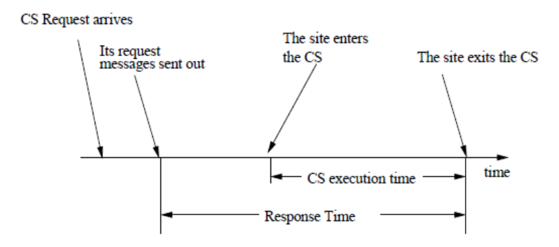
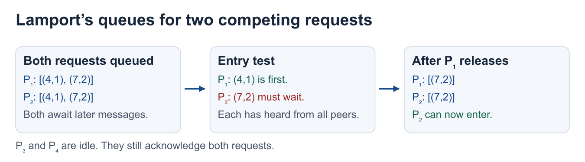
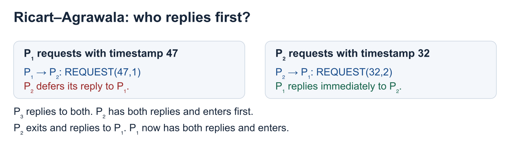
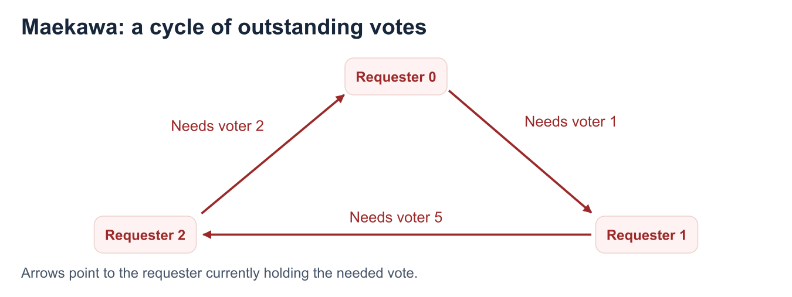
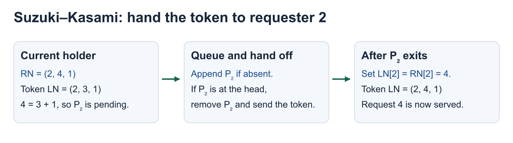

# 6. Distributed Mutual Exclusion

A **critical section** (CS) is the part of a program that needs exclusive access to a resource. Suppose two booking servers both read that seat 12 is free and then each sells it. Put the check and update in one critical section. The first server checks and reserves the seat. When the second server enters, it sees the reservation and rejects the booking.

## Requirements and performance

```text
request section -> critical section (CS) -> release section -> remainder section
```

| Requirement | What the protocol must guarantee |
|---|---|
| Safety (mutual exclusion) | At most one process is in the critical section. |
| Progress (deadlock freedom) | If requests are pending, some requester eventually enters, assuming each holder eventually exits. |
| Starvation freedom | Each correct requester eventually enters under the stated assumptions. |
| Fairness | A stated ordering rule applies, such as ordering competing requests by logical timestamp and process ID. |

Typical uses include exclusive writes to a shared file, inventory updates, and access to a shared device. Servers on different machines coordinate by sending messages. A local semaphore can coordinate threads on one server, and each server sees only its own state and the messages that have arrived.

**System model.** Each of the $N$ sites runs one process with a unique ID. A process can be **idle**, **waiting to enter**, or **executing the critical section**. It queues local requests and issues one at a time. While waiting, it still handles protocol messages. An **idle token** is held by a process that is idle. The protocols assume reliable delivery, finite critical sections, and no crashes unless stated otherwise. Message delays may vary.

| Approach | Entry condition |
|---|---|
| Permission-based (non-token) | Exchange request and reply messages to obtain permission from every other site, or from a coordinator in a centralized design. |
| Quorum-based | Obtain votes from a selected subset. Every two quorums share a voter, and a voter grants one request at a time. |
| Token-based | Hold the unique token. |

| Metric | How to measure it |
|---|---|
| Message cost | Sends attributable to one entry and release. |
| Synchronization delay $SD$ | Gap from one exit to the next entry when another process is waiting. |
| Response time | From issuing the request to leaving the critical section. When messages are needed, timing starts at the request send. |
| Saturated throughput | Approximately $1/(SD+E)$ entries per time unit, where $E$ is mean critical-section duration. |



*Response time includes both the wait after sending the request and the critical section itself.*

Let $T$ be a one-way message delay in the timing examples. Ignore local processing. If a request starts at 0 ms, enters at 4 ms, and exits at 9 ms, its **entry wait** is 4 ms and its **response time** is 9 ms. If the next waiting site enters at 11 ms, the **synchronization delay** is 2 ms. Under sustained demand, a 5 ms critical section and a 2 ms handoff give roughly one completion every 7 ms.

## Central coordinator

1. The requester sends `REQUEST` to the coordinator.
2. The coordinator sends `GRANT` if the resource is free. Otherwise it adds the request to its FIFO queue.
3. The exiting process sends `RELEASE`. The coordinator clears the grant and grants the next queued request.

One entry costs **3 messages** for a remote requester. The handoff takes **$2T$** when another process is queued. The release travels to the coordinator, then the grant travels to the next requester. The queue gives fairness in coordinator arrival order. Every request depends on the same coordinator, making it a bottleneck and a single point of failure.

## Lamport permission algorithm

Every process keeps a **local queue** of outstanding requests, including its own. It sorts by logical time first and process ID second. Queues can differ while messages are in transit. On each reliable FIFO channel, messages from the same sender arrive in sending order.

### Protocol

1. **Request the critical section.** $P_i$ advances its Lamport clock and takes the new value $t_i$ as the request time. It inserts $(t_i,i)$ into its own queue and broadcasts `REQUEST` with that same timestamp to the other $N-1$ processes. The queue entry keeps its original timestamp.
2. **Receive a request.** If $P_j$ receives $P_i$’s request with time $t_i$, it updates its clock using $L_j\gets\max(L_j,t_i)+1$ and inserts $(t_i,i)$ into its queue. It immediately sends a `REPLY` to $P_i$, even if it is waiting or in the critical section. The reply carries **$P_j$’s current send timestamp**, which is later than $t_i$.
3. **Enter the critical section.** $P_i$ checks both conditions locally.
   - Its **own request is first** in its queue.
   - It has received **a message with a later timestamp from each other process**. Compare timestamp–sender pairs using the same order as the queue. In the basic protocol, each peer’s `REPLY` satisfies this check. A qualifying later message can also satisfy it, as in the optimization below.
4. **Release the critical section.** On exit, $P_i$ removes its own request and broadcasts a timestamped `RELEASE` to all peers. Its request remains queued throughout the critical section.
5. **Receive a release.** A peer updates its clock and removes the **sender’s request** from its own queue. If this exposes the peer’s own request at the front, it can enter once the later-message condition also holds.

**Purpose of the reply.** A `REPLY` confirms that the peer queued the request. For example, if $P_2$’s clock is 7 when it receives $P_1$’s request stamped 4, its clock becomes 8 and its reply is stamped 9 after the send increment. By FIFO, any earlier request that $P_2$ sent has already reached $P_1$ by the time that reply arrives. [Lamport’s original rules](https://lamport.azurewebsites.net/pubs/time-clocks.pdf#page=4)

### Correctness

**Safety.** Suppose two sites are in the critical section together. Call their requests earlier and later according to `(timestamp, process ID)`. Before entering, the later requester received a message from the earlier site stamped higher than the later request. That site sent its own request first, so FIFO placed the earlier request in the later site's queue before that message arrived. The earlier site is still in the CS, so its request remains ahead of the later request in that queue. The later site therefore failed the queue-head test.

**Fairness.** The same argument applies to entry order. The later request can reach the head only after the earlier site has entered, exited, and sent its release. Logical timestamp order preserves happened-before, and the process ID gives a deterministic order for equal timestamps. It need not match wall-clock arrival order for concurrent requests.

### Worked trace with four sites

Let $P_1$ and $P_2$ issue overlapping requests $(4,1)$ and $(7,2)$. $P_3$ and $P_4$ are idle. Use direct reliable FIFO channels between all four sites.



*Queue states at the two contenders. P₃ and P₄ also receive and acknowledge requests.*

| Step | What each requester can do |
|---|---|
| Both broadcast `REQUEST`. | Initially $P_1$ sees only $(4,1)$ and $P_2$ sees only $(7,2)$. Each has its own request at the front, but both still need later messages from their peers. |
| The requests cross. | $P_2$ inserts $(4,1)$ ahead of $(7,2)$ and replies to $P_1$. $P_1$ inserts $(7,2)$ behind $(4,1)$ and replies to $P_2$. $P_3$ and $P_4$ reply to both. |
| Both receive all replies. | $P_1$ enters because $(4,1)$ is first. $P_2$ has all its replies and still waits because $(4,1)$ is first in its queue too. |
| $P_1$ exits and sends `RELEASE`. | When the release reaches $P_2$, it removes $(4,1)$. Both entry conditions now hold for $P_2$, so it enters. |

Finite critical sections and eventual delivery let each pending request advance.

### Cost

Each entry uses $N-1$ requests, $N-1$ replies, and $N-1$ releases, for **$3(N-1)$** sends. The four-site example uses nine. A full mesh with four neighbours per node has five sites and uses twelve. On a routed network, the formula counts end-to-end messages. Counting transmissions on each link also requires the route lengths. The final release reaches the next waiting requester in **$T$** when its other entry condition is already met.

**Omitting a reply.** If $P_2$ already sent its request $(7,2)$ before receiving $P_1$’s request $(4,1)$, the request from $P_2$ itself satisfies $P_1$’s later-message test for that peer. FIFO ensures it comes after any smaller request that $P_2$ sent. The optimized cost is **$2(N-1)$ to $3(N-1)$**.

**Limitations.** Every site participates even when only one site wants to enter. Each site can hold up to $N$ queue entries. A failed peer can prevent the later-message test from succeeding, and a missing release can leave an old request at the head of the queue.

## Ricart-Agrawala

The reply grants permission. Deferring it until exit removes the separate release broadcast.

### Protocol

Use reliable FIFO channels for the version studied here. The original algorithm also permits reliable out-of-order delivery. Each process $P_i$ initializes an array `RD` with one false flag per peer. `RD[j]` becomes true when $P_i$ owes $P_j$ a deferred reply. [Ricart and Agrawala, original paper](https://www.cs.ucf.edu/courses/cop6614/fall2005/Ricart-Agrawala.pdf)

**Request and enter.** Advance the logical clock, use its value as the request’s timestamp, and send `REQUEST(ts,i)` to all peers. Enter after all $N-1$ replies arrive. Receiving timestamped messages advances the local clock. Each outstanding request keeps the timestamp assigned when it was sent.

**Receive a request.** Compare request priorities by `(timestamp, process ID)`. The smaller pair goes first.

| Receiver's state | Action |
|---|---|
| Idle | Reply immediately. |
| Waiting, and the incoming timestamp–ID pair is smaller | Reply immediately. |
| Waiting, and its own timestamp–ID pair is smaller | Defer. |
| In the critical section | Defer until exit. |

**Release.** Exit the CS, send replies to every peer with a true `RD` flag, and clear each flag as its reply is sent.

### Worked trace with three sites

$P_1$ and $P_2$ request concurrently with timestamps 47 and 32. $P_3$ is idle.



*P₂’s request has the smaller timestamp, so it gets both permissions first. The deferred reply lets P₁ enter next.*

| Event | Result |
|---|---|
| Both broadcast their requests before receiving each other’s. | $P_1$ sends `REQUEST(47,1)` and $P_2$ sends `REQUEST(32,2)`. |
| The requests arrive. | $P_3$ replies to both. $P_1$ replies to $P_2$, whose timestamp is smaller. $P_2$ defers its reply to $P_1$. |
| $P_2$ has replies from both peers. | $P_2$ enters and executes its critical section. |
| $P_2$ exits and replies to $P_1$. | $P_1$ now has both replies, enters, and exits. |

### Correctness and cost

Suppose $P_1$ has the earlier request and both processes try to enter together. $P_2$ needs a reply from $P_1$. If $P_1$ received $P_2$’s request before making its own, $P_1$’s clock update would make its own request later. So $P_1$ received it while waiting or in the CS and defers the reply until it exits. This prevents overlapping entries. With reliable delivery and finite critical sections, the earliest pending request can collect every reply once any current holder exits.

Each entry costs $N-1$ requests and $N-1$ replies, for **$2(N-1)$** sends. A deferred reply can hand off access in **$T$** if the successor already has all other replies. A failed process can block all requesters that need its permission.

### Implicit replies with a known delay bound

On reliable links with a known request–processing–reply deadline and no failures, send `DEFERRED` immediately when permission must be withheld. If the peer would normally grant permission immediately, it stays silent. After the deadline, silence from a peer counts as permission. For each peer that sent `DEFERRED`, the requester waits for its eventual explicit `REPLY`. Match the notices and replies to the current request.

For $N-1$ peers and $d$ deferrals this costs $(N-1)+2d$ messages. For one-way delay bound $T$ and negligible local processing, measure the deadline as $2T$ on the local clock of the requester. Clock offsets between sites do not matter. With light contention the cost approaches $N-1$, compared with $2(N-1)$ in the basic version. With many deferrals it can cost more and usually makes the requester wait out the bound. With unbounded delay, a late deferral could arrive after the requester had already entered. [Ricart and Agrawala, §6.1](https://www.cs.ucf.edu/courses/cop6614/fall2005/Ricart-Agrawala.pdf)

## Maekawa quorum algorithm

Each process $P_i$ has a voting set $R_i$ such that:

- $P_i\in R_i$;
- $R_i\cap R_j\ne\varnothing$ for all $i\ne j$.
- balanced constructions have $|R_i|\approx\sqrt N$.

Use reliable FIFO channels between sites. Each voter grants at most one request at a time. A requester’s own vote follows the same rule as the remote votes. The grant is also called a reply or acknowledgement.

A **coterie** is a family of quorums with two properties.

- **Intersection.** Every pair shares a voter. For example, $\{1,2,3\}$ and $\{5,7,9\}$ cannot both belong because they are disjoint. Intersection protects safety.
- **Minimality.** No quorum contains another as a proper subset. For example, including $\{1,3\}$ makes $\{1,2,3\}$ redundant. Minimality saves unnecessary votes. Intersection and one active vote per voter guarantee safety.

In a **balanced quorum system**, each quorum has the same size $K$ and each voter appears in the same number $D$ of quorums. The following seven-site construction has $K=D=3$.

| Requester | Voters |
|---|---|
| 0 | 0, 1, 2 |
| 1 | 1, 3, 5 |
| 2 | 2, 4, 5 |
| 3 | 0, 3, 4 |
| 4 | 1, 4, 6 |
| 5 | 0, 5, 6 |
| 6 | 2, 3, 6 |

For example, requesters 0 and 1 share voter 1. In this construction each pair shares exactly one voter. Counting the other quorums met by the $K$ voters gives $N-1=K(D-1)$. With $K=D$, this gives $N=K(K-1)+1$ and $K\approx\sqrt N$.

### Basic protocol

1. $P_i$ submits `REQUEST(ts,i)` to all voters in $R_i$, including its own local voter.
2. A free voter grants the highest-priority request it has received, using timestamp and ID. Once it grants, the vote is locked to that request. Later requests wait in the priority queue.
3. $P_i$ enters after every voter in $R_i$ grants.
4. On exit, it sends `RELEASE` to all voters. A voter clears the grant and serves the highest-priority queued request. It becomes free if its queue is empty.

### Safety and cost

Any two request quorums intersect. Their common voter cannot grant both simultaneously, so both requesters cannot enter together.

The basic design exchanges three messages per remote voter. This is **$3(K-1)$** for a quorum of size $K$ when the requester counts itself and local operations are free, usually reported as about $3\sqrt N$. Releasing the last needed vote and granting it to the waiting successor takes about **$2T$** across two remote hops.

### Deadlock

The basic algorithm can deadlock if requesters each hold some votes and wait for the rest. In the seven-site example, suppose requesters 0, 1, and 2 hold the votes shown below.



*The three outstanding votes form a directed wait cycle.*

| Requester | Quorum | Votes held | Waiting for |
|---|---|---|---|
| 0 | $\{0,1,2\}$ | 0, 2 | Voter 1, granted to requester 1 |
| 1 | $\{1,3,5\}$ | 1, 3 | Voter 5, granted to requester 2 |
| 2 | $\{2,4,5\}$ | 4, 5 | Voter 2, granted to requester 0 |

The wait cycle is $0\to1\to2\to0$. Each requester still needs one vote, so none can enter and release its grants. This is a **liveness failure**. The one-vote rule still protects mutual exclusion. A voter can grant a later request before it learns that an earlier request is on the way.

**Global FIFO.** One way to rule out the cycle is to require delivery in increasing timestamp order across all senders, with IDs breaking ties. A common voter sees the earlier request first, so it cannot give its vote to a later requester while the earlier one is waiting for it. Each wait edge then points toward an earlier request, and a cycle would require timestamps to decrease back to their starting value. Ordinary per-channel FIFO orders messages from each sender separately. Global FIFO is a stronger delivery assumption.

### Resolving partial grants

| Message | When it is sent | Effect |
|---|---|---|
| **FAILED** | The voter tells an incoming requester that a higher-priority request is ahead of it. | The requester has evidence that it is blocked at this voter. Its request stays queued. |
| **INQUIRE** | A new request outranks the current grant and all other waiters. The voter asks the current grantee whether it can return the vote. | The voter keeps the current grant active until it receives a `YIELD` or `RELEASE`. |
| **YIELD** | An inquired requester gives back the vote if it is still waiting and has a `FAILED` from another needed voter, or has already yielded and is waiting for a replacement vote. | The voter requeues the requester and grants the highest-priority request. The old holder must obtain a fresh grant. |

If `INQUIRE` arrives before the requester knows whether it can collect all votes, it saves the inquiry and acts when that becomes clear. A requester in the CS keeps every vote until exit. A voter can use one outstanding inquiry per active grant. [Maekawa’s original protocol](https://cseweb.ucsd.edu/classes/wi09/cse223a/p145-maekawa.pdf)

**Worked resolution.** Use the same grants as in the deadlock example and assume request priority $0,1,2$, with 0 first.

1. Voter 2 holds its vote for requester 0 and sends `FAILED` to requester 2. Voter 5 holds its vote for requester 2, but requester 1 is earlier, so voter 5 sends `INQUIRE` to requester 2.
2. Requester 2 has a `FAILED`, so it sends `YIELD` to voter 5. Voter 5 requeues 2 and grants to 1. Requester 1 now has votes 1, 3, and 5 and enters.
3. When requester 1 exits, voter 1 grants to requester 0. Requester 0 now has votes 0, 1, and 2 and enters.
4. When requester 0 exits, voter 2 grants to requester 2. Once 2 also receives the fresh grant from voter 5, it holds votes 2, 4, and 5 and can enter.

**Entry order.** Maekawa orders each voter’s waiting queue. Votes that already went out depend on arrival order at different voters. Here the CS order is **1 → 0 → 2**, even though 0 has the earliest timestamp. Ricart–Agrawala compares each pair of contenders directly and grants access in request priority order under its clock and delivery assumptions.

The extra conflict-handling exchanges raise the usual message count from about **$3\sqrt N$** to at most about **$5\sqrt N$** in the standard analysis.

## Suzuki-Kasami broadcast token algorithm

Only the site with the token may enter. A long-delayed request can arrive after that request has already been served. If a holder sends the token in response, the token takes an unnecessary trip. The algorithm uses **per-process sequence numbers** to identify requests and track which ones still need service. A sequence number counts a process’s broadcast requests for the token. The numbers of different processes do not define a global priority order.

| State | Stored at | Meaning |
|---|---|---|
| $RN_i[j]$ | Process $P_i$ | Largest request number for $P_j$ that $P_i$ knows about. |
| $LN[j]$ | Token | Most recent request number served for $P_j$. |
| `Q` | Token | FIFO queue of known pending requesters. |

Initially, all request numbers are zero and the token queue is empty.

### Protocol

**Request and enter.** If $P_i$ holds the idle token, it can enter immediately. Otherwise, it increments $RN_i[i]$, sends `REQUEST(i, sequence)` to all $N-1$ peers, and enters when it receives the token. Each process has at most one outstanding request.

**Receive a request.** On receiving `REQUEST(j, n)`, process $P_i$ updates $RN_i[j]$ to $\max(RN_i[j],n)$. A delayed message with a smaller sequence number cannot overwrite newer information. If $P_i$ has the token, it can compare its request record with the token’s last-served record.

$$RN_i[j]=LN[j]+1$$

This equality means **$P_j$ has a pending request**. If $P_i$ holds the idle token, it sends the token to $P_j$ immediately. If $P_i$ is entering or executing its own CS, it keeps the token and checks for pending requests on exit. If $RN_i[j]\le LN[j]$, all requests for $P_j$ known to $P_i$ have already been served.

On receiving a request, a holder that is idle can transfer the token directly to the newly pending requester. A holder waiting to enter or executing its own CS retains the token and handles outstanding requests on exit.

**Release.** After $P_i$ exits, it updates the token.

1. Set $LN[i]$ to $RN_i[i]$.
2. Append each $P_j$ with $RN_i[j]=LN[j]+1$ that is absent from `Q`.
3. If `Q` is nonempty, remove its head and send the token there. Otherwise keep the token idle.

### Worked token handoff



*The example follows the queued handoff after the current holder exits.*

1. $P_1$ is finishing its critical section. Its local $RN_1=(2,4,1)$ and the token has $LN=(2,3,1)$ after $P_1$ updates its own entry.
2. $P_1$ adds $P_2$ to the empty queue because $4=3+1$. A delayed `REQUEST(2,3)` leaves the known request number at 4.
3. $P_1$ removes $P_2$ from the queue and sends it the token. $P_2$ enters and then sets $LN[2]=4$ when it exits. The token now carries $LN=(2,4,1)$.

### Correctness and cost

- If requester lacks token: $N-1$ request messages plus one token transfer, at most $N$.
- If it already holds token: zero messages.
- Synchronization delay: zero for immediate local entry, or $T$ for a handoff to a known successor. A new remote request to an idle holder needs a request hop as well as a token hop.

**Safety.** There is one token, and its holder keeps it throughout the critical section. **Progress.** The broadcast reaches every site in finite time. The holder either sends the idle token or places the pending requester in `Q` when it exits. If the token is moving, a subsequent holder handles the request. Once queued, there are at most $N-1$ other requests ahead of it. Each holder finishes in finite time, so the requester eventually enters. [Suzuki and Kasami’s paper](https://doi.org/10.1145/6110.214406)

## Response time under low and high load

**Load** depends on the arrival rate of CS requests. Under light load, requests seldom overlap. Under high load, there is usually a backlog. At saturation, another request is already waiting when the current holder exits.

| Load | Ricart–Agrawala response time | Suzuki–Kasami response time |
|---|---|---|
| Light | Typically $2T+E$. Peers reply immediately, then the requester executes its CS. | $E$ with a local idle token. About $2T+E$ with a remote idle holder. |
| Saturated | Includes time behind earlier contenders, followed by the requester’s own CS. The final reply takes one hop after the preceding exit. | Includes time behind earlier holders, their token handoffs, and the requester’s own CS. Once the requester is next, entry is just one hop after the preceding exit. |

For example, take $T=2$ ms and $E=5$ ms. A requester with the idle token finishes in 5 ms. A new remote request to an idle holder finishes in about 9 ms. Now suppose a process has just entered and another process is ahead of the requester in the token queue. From that point, the requester needs two earlier critical sections, two handoffs, and its own critical section, or $2(5+2)+5=19$ ms. The synchronization delay at each handoff is still 2 ms.

## Comparison

| Algorithm | Entry condition | Messages per CS | Handoff to a waiting successor |
|---|---|---:|---|
| Central coordinator | Grant from coordinator | 3 for a remote requester | $2T$ |
| Lamport | Queue head and later message from every peer | $3(N-1)$ | $T$ via release |
| Ricart–Agrawala | Reply from every peer | $2(N-1)$ | $T$ via deferred reply |
| Maekawa | Vote from every quorum member | About $3\sqrt N$ basic, up to about $5\sqrt N$ with deadlock handling | $2T$ for release and regrant in the basic protocol |
| Suzuki–Kasami | Hold the unique token | 0 locally or $N$ for a remote broadcast request | $T$ for a remote handoff, 0 for local reuse |

## Related protocols

### Asynchronous shared-memory example

The [shared-register model](../01_Fundamental_Concepts/Fundamental%20Concepts.md#asynchronous-shared-memory) classifies registers by who can read and write them and by their behaviour during concurrent operations. A shared-memory lock uses these registers instead of sending permission messages. **Peterson's algorithm** uses two processes, 0 and 1, and atomic reads and writes that obey sequential consistency, so all reads and writes appear in one order consistent with each process's program order.

```text
Initially: interested[0] = interested[1] = false
For process i, let j = 1 - i:

interested[i] = true
turn = j
while interested[j] and turn == j:
    wait by rereading the shared variables
execute critical section
interested[i] = false
```

Each process owns its flag. Both write `turn`. If both want to enter, the last writer yields. On exit, the other process clears its flag. If it requests again immediately, it gives the waiting process priority. This gives progress and starvation freedom under fair scheduling, finite critical sections, and no crashes. [Peterson’s paper](https://doi.org/10.1016/0020-0190(81)90106-X)

### Roucairol-Carvalho optimization

This optimization observes that a permission already received from process $P_j$ can be retained across later CS requests until $P_i$ sends a reply/permission back to $P_j$.

- First request may still need up to $2(N-1)$ request/reply messages.
- Repeated low-contention entries can reuse permissions and send fewer messages, potentially none when all required permissions are retained.
- When $P_i$ yields permission to another requester, it must reacquire that permission before a later entry.

The safety argument is ownership of permission: a process cannot treat permission from $P_j$ as retained after granting the conflicting right back. The optimization improves average cost, not the same fixed worst-case bound under contention.

### Agrawal-El Abbadi tree quorum

Processes are arranged as a logical complete binary tree. A quorum is built recursively:

- if a node is available, include it and continue through an appropriate child path;
- if it is unavailable, obtain quorums from both subtrees. An unavailable leaf cannot contribute a quorum.

Any two valid tree quorums intersect: if both use the root, they meet there. If one omits the root, it has a quorum in each subtree and meets the other in a subtree the other uses. In the failure-free best case a root-to-leaf path gives $O(\log N)$ quorum size/messages; failures force branching into both subtrees, increasing cost while preserving availability when a quorum can still be formed.

For example, in a seven-site tree rooted at 1 with children 2 and 3, choose path $\{1,2,4\}$ when all are available. If root 1 is unavailable, use a valid path in each subtree, for example $\{2,4,3,6\}$. A complete tree has a minimum quorum of height plus one and can require as many as $(N+1)/2$ votes when only the leaves are accessible. Failed attempts may add messages beyond the contacts in the successful quorum. [Agrawal and El Abbadi, original paper](https://citeseerx.ist.psu.edu/document?doi=37ff7811c1cf1c2a2400d902dfad51c0045cd4af&repid=rep1&type=pdf)

### Raymond tree-based token algorithm

Processes form a logical tree. Every process stores:

- `holder`: neighbor on the path toward the token, or self if holding it;
- FIFO request queue;
- `asked`: whether a request has already been forwarded toward `holder`.

**Request flow.**

1. A requester enqueues itself.
2. If it lacks token and has not asked, it sends one `REQUEST` to `holder` and sets `asked`.
3. Intermediate nodes enqueue the requester direction and forward at most one outstanding request toward their holder.
4. When the token arrives, set `holder` to self and clear `asked` for the fulfilled upstream request. If the queue head is self, remove it and enter the CS. Otherwise, remove the head neighbour, set `holder` to it, and forward the token.
5. After forwarding the token, check the queue again. If work remains, send a request to the new `holder` and set `asked`. A process that exits its CS repeats the same queue-handling rules.

For example, with a line $A$–$B$–$C$ and the token idle at $A$, a request at $C$ sends one message to $B$. $B$ queues the $C$ direction and requests from $A$. The token travels $A\to B\to C$, reversing the pointers to lead toward the new holder. The four messages cost two per tree edge on this uncontended route. [Raymond's original algorithm](https://ics.uci.edu/~cs237/reading/p61-raymond.pdf)

Typical light-load cost is proportional to the tree distance to the token, often $O(\log N)$ in a balanced tree. Under saturated demand the published algorithm approaches a small constant number of messages per CS. Worst-case movement depends on tree diameter.
