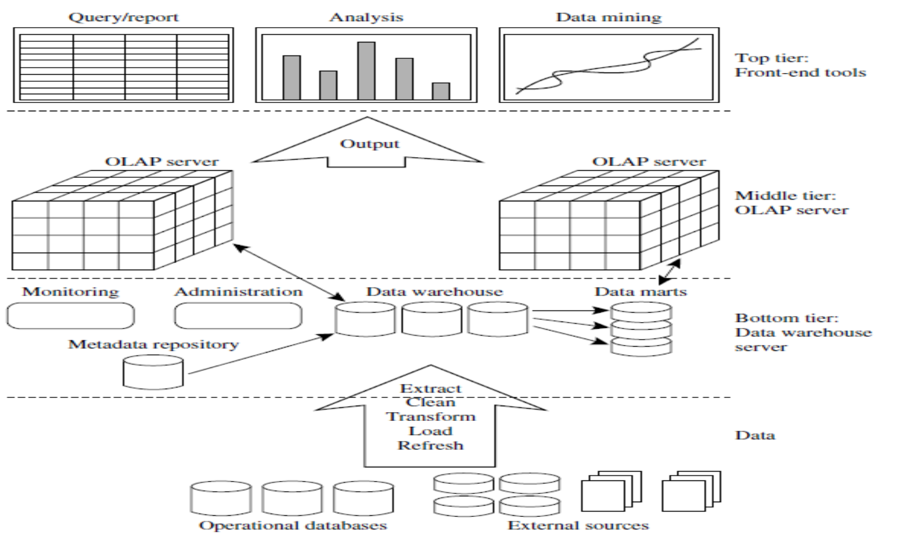
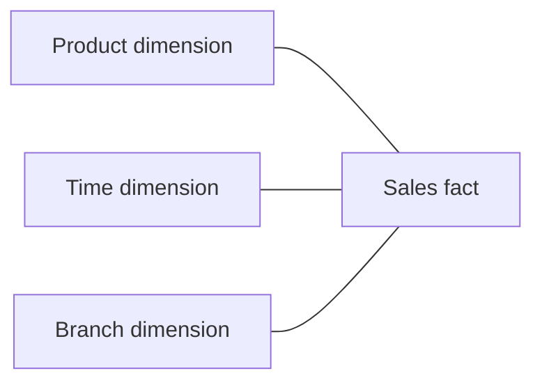

# Chapter 3. Data Warehousing

A business records individual events to operate: a purchase, a payment, a shipment, or a change in stock. Management needs a different view: how sales changed over five years, which regions are growing, and which products contribute most to revenue. A data warehouse prepares integrated historical data for these questions.

## 1. Data Warehouse Concepts

A **data warehouse** is a subject-oriented, integrated, time-variant, nonvolatile collection of data used to support management decisions. **Data warehousing** is the process of constructing, maintaining, and using this collection.

Consider a retailer with separate billing databases in Kolkata, Delhi, and Mumbai. The warehouse combines their records into a common sales model. An analyst can compare annual sales across cities without repeatedly collecting and reconciling data from each billing system.

| Characteristic | Meaning | Retail example |
|---|---|---|
| Subject-oriented | Organizes information around subjects relevant to decisions rather than individual operational applications | Sales, customers, products, and suppliers form analytical subjects |
| Integrated | Reconciles heterogeneous sources into consistent names, codes, units, and meanings | Different product codes and currencies are mapped to common representations |
| Time-variant | Retains information over a substantial historical period and associates observations with time | Sales from several years support trend and seasonal analysis |
| Nonvolatile | Primarily supports loading and reading; ordinary operational transactions do not continually overwrite historical records | New sales batches are loaded while earlier periods remain available |

Time-variant does not mean the warehouse changes every second. It means time is part of the analytical meaning of the data. Nonvolatile does not mean a warehouse can never be corrected, refreshed, or maintained.

A warehouse may hold both detailed and summarized data. A daily city-level total supports quick reporting, while detailed sales records allow investigation of the total. The **granularity**, or grain, specifies the level of detail represented by one stored record.

## 2. Why Maintain a Separate Warehouse?

Operational and analytical workloads differ in their data needs and access patterns.

**Online transaction processing (OLTP)** handles the short transactions required for daily operations. **Online analytical processing (OLAP)** supports interactive analysis of data from several perspectives and at several levels of detail.

A billing system must quickly insert a sale and update stock. A sales analysis might scan millions of rows, join several subjects, and aggregate years of activity. Running both on the same operational system can create resource contention and reduce transaction throughput.

A separate warehouse provides:

- **Workload isolation:** long analytical queries do not compete directly with operational transactions.
- **Historical information:** analysis can use previous states and periods that operational databases may not retain.
- **Consolidation:** records from several branches or organizations are integrated before analysis.
- **Consistent quality:** codes, names, units, duplicates, and other inconsistencies are resolved in a common preparation process.
- **Analytical organization:** dimensions, summaries, and indexes are designed for complex queries.

A DBMS is software for managing a database; a warehouse is a particular kind of database and analytical environment. A warehouse itself can be implemented using a relational DBMS. Thus an exam comparison of “warehouse versus DBMS” normally means warehouse data and workloads versus an operational database managed by a DBMS.

### OLTP and OLAP Compared

| Aspect | OLTP | OLAP and warehousing |
|---|---|---|
| Main purpose | Execute daily business operations | Support analysis and strategic decisions |
| Orientation | Application and transaction oriented | Subject and analysis oriented |
| Users | Clerks, customers, operational staff, database professionals | Analysts, managers, executives |
| Data | Mainly current, detailed records | Integrated historical data, detail, and summaries |
| Typical request | Insert an order or retrieve one account | Compare annual sales across product categories and regions |
| Access | Frequent reads and writes through short transactions | Mostly reads through complex, ad hoc queries |
| Design | Often ER modeling and normalized relations | Often multidimensional star or snowflake modeling |
| Rows accessed per request | Usually a relatively small set | Potentially very large sets |
| Usage | Relatively repetitive and predictable | Exploratory and less predictable |
| Performance emphasis | Transaction throughput, availability, response time | Query response time, query throughput, analytical flexibility |

OLAP queries do not normally require the same fine-grained transaction updates as OLTP. However, the underlying warehouse still needs reliable loading, consistent reads, backup, and recovery. The traditional read-mostly model should not be interpreted as an absence of all concurrency or recovery mechanisms.

### Query-Driven and Update-Driven Integration

In **query-driven integration**, a mediator uses metadata to translate a global query into queries for individual sources. Wrappers communicate with the heterogeneous systems; returned results are combined into a global answer. Integration occurs when a query is issued.

This can provide access to source data, but repeated distributed aggregation is expensive and depends on the availability and performance of the sources.

In **update-driven integration**, data are extracted, cleaned, transformed, and integrated in advance. Queries run against the warehouse. Repeated analysis is faster and independent of the immediate source workload, but freshness depends on the refresh process.

## 3. Three-Tier Warehouse Architecture

The three tiers separate data preparation and storage, analytical processing, and user interaction.



| Tier | Main components | Responsibility |
|---|---|---|
| Bottom | Warehouse database server, preparation utilities, metadata repository, detailed and summary storage | Extract, clean, transform, load, refresh, and store integrated data |
| Middle | OLAP server | Present multidimensional views and execute analytical operations |
| Top | Query, reporting, visualization, analysis, and mining tools | Let users request, explore, and interpret information |

Operational databases and external files are **sources feeding the bottom tier**, not the top tier. Gateways such as ODBC, OLE DB, and JDBC enable applications to communicate with database systems and execute queries.

The bottom-tier environment includes several functional managers:

- The **load manager** extracts and prepares incoming data and loads them into warehouse storage.
- The **warehouse manager** maintains stored data, summaries, indexes, partitions, and refresh operations.
- The **query manager** directs and schedules analytical queries and selects appropriate stored data or summaries.
- **Background processes** perform loading, refresh, monitoring, maintenance, and related housekeeping.

Detailed data preserve fine-grained information. Summarized data accelerate common analyses. Archive and backup data support long-term retention and recovery. Metadata describe what each dataset means and how it was produced.

## 4. Building and Maintaining the Warehouse

### Extraction, Transformation, and Loading

**ETL** stands for extraction, transformation, and loading. Cleaning and refresh are closely related parts of the warehouse preparation lifecycle.

1. **Extract:** collect required data from databases, files, and external systems.
2. **Clean:** detect invalid values, inconsistent identifiers, duplicates, and other quality problems; correct or flag them.
3. **Transform:** convert records into the warehouse's representation, including common units, codes, date formats, and derived values.
4. **Load:** insert prepared records, check integrity, construct indexes and partitions, and compute required summaries or views.
5. **Refresh:** propagate subsequent source changes according to the warehouse refresh policy.

For the retailer, extraction collects branch sales. Cleaning resolves duplicate receipts. Transformation converts local product codes to a common product key and standardizes currency. Loading stores the common records and computes daily totals. Refresh brings in later sales.

### Extraction Strategies

Extraction may read the complete dataset or retrieve only changes since the previous load.

| Strategy | Procedure | Main tradeoff |
|---|---|---|
| Full extraction | Read the complete selected source dataset each time | Simple to reason about; expensive for large datasets |
| Incremental extraction | Read changes since a previous extraction using a watermark, timestamp, or change indicator | Transfers less data; requires reliable identification of changes |
| Change data capture | Identify inserts, updates, and deletes through database logs or change records | Can capture detailed changes; requires source support and correct change processing |

Incremental extraction must account for deletions and late updates; selecting only recently inserted rows may miss them. Change data capture is one way of implementing change-oriented incremental extraction, rather than a mutually exclusive alternative.

### Warehouse Models and Development

An **enterprise warehouse** integrates subjects across the organization. A **data mart** serves the analytical needs of a department or business function. A **virtual warehouse** provides views over operational databases, possibly materializing selected summaries.

| Model | Scope and construction | Example |
|---|---|---|
| Enterprise warehouse | Organization-wide integration, detailed data, and summaries | Common sales, supply, and customer analysis across the retailer |
| Dependent data mart | Departmental subset obtained from the enterprise warehouse | Marketing mart derived from common customer and sales data |
| Independent data mart | Departmental store built directly from operational or external sources | A local finance team builds its own revenue analysis store |
| Virtual warehouse | Views expose an integrated analytical interface; selected summaries may be stored | A shared query layer over branch systems |

A mart has narrower scope and is usually easier to navigate than an enterprise warehouse. It can contain detailed data when departmental analysis requires them; being a mart does not prohibit detail.

An incremental development approach starts with a high-level corporate data model, implements useful marts or warehouse subjects, refines the model, and expands integration. Shared definitions prevent independently developed departmental systems from becoming incompatible islands.

### Metadata Repository

**Metadata** are descriptions of the warehouse's data, structure, meaning, and operation.

| Category | Contents | Example |
|---|---|---|
| Structural and technical | Schemas, dimensions, hierarchies, views, derived definitions, mart locations | Sales grain is one product at one branch on one day |
| Operational | Data lineage, refresh status, archived/purged state, errors, usage statistics, audit trails | A batch came from branch A and used a particular currency conversion |
| Transformation and aggregation | Source-to-warehouse mappings and summarization rules | Revenue is quantity multiplied by selling price, then summed |
| Business | Business terms, ownership, policies, interpretation | Definition and responsible owner of “net sales” |

**Data lineage** records the origin of a value and the transformations applied to it. Without lineage, an analyst may see a number without being able to explain why it differs from a source report.

## 5. Multidimensional Data Models

A **dimension** is a perspective along which facts are analyzed, such as product, location, or time. A **measure** is a value to be analyzed, such as sales amount or units sold. A **fact table** stores measures and the keys linking each fact to dimension members.

For a daily sales warehouse, define the grain before defining tables:

> One fact row represents one product's sales at one branch on one day.

A possible fact relation is:

```text
Sales(day_key, product_key, branch_key, units_sold, sales_amount)
```

The dimension tables describe the keys:

```text
Time(day_key, date, month, quarter, year)
Product(product_key, product_name, brand, category)
Branch(branch_key, branch_name, city, state, country)
```

The word “cube” does not restrict the data to three dimensions. A data cube can have any number of analytical dimensions. Each cell contains measures for a combination of dimension values.

### Concept Hierarchies and Granularity

A **concept hierarchy** connects detailed dimension values to more general values:

```text
Location: office -> city -> country -> region -> all
Product:  product -> category -> industry -> all
Time:     day -> month -> quarter -> year -> all
```

Time can also have multiple paths, such as day-to-week and day-to-month. These paths form a partial order rather than one compulsory linear chain. Calendar weeks can cross months; aggregation paths must respect the actual calendar definitions.

Moving from city to country increases summarization and decreases detail. Moving from year to quarter increases detail. The choice of grain determines which drill-down requests can be answered from the stored data.

### Star, Snowflake, and Fact Constellation Schemas

A **star schema** connects one central fact table directly to dimension tables. Dimension descriptions are typically stored together.



A **snowflake schema** normalizes one or more dimension hierarchies into related tables. For example:

```text
Sales -> Product -> Category
Sales -> Branch -> City -> Country
Sales -> Time
```

This reduces repeated dimension descriptions but requires more joins to traverse the hierarchy.

A **fact constellation**, also called a galaxy schema, contains several fact tables sharing dimensions:

```text
Sales(day_key, product_key, branch_key, units_sold, sales_amount)
Shipment(day_key, product_key, supplier_key, units_shipped, shipping_cost)
```

Sales and Shipment share Time and Product, but each fact table retains its own grain and measures. Combining them requires aggregation to compatible grains to avoid multiplying records through a many-to-many join.

| Schema | Organization | Strength | Limitation |
|---|---|---|---|
| Star | Central fact with directly connected dimensions | Simple queries and relatively few joins | Repeated descriptions in dimensions |
| Snowflake | Fact with normalized dimension hierarchies | Reduced hierarchy redundancy | More joins and a more complex structure |
| Fact constellation | Multiple facts with shared dimensions | Supports related business processes consistently | More complex grain and relationship management |

These examples directly support the schema part of 2025 Q2(c).

## 6. Data Cubes and Cuboids

A **cuboid** is one particular grouping or summarization of a multidimensional dataset. The collection of cuboids forms a **lattice**, ordered by their aggregation relationships.

For dimensions Product, Time, and Location, the cuboids are:

| Dimensionality | Grouping dimensions |
|---|---|
| 3-D base cuboid | Product, Time, Location |
| 2-D cuboids | Product-Time; Product-Location; Time-Location |
| 1-D cuboids | Product; Time; Location |
| 0-D apex cuboid | None: one overall aggregate |

The **base cuboid** retains all dimensions at the chosen base grain. The **apex cuboid** summarizes over every dimension. With $d$ dimensions and only the choice to retain or aggregate away each dimension, there are $2^d$ cuboids. This count excludes additional hierarchy levels.

For three dimensions, $2^3=8$. A Product-Time cuboid sums sales across locations. The apex stores total sales across all products, times, and locations.

### Categories of Cube Measures

The categories depend on how aggregate results can be combined across partitions.

| Category | Definition | Examples |
|---|---|---|
| Distributive | A fixed-size partial result of the same kind can be merged to obtain the full result | SUM, COUNT, MIN, MAX |
| Algebraic | A fixed number of distributive summaries determine the result | AVG; standard deviation from count, sum, and sum of squares; fixed top-$N$ summaries |
| Holistic | An exact general result cannot be computed from partial summaries of fixed bounded size | MEDIAN, MODE, RANK |

COUNTs merge by summing partial counts. For AVG, preserve both sum and count:

$$
\operatorname{AVG}=\frac{\sum_i \operatorname{SUM}_i}{\sum_i \operatorname{COUNT}_i}.
$$

Suppose branch A sells 2 units at an average price of 100, and branch B sells 8 units at an average price of 200. The combined average is

$$
\frac{2(100)+8(200)}{2+8}=180,
$$

not the unweighted average 150. Partial medians similarly cannot generally be combined to obtain the full median.

## 7. OLAP Operations

Use sales amount with dimensions Product, Time, and Location throughout this section.

| Operation                | What changes                                                                      | Example                                                                      |
| ------------------------ | --------------------------------------------------------------------------------- | ---------------------------------------------------------------------------- |
| Roll-up, or drill-up     | Aggregates to a higher hierarchy level or removes a dimension through aggregation | Sum city sales into country sales, or sum over Location entirely             |
| Drill-down, or roll-down | Moves toward finer hierarchy levels or introduces a dimension                     | Expand yearly sales into quarters, or show each product's regional breakdown |
| Slice                    | Fixes one dimension value to obtain a lower-dimensional view                      | Set Year = 2026 and view Product by Location                                 |
| Dice                     | Selects a subcube using sets or ranges on several dimensions                      | Select two products, two cities, and quarters Q1-Q2                          |
| Pivot, or rotate         | Reorients dimensions in the display                                               | Exchange product rows and location columns                                   |
| Drill-across             | Analyzes compatible measures across related fact tables                           | Compare sales and shipments by product and month                             |
| Drill-through            | Retrieves underlying detailed records behind an aggregate                         | Open the sales rows contributing to Kolkata's monthly total                  |

A pivot changes presentation; it does not change the aggregate's value. A roll-up changes granularity. A slice selects a fixed coordinate. A dice retains a selected multidimensional region.

For example, January product sales are:

| Product | Kolkata | Delhi | Product total |
|---|---:|---:|---:|
| TV | 100 | 150 | 250 |
| PC | 80 | 120 | 200 |
| Location total | 180 | 270 | 450 |

Slicing at January produces this two-dimensional table. Slicing further at Kolkata produces the one-dimensional values TV = 100 and PC = 80. Rolling up Location to the country level produces TV = 250 and PC = 200. Aggregating both remaining dimensions gives the apex total 450. Pivoting interchanges the Product and Location axes while retaining these values.

Drill-down is possible only if the system retains or can access the detail. An annual total alone does not reveal the original monthly distribution.

## 8. OLAP Server Types and Tool Requirements

| Server type | Storage and operation | Strength | Tradeoff |
|---|---|---|---|
| ROLAP | Uses relational tables; maps multidimensional analysis to relational operations | Uses relational infrastructure and supports large detailed stores | Complex joins and aggregations may be expensive |
| MOLAP | Uses specialized multidimensional structures and stored cube aggregates | Efficient cube navigation and common aggregate queries | Cube construction, sparse storage, and refresh require care |
| HOLAP | Combines relational detail with multidimensional aggregate storage | Balances detailed access with fast summarized analysis | Must coordinate two representations |

The three-tier architecture describes **layers**. ROLAP, MOLAP, and HOLAP describe **ways to implement OLAP storage and processing**.

Codd's twelve OLAP tool requirements can be understood as follows:

| Requirement | Intended capability |
|---|---|
| Multidimensional conceptual view | Analyze measures by several dimensions and levels |
| Transparency | Hide unnecessary storage and implementation details |
| Accessibility | Access required sources through a consistent analytical interface |
| Consistent reporting performance | Maintain useful response times across reporting forms |
| Client/server architecture | Separate client interaction from server processing |
| Generic dimensionality | Treat dimensions uniformly where their semantics permit |
| Dynamic sparse matrix handling | Store and process largely empty multidimensional spaces efficiently |
| Multi-user support | Support concurrent analytical users consistently |
| Unrestricted cross-dimensional operations | Calculate across dimensions without arbitrary restrictions |
| Intuitive data manipulation | Support natural navigation and manipulation of the analytical view |
| Flexible reporting | Present different layouts and levels of detail |
| Unlimited dimensions and aggregation levels | Avoid arbitrary conceptual restrictions on the model |

The final requirement expresses a design goal; actual systems always have resource limits.

## 9. Warehouse Design and Efficient Implementation

### From Business Question to Fact Table

A warehouse design begins with the process to be analyzed, not with a list of convenient source columns.

1. **Choose the business process:** for example, retail sales.
2. **Declare the grain:** one row per sold product per receipt line. This determines what each fact means.
3. **Identify dimensions:** date, product, store, and customer, with usable keys and hierarchies.
4. **Identify facts:** quantity, line revenue, and cost at that grain. State which measures can be added along which dimensions.
5. **Map and validate sources:** reconcile identifiers, currencies, timestamps, missing values, and duplicates.
6. **Plan history and refresh:** preserve required historical dimension values, load new facts, and test reconciliation totals.
7. **Choose physical storage and summaries:** use observed query needs, storage limits, and refresh costs.

A common dimension definition used across several fact tables is a **conformed dimension**. Shared product and calendar definitions allow sales and inventory analyses to be compared consistently. Different fact-table grains must be reconciled before combining measures; directly joining many sales lines to many inventory rows can multiply totals.

A surrogate dimension key is an internal warehouse identifier. It can distinguish successive historical versions of the same business entity. For example, preserving an old customer region separately from its current region permits sales to be reported according to the region applicable when the sale occurred. The chosen history policy must match the analytical question.

### Cube Materialization

**Materialization** stores a query result or cuboid so it can be reused rather than recomputed from base data.

| Strategy | Stored cuboids | Benefit | Cost |
|---|---|---|---|
| No additional materialization | Base facts only | Low summary-storage cost and simpler refresh | Repeated aggregation can be expensive |
| Full materialization | Every cuboid in the chosen lattice | Many aggregate queries can read an existing view | Potentially enormous storage and refresh work |
| Partial materialization | Selected useful cuboids | Balances query speed, storage, and maintenance | Requires workload-sensitive selection |

Suppose sales detail includes `(day, product, store, revenue)`. A stored `(month, product, store)` SUM view can answer a `(year, product)` SUM query by rolling up months and stores. It cannot recover a day-level receipt query. A view must retain enough detail, dimensions, and aggregation state to answer the requested query correctly.

For AVG, store SUM and COUNT and combine those states; averaging precomputed averages gives the wrong result when group sizes differ. This links materialization directly to distributive and algebraic measures. Even with only $2^d$ cuboids for $d$ simple dimensions, the number of cells within those cuboids may be extremely large; hierarchies add further grouping choices.

### Preliminary Cube Computation

A straightforward computation scans base facts and accumulates aggregates keyed by dimension combinations. Shared sorting, hashing, and reusable intermediate summaries avoid independently rescanning all facts for every query. A computation may proceed from a detailed cuboid to more aggregated ones when the measure supports correct combination.

An **iceberg cube** retains only cells satisfying a condition, such as COUNT≥3. For transactions grouped by `(product, store)`, suppose counts are `(bread,A)=4`, `(bread,B)=1`, `(milk,A)=3`. The two cells with counts 4 and 3 survive. The `(bread,ALL)` aggregate has count 5 and also survives even though one detailed bread cell does not.

Count-based pruning uses the fact that adding grouping restrictions cannot increase a cell's count. If a projected group has count below 3, none of its more specific groups can reach 3. It would be incorrect to prune a general group merely because one of its specific cells is small. SUM thresholds require appropriate assumptions, such as nonnegative contributions; negative values can invalidate analogous pruning.

### Indexes, Partitioning, and Refresh

A **bitmap index** records membership in a value using a bit vector over rows. For four facts with regions `[North, South, North, South]` and categories `[Food, Food, Books, Books]`, North is `1010` and Food is `1100`. Their bitwise AND is `1000`, selecting only the first fact. Bitmaps are especially useful for suitable low-cardinality analytical attributes; their maintenance and compression behavior matter.

A **join index** records relationships between rows in fact and dimension tables to reduce repeated join work. It supports star-schema access; it is not itself an aggregate cube. A conventional B-tree can be useful for selective range or key access. Index choice follows workload rather than a universal warehouse rule.

Partitioning facts by date can avoid scanning irrelevant periods and simplify period-based loading. Incremental refresh updates affected facts and summaries rather than rebuilding everything. Inserts, corrections, deletes, and late-arriving records must follow an explicit policy. Reconcile row counts and measures after refresh, and expose consistent snapshots to readers.

## 10. Usage, Benefits, and Difficulties

Warehouse applications fall into three groups. **Information processing** provides queries, basic statistics, tables, charts, and routine reports. **Analytical processing** supports multidimensional operations such as slicing and drilling. **Data mining** discovers patterns and builds models for association, classification, prediction, and clustering.

Integrated preparation reduces duplicated work across reporting systems. Common definitions support more consistent decisions. Historical detail and flexible aggregation help reveal trends, improve market analysis, and support business process redesign. These benefits can improve productivity and competitive decisions; a high return on investment depends on useful requirements, quality, and execution.

Common difficulties include:

- **Complex integration:** matching identifiers and meanings across sources requires domain knowledge.
- **Hidden source problems:** missing, incorrect, or inconsistently collected data may appear only during integration.
- **Uncaptured information:** historical facts cannot always be reconstructed if they were never recorded.
- **Loading effort:** cleaning, transformation, and refresh may take longer than expected.
- **Storage growth:** historical detail, summaries, indexes, and backups consume space.
- **Maintenance:** schemas, source systems, business definitions, and mappings evolve.
- **Long projects:** enterprise-wide integration can delay useful results without incremental delivery.
- **Homogenization:** forcing unlike concepts into one representation can discard meaningful differences if mappings are poorly designed.

## 11. Sources

Primary source: `sources/3_Data_Warehouse.pdf`. Design, materialization, cube computation, and indexing also use the shared textbook, Chapters 3–4. The architecture figure is from lecture PDF page 23. Extraction strategies are supported by [Oracle's extraction guide](https://docs.oracle.com/en/database/oracle/oracle-database/26/dwhsg/extraction-data-warehouses.html); maintenance and recovery by its [warehouse concepts guide](https://docs.oracle.com/en/database/oracle/oracle-database/26/dwhsg/introduction-data-warehouse-concepts.html).
