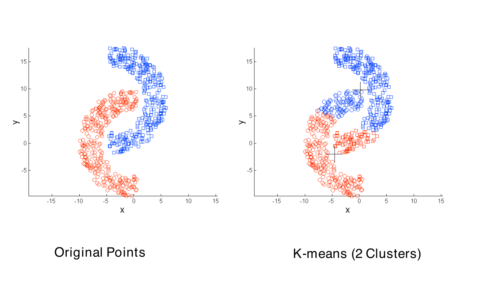
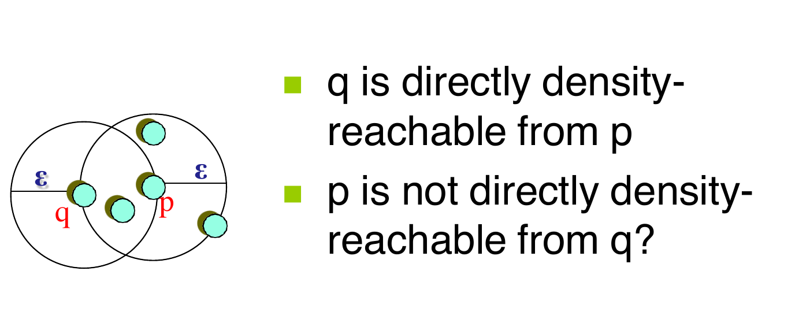

# Chapter 6. Clustering and Outlier Analysis

Chapter 5 learned known labels. Cluster analysis discovers groups of related objects when class labels are not supplied; outlier analysis then studies observations that do not fit the chosen description of ordinary behavior. It can organize documents by subject, group genes with similar behavior, summarize precipitation patterns, or identify stocks with similar price movements.

## 1. Clusters and Types of Clustering

A **cluster** is a group whose members are relatively similar to one another and relatively dissimilar to members of other groups. **Intra-cluster distance** measures separation within a group; **inter-cluster distance** measures separation between groups. Good clustering seeks within-group cohesion and between-group separation according to a chosen definition of similarity.

There need not be one universally correct clustering. Six small groups may also form two larger groups. The useful granularity depends on the purpose, data representation, distance, and algorithm.

| Distinction | Meaning |
|---|---|
| Partitional versus hierarchical | A partition gives one flat grouping; a hierarchy gives nested groupings |
| Exclusive versus overlapping | A point belongs to one cluster versus potentially several clusters |
| Non-fuzzy versus fuzzy | Membership is a definite decision versus a weight for each cluster; fuzzy weights for an object sum to 1 |
| Complete versus partial | Every object is assigned versus some objects remaining unassigned, as with noise |
| Homogeneous versus heterogeneous cluster structure | Groups have similar characteristics versus different sizes, shapes, or densities |

Probabilistic clustering can assign each object a probability of membership in each cluster. These probabilities reflect a model; fuzzy membership weights express degrees of membership and are not automatically calibrated probabilities.

Traditional partitional clustering divides all objects into nonoverlapping groups. A hierarchy can be represented by a **dendrogram**, a tree showing the order and level of merges or splits. A cut across a dendrogram selects a flat clustering.

Clustering is used for both **understanding** and **summarization**. Its groups are inferred from the data. Classification instead learns to reproduce supplied labels. An **outlier** is an observation unusually different from the bulk of the data under a chosen model; it may be an error or a valid rare event.

## 2. Distance, Similarity, and Data Types

A dissimilarity is small for similar objects. A similarity is large for similar objects. Do not maximize a distance or minimize a similarity by confusing their meanings.

A metric distance satisfies nonnegativity, identity of indiscernibles, symmetry, and the triangle inequality:

$$
d(x,y)\ge0,\quad d(x,y)=0\iff x=y,\quad d(x,y)=d(y,x),
$$

$$
d(x,y)\le d(x,z)+d(z,y).
$$

Not every useful similarity or dissimilarity satisfies every metric condition. Attribute weighting should reflect the application; scale and irrelevant features can otherwise dominate the result.

### Numerical Variables and Standardization

For attribute $f$ with values $x_{1f},\ldots,x_{nf}$, the course's mean-absolute-deviation standardization is

$$
m_f=\frac1n\sum_i x_{if},\qquad
s_f=\frac1n\sum_i|x_{if}-m_f|,\qquad
z_{if}=\frac{x_{if}-m_f}{s_f}.
$$

Here $s_f$ is **mean absolute deviation**, not standard deviation. For $[1,2,3]$, $m=2$, $s=(1+0+1)/3=2/3$, giving standardized values $[-1.5,0,1.5]$. A constant feature has $s_f=0$ and must be omitted or handled explicitly.

For $p$ numerical dimensions, Minkowski distance of order $q\ge1$ is

$$
d_q(x,y)=\left(\sum_{f=1}^{p}|x_f-y_f|^q\right)^{1/q}.
$$

For $q=1$ this is **Manhattan distance**; for $q=2$ it is **Euclidean distance**. Between $(2,3)$ and $(5,7)$, Manhattan distance is $3+4=7$ and Euclidean distance is $\sqrt{3^2+4^2}=5$.

A weighted Euclidean distance uses nonnegative attribute weights inside the sum. A zero weight intentionally ignores that attribute.

### Binary Variables

For two binary records, count:

| | Object $j$: 1 | Object $j$: 0 |
|---|---:|---:|
| Object $i$: 1 | $a$ | $b$ |
| Object $i$: 0 | $c$ | $d$ |

For **symmetric binary attributes**, both 0 and 1 are meaningful matches. The simple matching dissimilarity is

$$
d_{SM}=\frac{b+c}{a+b+c+d}.
$$

The corresponding similarity is $(a+d)/(a+b+c+d)$.

For **asymmetric binary attributes**, joint absence carries little evidence of similarity. Jaccard dissimilarity excludes $d$:

$$
d_J=\frac{b+c}{a+b+c},\qquad J=\frac{a}{a+b+c}.
$$

For records $(1,1,0,0)$ and $(1,0,1,0)$, $a=1,b=1,c=1,d=1$. Simple matching dissimilarity is $2/4=0.5$; Jaccard dissimilarity is $2/3$. Joint absence of a rare symptom should not make two patients appear strongly similar. If both records contain only zeros on asymmetric attributes, specify a convention for the zero denominator.

In the course's symptom example, ignore Gender and encode Y/P as 1 and N as 0:

```text
Jack: 1 0 1 0 0 0
Mary: 1 0 1 0 1 0
Jim:  1 1 0 0 0 0
```

Jack-Mary have $a=2$ and one mismatch: $d_J=1/3$. Jack-Jim have $a=1$ and two mismatches: $2/3$. Jim-Mary have $a=1$ and three mismatches: $3/4$. Shared negative results are excluded throughout.

### Nominal, Ordinal, Ratio, and Mixed Variables

For nominal attributes, if $m$ of $p$ attributes match, use $d=(p-m)/p$. Alternatively, create a binary indicator for each possible category. Numeric category codes do not automatically create meaningful numeric distances.

For an ordinal attribute with $M_f$ ordered levels, replace a category by its rank $r_{if}$ and map it to

$$
z_{if}=\frac{r_{if}-1}{M_f-1}.
$$

Small, Medium, and Large become 0, 0.5, and 1. This preserves order while imposing a convenient spacing; it does not prove that the original category gaps are equal.

Ratio-scale measurements have a meaningful zero and meaningful ratios. For positive quantities varying multiplicatively, a logarithm $y_{if}=\log x_{if}$ can make relative differences easier to analyze. For example, 1, 10, and 100 become 0, 1, and 2 under $\log_{10}$. Not every ratio variable grows exponentially or needs a logarithm. The transformation is undefined for zero or negative values without a separately justified treatment. Ranking is another option when only order matters.

For mixed data, calculate a compatible dissimilarity for each attribute and combine them:

$$
d(i,j)=\frac{\sum_{f=1}^{p}w_f\delta_{ij}^{(f)}d_{ij}^{(f)}}
{\sum_{f=1}^{p}w_f\delta_{ij}^{(f)}}.
$$

Here $w_f\ge0$ is an importance weight, $\delta$ indicates whether the attribute is comparable, and $d_{ij}^{(f)}$ is the attribute-specific dissimilarity. Binary/nominal matches give 0 and mismatches give 1. Numerical absolute differences can be divided by their range. Ordinal values use rank scaling. Missing comparisons, and joint zeros for asymmetric binary attributes, can be excluded using $\delta=0$.

For age 20 versus 30 with range 40, color Red versus Blue, and rank 1 versus 2 on three levels, equal weights give

$$
d=\frac{10/40+1+(2-1)/(3-1)}3=\frac{0.25+1+0.5}3=0.583333.
$$

If no attributes are comparable, the denominator is zero and the distance cannot be inferred from this formula.

## 3. K-Means Clustering

**K-means** partitions numerical data into $K$ clusters, each represented by its mean vector or centroid. Standard Euclidean k-means minimizes the **sum of squared errors (SSE)**:

$$
SSE=\sum_{j=1}^{K}\sum_{x\in C_j}\|x-\mu_j\|_2^2,
\qquad
\mu_j=\frac1{|C_j|}\sum_{x\in C_j}x.
$$

$C_j$ is cluster $j$, and $\mu_j$ is its centroid. A centroid need not be an observed object; for a nonconvex group it can even fall outside its occupied region.

For fixed centroids, assigning every point to the nearest centroid minimizes its individual squared error. For fixed assignments, the mean minimizes each cluster's sum of squared Euclidean distances. Alternating these two operations makes SSE nonincreasing. It can stop at a local solution rather than the globally best partition.

### Algorithm

**Inputs:** $n$ numerical points in $d$ dimensions, $K$, initial centroids, distance convention, tie rule, and stopping rule. **Outputs:** assignments, final centroids, and SSE for standard Euclidean k-means. Maintain one label per point and $K$ centroid vectors.

1. Select $K$ initial centroids, often from the data.
2. Assign every point to its nearest current centroid. Break ties consistently.
3. Recompute each centroid as the coordinatewise mean of its assigned points.
4. Repeat assignment and update until labels or centroids no longer change, or a declared tolerance/iteration limit is reached.
5. Report the final memberships, centroids, and objective.

If a cluster becomes empty, its mean is undefined. Use an explicit repair such as reinitializing it to a poorly represented point; do not divide by zero.

For $I$ iterations, assignment requires $O(nKdI)$ time; updating means requires $O(ndI)$. This is usually summarized as $O(nKdI)$. Centroids and labels need $O(Kd+n)$ additional storage beyond the input.

### Complete K-Means Dry Run

Take A$(1,1)$, B$(2,1)$, C$(3,2)$, D$(8,8)$, E$(9,8)$, F$(10,9)$ with $K=2$. Start at $\mu_1=(1,1)$ and $\mu_2=(3,2)$. Squared Euclidean distances give the same nearest-center decisions as Euclidean distances.

| Point | Initial squared distance to $\mu_1$ | Initial squared distance to $\mu_2$ | Assignment |
|---|---:|---:|---|
| A | 0 | 5 | $C_1$ |
| B | 1 | 2 | $C_1$ |
| C | 5 | 0 | $C_2$ |
| D | 98 | 61 | $C_2$ |
| E | 113 | 72 | $C_2$ |
| F | 145 | 98 | $C_2$ |

Update:

$$
\mu_1=(1.5,1),\qquad
\mu_2=((3+8+9+10)/4,(2+8+8+9)/4)=(7.5,6.75).
$$

| Point | Second squared distance to $\mu_1$ | Second squared distance to $\mu_2$ | Assignment |
|---|---:|---:|---|
| A | 0.25 | 75.3125 | $C_1$ |
| B | 0.25 | 63.3125 | $C_1$ |
| C | 3.25 | 42.8125 | $C_1$ |
| D | 91.25 | 1.8125 | $C_2$ |
| E | 105.25 | 3.8125 | $C_2$ |
| F | 136.25 | 11.3125 | $C_2$ |

C changes cluster because the second center moved toward the distant D-E-F group. The updated centroids become

$$
\mu_1=(2,4/3),\qquad \mu_2=(9,25/3).
$$

A further assignment gives the same clusters: A-B-C versus D-E-F. The own-center squared distances are $10/9,1/9,13/9$ in each cluster, giving final $SSE=48/9=16/3$.

### Initialization, K, and Limitations

Different initial centers can produce different local solutions. Multiple starts, selecting well-separated candidates, and hierarchical clustering of a sample can improve initialization. If there are $K$ equal-sized underlying groups and initial choices are modeled as independent uniform group selections, the chance of one seed from each group is $K!/K^K$. For $K=10$, this is 0.00036288. Sampling distinct records without replacement gives a different exact finite-sample probability.

Increasing $K$ can reduce SSE simply by increasing model flexibility. The globally best achievable SSE cannot increase when another center is allowed. A poor local solution with larger $K$ can nevertheless have worse SSE than a good solution with smaller $K$. SSE alone therefore does not determine a useful number of clusters.

K-means is sensitive to outliers, initialization, attribute scale, and the requested $K$. It favors compact groups and may fail when clusters have very different sizes or densities, or non-globular shapes.



*The left panel shows curved groups; the right shows their k-means partition.*

Using many small clusters can recover pieces of complex shapes, but a separate merging strategy is then needed. This changes the problem and is not an automatic cure.

### Bisecting K-Means and K-Modes

**Bisecting k-means** repeatedly divides a selected cluster into two:

1. Start with one cluster containing every point.
2. Select a cluster to split, for example the one with large SSE; state the policy.
3. Run two-means on it several times using different seeds.
4. Keep the trial with the smallest combined child SSE.
5. Replace the selected cluster by its two children.
6. Continue until there are $K$ clusters.

The sequence of splits gives a hierarchy; its leaves give a partition. For $[0,1,2,8,9,10]$, a successful first bisection gives $[0,1,2]$ and $[8,9,10]$, each with mean 1 or 9 and SSE 2. If $K=3$, splitting the first group into $[0,1]$ and $[2]$ reduces its SSE to 0.5, giving total SSE 2.5. Declare how equal-quality split choices are handled.

**K-modes** adapts the center-based idea to categorical data. It replaces means by coordinatewise modes, uses categorical mismatch dissimilarity, assigns objects to the nearest mode vector, and updates modes from category frequencies until stable. For (Red,Small), (Red,Large), and (Blue,Small), the mode vector is (Red,Small). Modal ties need a policy.

Cosine or correlation-based clustering variants require objectives and representative updates consistent with those measures. The standard Euclidean SSE argument does not prove convergence for arbitrary replacement distances with an unchanged mean update.

## 4. Worked 2025 Question: Books and Manhattan Assignment

2025 Q5(a) supplies the following records, requires three clusters, and fixes records 1, 2, and 3 as the initial centroids:

| ID | Pages | Price |
|---|---:|---:|
| 1 | 245 | 135 |
| 2 | 335 | 255 |
| 3 | 170 | 910 |
| 4 | 146 | 670 |
| 5 | 170 | 250 |
| 6 | 365 | 375 |
| 7 | 456 | 440 |
| 8 | 250 | 655 |
| 9 | 322 | 260 |
| 10 | 167 | 190 |

**Convention:** use the requested Manhattan assignment distance and the arithmetic-mean centroid update named in k-means. Use raw values because no scaling is specified. This is the paper's hybrid convention. Standard minimization of Manhattan absolute error instead uses coordinatewise medians, giving k-medians. Do not silently change the requested distance or claim the Euclidean SSE proof applies to this hybrid.

For a record $(x,y)$ and center $(a,b)$, $d=|x-a|+|y-b|$. Start with $(245,135)$, $(335,255)$, and $(170,910)$.

| Record | Distance to center 1 | Distance to center 2 | Distance to center 3 | First assignment |
|---|---:|---:|---:|---|
| 1 | 0 | 210 | 850 | $C_1$ |
| 2 | 210 | 0 | 820 | $C_2$ |
| 3 | 850 | 820 | 0 | $C_3$ |
| 4 | 634 | 604 | 264 | $C_3$ |
| 5 | 190 | 170 | 660 | $C_2$ |
| 6 | 360 | 150 | 730 | $C_2$ |
| 7 | 516 | 306 | 756 | $C_2$ |
| 8 | 525 | 485 | 335 | $C_3$ |
| 9 | 202 | 18 | 802 | $C_2$ |
| 10 | 133 | 233 | 723 | $C_1$ |

The means become:

$$
\mu_1=((245+167)/2,(135+190)/2)=(206,162.5),
$$

$$
\mu_2=((335+170+365+456+322)/5,(255+250+375+440+260)/5)=(329.6,316),
$$

$$
\mu_3=((170+146+250)/3,(910+670+655)/3)=(188.666667,745).
$$

| Record | Second distance to center 1 | Second distance to center 2 | Second distance to center 3 | Second assignment |
|---|---:|---:|---:|---|
| 1 | 66.5 | 265.6 | 666.333 | $C_1$ |
| 2 | 221.5 | 66.4 | 636.333 | $C_2$ |
| 3 | 783.5 | 753.6 | 183.667 | $C_3$ |
| 4 | 567.5 | 537.6 | 117.667 | $C_3$ |
| 5 | 123.5 | 225.6 | 513.667 | $C_1$ |
| 6 | 371.5 | 94.4 | 546.333 | $C_2$ |
| 7 | 527.5 | 250.4 | 572.333 | $C_2$ |
| 8 | 536.5 | 418.6 | 151.333 | $C_3$ |
| 9 | 213.5 | 63.6 | 618.333 | $C_2$ |
| 10 | 66.5 | 288.6 | 576.667 | $C_1$ |

Only record 5 changes, from $C_2$ to $C_1$. Update the means:

$$
\mu_1=(194,191.666667),\qquad
\mu_2=(369.5,332.5),\qquad
\mu_3=(188.666667,745).
$$

A final assignment check gives:

| Record | Third distance to center 1 | Third distance to center 2 | Third distance to center 3 | Final assignment |
|---|---:|---:|---:|---|
| 1 | 107.667 | 322 | 666.333 | $C_1$ |
| 2 | 204.333 | 112 | 636.333 | $C_2$ |
| 3 | 742.333 | 777 | 183.667 | $C_3$ |
| 4 | 526.333 | 561 | 117.667 | $C_3$ |
| 5 | 82.333 | 282 | 513.667 | $C_1$ |
| 6 | 354.333 | 47 | 546.333 | $C_2$ |
| 7 | 510.333 | 194 | 572.333 | $C_2$ |
| 8 | 519.333 | 442 | 151.333 | $C_3$ |
| 9 | 196.333 | 120 | 618.333 | $C_2$ |
| 10 | 28.667 | 345 | 576.667 | $C_1$ |

No assignments change, so terminate:

$$
C_1=\{1,5,10\},\quad C_2=\{2,6,7,9\},\quad C_3=\{3,4,8\}.
$$

Distances are displayed rounded; unrounded centers are used in the calculation.

## 5. K-Medoids and Partitioning Around Medoids

A **medoid** is an observed member of a cluster that minimizes the sum of dissimilarities to its members. For cluster $C$,

$$
m_C\in\arg\min_{z\in C}\sum_{x\in C}d(x,z).
$$

Unlike a centroid, a medoid is an actual data object. A mean can be pulled strongly toward an extreme observation. With values $[1,2,100]$, the mean is 34.333, while the medoid under absolute distance is 2: its total distance is $1+0+98=99$, versus 100 for medoid 1 and 197 for medoid 100.

The k-medoids objective for a set $M$ of $K$ representatives is

$$
J(M)=\sum_{x\in D}\min_{m\in M}d(x,m).
$$

This uses the chosen dissimilarity directly. It is not automatically squared Euclidean error.

### PAM Algorithm

**Partitioning Around Medoids (PAM)** improves a representative set by replacing medoids with nonmedoids. Inputs are a dataset or dissimilarity matrix, $K$, initial medoids, and tie policy. Outputs are $K$ medoids, nearest-medoid clusters, and total cost. Maintain current medoids, assignments, and cost; nearest and second-nearest distances can accelerate swap evaluation.

1. Select $K$ initial observed objects as medoids. The course uses random initial choices; classical PAM also has a constructive BUILD initialization.
2. Assign each object to its nearest medoid and calculate $J(M)$.
3. For each medoid $m$ and nonmedoid $h$, calculate the cost after replacing $m$ by $h$ and reassigning all objects.
4. Select an improving swap, preferably the best one in a complete pass, and apply it.
5. Repeat assignment and swap search.
6. Terminate when **no medoid/nonmedoid swap decreases cost**, rather than after a single unsuccessful random proposal.

Strictly improving swaps decrease cost over a finite set of representative sets. The terminal result is locally optimal with respect to these swaps; it is not necessarily globally optimal.

### Small Complete PAM Example

Use $D=[1,2,3,8,9,10]$, $K=2$, absolute distance, and initial medoids 1 and 8. Assignments are $[1,2,3]$ and $[8,9,10]$, with cost $0+1+2+0+1+2=6$.

Replacing medoid 1 by 2 gives cost $1+0+1+0+1+2=5$. Replacing 8 by 9 also gives 5; break this tie by replacing the smaller-valued medoid first. Current medoids become 2 and 8.

The next improving swap replaces 8 by 9, giving cost $1+0+1+1+0+1=4$. Check every final swap:

| Current medoid replaced | New medoid | New total cost |
|---|---:|---:|
| 2 | 1 | 5 |
| 2 | 3 | 5 |
| 2 | 8 | 19 |
| 2 | 10 | 22 |
| 9 | 1 | 22 |
| 9 | 3 | 19 |
| 9 | 8 | 5 |
| 9 | 10 | 5 |

No candidate improves 4. Final representatives are 2 and 9, with clusters $\{1,2,3\}$ and $\{8,9,10\}$. The representative updates change which actual object stands for each cluster; they do not average coordinates.

### PAM and K-Means Compared

| Aspect | K-means | PAM/k-medoids |
|---|---|---|
| Representative | Arithmetic mean | Observed object |
| Basic objective | Squared Euclidean error | Sum of chosen dissimilarities to nearest medoid |
| Data requirement | Numerical mean must be meaningful | Needs meaningful object dissimilarities |
| Outlier behavior | Extreme values can move the mean substantially | Usually more robust with ordinary nonsquared dissimilarities |
| Update | Recompute means | Evaluate representative swaps |
| Scale | Usually efficient for large numerical datasets | Classical swap search is more expensive |

For 2026 Q5(a), advantages of PAM include actual interpretable representatives, flexibility of dissimilarity, and greater resistance to outliers. Robustness does not mean immunity, and PAM is not generally faster than k-means.

Classical PAM swap search with maintained distance information takes $O(K(n-K)^2)$ per iteration; recomputing assignments from scratch for every swap can be more expensive. PAM works well for small datasets but scales poorly compared with basic k-means.

### Worked 2026 Question: Ice-Cream Data

The paper supplies twelve points and asks for two clusters. It does not specify a distance, scaling, or initialization. Use **raw Euclidean distance**, $K=2$, and initial medoids records 1 and 5. These assumptions make the solution reproducible; other conventions can change the numerical result.

| ID | Temperature | Ice-cream sales |
|---|---:|---:|
| 1 | 18 | 120 |
| 2 | 20 | 150 |
| 3 | 22 | 165 |
| 4 | 34 | 320 |
| 5 | 40 | 400 |
| 6 | 26 | 210 |
| 7 | 28 | 240 |
| 8 | 32 | 300 |
| 9 | 24 | 180 |
| 10 | 36 | 350 |
| 11 | 30 | 260 |
| 12 | 38 | 370 |

For example, $d(1,9)=\sqrt{(18-24)^2+(120-180)^2}=\sqrt{3636}=60.299254$.

Evaluate swaps and reassign after every accepted change:

| Medoid IDs | Total nearest-medoid distance | Decision |
|---|---:|---|
| $(1,5)$ | 747.441276 | Initial state |
| $(9,5)$ | 536.892466 | Best improving swap: replace 1 by 9 |
| $(9,10)$ | 426.607788 | Best improving swap: replace 5 by 10 |
| Best alternative one-swap pair $(3,10)$ | 436.545577 | Higher cost: reject and stop |

Final assignment distances are:

| ID | Distance to medoid 9 | Distance to medoid 10 | Assigned medoid |
|---|---:|---:|---|
| 1 | 60.299254 | 230.703273 | 9 |
| 2 | 30.265492 | 200.638979 | 9 |
| 3 | 15.132746 | 185.528973 | 9 |
| 4 | 140.356688 | 30.066593 | 10 |
| 5 | 220.581051 | 50.159745 | 10 |
| 6 | 30.066593 | 140.356688 | 9 |
| 7 | 60.133186 | 110.290525 | 9 |
| 8 | 120.266371 | 50.159745 | 10 |
| 9 | 0 | 170.423003 | 9 |
| 10 | 170.423003 | 0 | 10 |
| 11 | 80.224684 | 90.199778 | 9 |
| 12 | 190.515091 | 20.099751 | 10 |

Thus the final groups are

$$
C_1=\{1,2,3,6,7,9,11\},\quad m_1=(24,180),
$$

$$
C_2=\{4,5,8,10,12\},\quad m_2=(36,350).
$$

For this small problem, all $\binom{12}{2}=66$ representative pairs were independently enumerated. Pair $(9,10)$ has the smallest cost under the stated distance and scale. This confirms global optimality **for this instance**, beyond what PAM's stopping rule guarantees in general.

### CLARA and CLARANS for Large Datasets

PAM compares many possible medoid swaps. **CLARA** reduces this work by drawing a sample, running PAM on the sample, assigning the full dataset to those medoids, and evaluating full-data cost. Repeat for several samples and retain the best full-data result. Its candidate medoids are restricted to sampled objects, so a missed small group can lead to poor representation.

**CLARANS**, Clustering Large Applications based upon Randomized Search, samples the medoid-swap neighborhood instead of fixing one data sample. A search state is a set of K medoids, and two states are neighbors if one medoid is replaced by one nonmedoid.

1. Choose a random medoid set and calculate its full-data cost.
2. Randomly propose a medoid/nonmedoid swap.
3. If it improves cost, accept it and reset the consecutive-failure counter.
4. Otherwise increase the counter.
5. When the counter reaches a declared `maxneighbor` budget, finish this search.
6. Repeat from another initial state up to `numlocal` searches and return the best encountered state.

The maintained state contains the medoids, cost, failure counter, and best result across restarts. Budget termination does **not** prove that no improving swap exists, because untested neighbors remain. Each state has $K(n-K)$ one-swap neighbors; runtime depends on how many proposals and restarts are allowed and how their costs are evaluated.

For $[1,2,3,8,9,10]$, start at medoids (1,8), cost 6. Propose (2,8), cost 5: accept. Propose (2,9), cost 4: accept. Propose (1,9), cost 5: reject. With failure budget 1, this run stops at (2,9), which happens to be optimal here. With a different proposal sequence, budget 1 can stop at a worse state. The example separates randomized search policy from an optimality guarantee.

## 6. Hierarchical Clustering

Hierarchical clustering organizes groups within larger groups. **Agglomerative** methods begin with singleton clusters and merge them. **Divisive** methods begin with one all-inclusive cluster and split it. Both can produce a dendrogram.

A hierarchy is useful when the required number of groups is not known beforehand or when the nested structure has meaning, such as a biological taxonomy. Choosing a final flat partition still requires selecting a cut level or a target number of clusters.

### Agglomerative Algorithm

**Inputs:** objects, object distance or similarity, linkage definition, tie rule, and optional target $K$. **Outputs:** merge sequence/dendrogram and a selected partition. Maintain current clusters and their proximity matrix.

1. Compute the initial object proximity matrix.
2. Treat each object as a separate cluster.
3. Select the closest pair of clusters under the chosen linkage. For a similarity matrix, select the most similar pair.
4. Merge them and record the merge level.
5. Remove the old cluster rows/columns and compute distances from the new cluster to all remaining clusters.
6. Repeat until one cluster remains, or stop early at the requested $K$.

The linkage determines what “closest clusters” means. Keeping the original point-to-point distances does not remove the need to update cluster-to-cluster distances.

### Linkage Definitions

For clusters $A$ and $B$ and point dissimilarity $d$:

| Linkage | Definition | Typical behavior |
|---|---|---|
| Single linkage, MIN | $d(A,B)=\min_{x\in A,y\in B}d(x,y)$ | Follows chains and non-globular groups; sensitive to noisy bridges |
| Complete linkage, MAX | $d(A,B)=\max_{x\in A,y\in B}d(x,y)$ | Favors compact groups; can break large or elongated groups |
| Group average | Mean of all cross-cluster point-pair distances | Compromise between single and complete linkage |
| Centroid linkage | Distance between the cluster mean vectors | Compares representatives; may produce nonmonotone merge heights |
| Ward's method | Increase in within-cluster Euclidean SSE after merging | Favors compact, roughly globular groups |

Group average is

$$
d_{avg}(A,B)=\frac{\sum_{x\in A}\sum_{y\in B}d(x,y)}{|A|\,|B|}.
$$

The denominator removes the direct bias of a raw sum toward large groups. After merging $A$ and $B$, the average-link distance to $C$ is

$$
d_{avg}(A\cup B,C)=\frac{|A|d_{avg}(A,C)+|B|d_{avg}(B,C)}{|A|+|B|}.
$$

It is not generally the unweighted mean of the two old cluster distances.

For Ward's method, the Euclidean SSE increase is

$$
\Delta SSE(A,B)=\frac{|A||B|}{|A|+|B|}\|\mu_A-\mu_B\|_2^2.
$$

Merge the pair with the smallest increase. Ward uses an explicit **local** objective increment; it does not globally optimize all possible partitions. Its squared-error criterion can still be influenced by outliers. Claims of lower noise sensitivity are relative to chaining methods, not a universal robustness guarantee.

If a matrix contains **similarities**, single linkage uses the largest cross-pair similarity, while complete linkage uses the smallest. The MIN and MAX definitions above use **distances**; a similarity matrix instead merges the most similar groups first.

### Complete Agglomerative Example

Use one-dimensional points A = 1, B = 2, C = 6, D = 10 with absolute distance and single linkage. Break equal merge-distance ties by cluster labels.

| | A | B | C | D |
|---|---:|---:|---:|---:|
| A | 0 | 1 | 5 | 9 |
| B | 1 | 0 | 4 | 8 |
| C | 5 | 4 | 0 | 4 |
| D | 9 | 8 | 4 | 0 |

1. Merge A and B at distance 1, the minimum off-diagonal entry.
2. Update $d(AB,C)=\min(5,4)=4$ and $d(AB,D)=\min(9,8)=8$; $d(C,D)=4$ remains unchanged.
3. The minimum is tied at 4. Choose AB with C by the stated label rule, producing ABC.
4. Update $d(ABC,D)=\min(9,8,4)=4$.
5. Merge ABC and D at 4; one cluster remains, so terminate.

The intermediate matrix after the first merge is:

| | AB | C | D |
|---|---:|---:|---:|
| AB | 0 | 4 | 8 |
| C | 4 | 0 | 4 |
| D | 8 | 4 | 0 |

A cut below height 4 but above 1 gives $\{A,B\},\{C\},\{D\}$. Because later merges tie at height 4, a requested two-cluster cut within that tied level depends on the tie convention.

The same first merge gives complete-link distances $d(AB,C)=5$ and $d(AB,D)=9$, so complete linkage next merges C-D at 4. Average-link distances are 4.5 and 8.5, also making C-D the next merge. Linkage can therefore change the hierarchy even with identical starting distances.

### Time, Space, and Limitations

A dense proximity matrix uses $O(n^2)$ space. A naive implementation can take $O(n^3)$ time: approximately $n$ merge steps, each searching or updating a matrix of quadratic size. Some implementations reduce this to $O(n^2\log n)$ or better for particular linkages.

Traditional agglomerative merging is irreversible. An early mistaken merge is not later split. Different linkages can chain groups, break large groups, or favor globular shapes. The method does not generally find a global optimum over all hierarchies. Its usefulness depends on the distance, linkage, and interpretation of the resulting tree.

### Divisive Clustering with a Minimum Spanning Tree

A **minimum spanning tree (MST)** connects every object, has no cycles, and minimizes the total edge weight in a weighted connected graph.

To build an MST using the procedure introduced in the course:

1. Start with any one vertex in the tree.
2. Find the smallest-weight edge joining a vertex already in the tree to one outside it.
3. Add the outside vertex and this edge.
4. Repeat until all vertices have been included.

To obtain a divisive hierarchy, start with the whole MST and repeatedly remove a largest remaining edge. Each removal splits one connected component. Stop after $K-1$ removals for $K$ clusters, or continue to singleton components. Equal-weight choices require a tie policy.

For A=1, B=2, C=6, D=10, an MST is A-B with weight 1, B-C with weight 4, and C-D with weight 4. Removing C-D first yields AB-C versus D. Removing B-C next yields AB, C, and D. Removing A-B finishes with four singletons. The hierarchy is related to single-link clustering, with tie choices explaining different binary representations at equal heights.

### Worked 2026 Agglomerative Question

For the twelve ice-cream records in Section 5, the paper does not specify linkage, distance, or the number of final clusters. Use **single linkage, raw Euclidean distance**, and display the full merge sequence. Choose two clusters for illustration by cutting before the final merge; this is a declared cut rather than a uniquely specified answer.

In increasing temperature order, the record IDs are:

```text
1, 2, 3, 9, 6, 7, 11, 8, 4, 10, 12, 5
```

Both temperature and sales increase along this order. For two nonadjacent records, their Euclidean distance is at least every intervening adjacent distance because each coordinate difference accumulates positive increments. Consequently, the adjacent chain is an MST; processing its edges in increasing order gives the single-link merge levels. This avoids printing a redundant twelve-by-twelve matrix while retaining the distances needed to verify the hierarchy.

The adjacent distances are:

| Adjacent records | Euclidean distance |
|---|---:|
| 1-2 | $\sqrt{2^2+30^2}=30.066593$ |
| 2-3 | $\sqrt{2^2+15^2}=15.132746$ |
| 3-9 | 15.132746 |
| 9-6 | 30.066593 |
| 6-7 | 30.066593 |
| 7-11 | $\sqrt{2^2+20^2}=20.099751$ |
| 11-8 | $\sqrt{2^2+40^2}=40.049969$ |
| 8-4 | 20.099751 |
| 4-10 | 30.066593 |
| 10-12 | 20.099751 |
| 12-5 | 30.066593 |

One valid ordering of equal-distance merges is:

| Step | Merge | Distance | Resulting cluster |
|---|---|---:|---|
| 1 | 2 with 3 | 15.132746 | {2,3} |
| 2 | {2,3} with 9 | 15.132746 | {2,3,9} |
| 3 | 4 with 8 | 20.099751 | {4,8} |
| 4 | 7 with 11 | 20.099751 | {7,11} |
| 5 | 10 with 12 | 20.099751 | {10,12} |
| 6 | 1 with {2,3,9} | 30.066593 | {1,2,3,9} |
| 7 | {4,8} with {10,12} | 30.066593 | {4,8,10,12} |
| 8 | 5 with {4,8,10,12} | 30.066593 | {4,5,8,10,12} |
| 9 | 6 with {1,2,3,9} | 30.066593 | {1,2,3,6,9} |
| 10 | {7,11} with {1,2,3,6,9} | 30.066593 | {1,2,3,6,7,9,11} |
| 11 | The two remaining clusters | 40.049969 | All twelve records |

The last merge uses the nearest cross-cluster pair, records 11 and 8. A cut between heights 30.066593 and 40.049969 gives the two clusters listed in Section 5. Their agreement with the PAM result is specific to this dataset and convention; hierarchical clustering and PAM do not generally agree.

### BIRCH and Clustering Features

**BIRCH**, Balanced Iterative Reducing and Clustering using Hierarchies, compresses numerical observations into small subclusters and then clusters those summaries. This connects Chapter 2's reduction idea to hierarchical organization.

A **clustering feature** stores $CF=(N,LS,SS)$, where $N$ is the number of objects, $LS=\sum_ix_i$ is the vector linear sum, and $SS=\sum_ix_i\odot x_i$ is the vector coordinatewise square sum. A scalar sum of squared norms is an equivalent convention for the following radius calculation:

$$
\mu=LS/N,\qquad R^2=\frac{\sum_fSS_f}{N}-\|LS/N\|^2.
$$

CFs of disjoint groups add componentwise. They retain enough information for centroids and mean squared radius, but not the individual object arrangement or every possible distance statistic.

A **CF tree** stores leaf subcluster summaries and nonleaf sums of descendant summaries. It has capacity parameters and a compactness threshold. Radius-based and diameter-based variants must state which threshold is being used.

1. Read an object and descend toward the closest child summaries.
2. At a leaf, tentatively add it to the nearest subcluster and recompute compactness.
3. Absorb it if the declared radius/diameter threshold is satisfied; otherwise create another leaf entry.
4. Split an over-capacity node and propagate updated summaries toward the root.
5. If necessary, rebuild a coarser tree that fits the memory budget.
6. Cluster the leaf summaries globally, accounting for their counts; optionally reassign original observations for refinement.

In one dimension with radius threshold 1.5, points 2 and 4 form CF=(2,6,20), mean 3, radius 1. Adding 5 gives CF=(3,11,45), mean $11/3$, radius $\sqrt{14/9}=1.247219$, so absorb it. Adding 20 would give CF=(4,31,445), radius $\sqrt{51.1875}=7.154544$, so it cannot join that entry; create another entry for 20. If leaf capacity is exceeded, split the leaf. The insertion phase ends after the scan; global clustering and optional refinement then produce the final groups.

A larger compactness threshold allows larger subclusters and usually reduces the number of entries, trading detail for memory. A smaller threshold generally produces more entries. BIRCH can be incremental and efficient when summaries fit memory, but it depends on order, threshold, scale, and its numerical compactness model. It does not recover arbitrary irregular shapes merely by using a tree. 

### Chameleon and Dynamic Graph Similarity

**Chameleon** adapts a merge decision to the internal connectivity and closeness of the candidate groups.

1. Construct a weighted nearest-neighbor graph of the objects, declaring its neighbor count and similarity weights.
2. Partition the graph into many small subclusters using graph partitioning.
3. For candidate subcluster pairs, calculate relative interconnectivity and relative closeness.
4. Merge a pair meeting the chosen similarity rule, update its internal statistics, and repeat until the stopping condition.

The **interconnectivity** between two groups is the sum of weights crossing between them. Normalize it by the typical internal balanced-cut weights:

$$
RI(A,B)=\frac{EC(A,B)}{[EC(A)+EC(B)]/2}.
$$

Here $EC(A)$ and $EC(B)$ are weights of approximately balanced cuts within the separate groups. **Relative closeness** compares the mean crossing-edge weight $\overline{EC}(A,B)$ with a size-weighted mean of the internal cut-edge means:

$$
RC(A,B)=\frac{\overline{EC}(A,B)}
{\frac{|A|}{|A|+|B|}\overline{EC}(A)+\frac{|B|}{|A|+|B|}\overline{EC}(B)}.
$$

A common combined score is $RI\,RC^{\alpha}$ with a declared positive parameter $\alpha$; threshold-based rules are another choice. Degenerate zero denominators require an implementation policy.

For equally sized groups with internal cut weights 4 and 6 and internal cut means 2 and 3, a crossing cut of total 5 and mean 2.5 yields RI=1 and RC=1. Another candidate with the same internal baselines but crossing total 3 and mean 1.5 yields RI=0.6 and RC=0.6. At $\alpha=1$, their scores are 1 and 0.36, so the first is preferred. Recompute summaries after merging; applying old values indefinitely would lose the dynamic normalization.

Unlike single linkage, a single close pair is not sufficient to prove strong connectivity between groups. The graph and partitioning stages still influence the answer; nearest-neighbor graphs and graph cuts also have computational costs. Chameleon's flexibility is a modeling advantage, not a guarantee of one correct hierarchy for every dataset.

## 7. Density-Based Clustering and DBSCAN

A density-based cluster is a dense region separated from other dense regions by sparse areas. **DBSCAN** stands for Density-Based Spatial Clustering of Applications with Noise. Its parameters are a neighborhood radius $\varepsilon$ (Eps) and a minimum neighborhood size MinPts. It does not require the number of clusters in advance.

### Neighborhoods, Core Points, Border Points, and Noise

Define

$$
N_{\varepsilon}(p)=\{q\in D:d(p,q)\le\varepsilon\}.
$$

In this chapter, the neighborhood **includes the point itself**, the radius boundary is included, and a point is core when the neighborhood contains **at least** MinPts objects.

| Point type | Condition | Role |
|---|---|---|
| Core | $\lvert N_{\varepsilon}(p)\rvert\ge\text{MinPts}$ | Can expand a cluster |
| Border | Not core, but lies within $\varepsilon$ of at least one core point | Joins a cluster without expanding it |
| Noise | Neither core nor border | Remains outside the discovered clusters |

A point can be provisionally marked noise before a nearby core point is processed. If later reached from a core point, it becomes a border member. Noise labels during scanning are therefore provisional.

### Density Reachability and Connectivity

Point $q$ is **directly density-reachable from $p$** if $q\in N_{\varepsilon}(p)$ and $p$ is core. The core requirement applies to the **starting point**. This relation need not be symmetric: a border point can be reached from a core point without being able to expand back toward it.

Point $q$ is **density-reachable from $p$** if there is a chain starting at $p$ and ending at $q$, with every next object directly reachable from its predecessor. Intermediate expansion points must be core; the final object may be border. Reachability is generally asymmetric.

Points $p$ and $q$ are **density-connected** if some object $o$ can density-reach both. This relation is symmetric. A border point may belong to the same cluster as another distant border point because both are reachable from the core region; they need not lie within $\varepsilon$ of each other.



*For MinPts = 4 including self, p is core and q is border; expansion is possible from p to q.*

A density-based cluster is a nonempty connected group maximal under the relevant density-reachability rule: once a core point is included, all points reachable from it must be included. Core points linked through chains of core points form the stable dense backbone. Border points are attached to that backbone.

### DBSCAN Algorithm

**Inputs:** data, distance function, $\varepsilon$, MinPts, and the self-count/boundary conventions. **Outputs:** cluster labels and noise labels. Maintain visited flags, labels, and a queue or set of points awaiting neighborhood expansion.

1. Select an unvisited point $p$ and mark it visited.
2. Retrieve $N_{\varepsilon}(p)$.
3. If $p$ is not core, mark it provisionally noise if unassigned, and continue to another unvisited point.
4. If $p$ is core, create a cluster and place its neighbors in an expansion queue.
5. Remove a queued point $q$. If unvisited, visit it and retrieve its neighborhood. If it is core, add its not-yet-expanded neighbors to the queue.
6. If $q$ has no cluster label, or has only a provisional noise label, assign it to the current cluster.
7. Continue until the expansion queue is exhausted.
8. Resume the outer scan. Terminate when every point has been visited and all expansions have completed.

Border points join the cluster but do not expand it. A chain consisting only of border points cannot merge two dense regions. A border object within reach of two otherwise separate core components can be assigned to whichever component processes it first; it does not make their core components merge.

### Complete DBSCAN Dry Run

Use one-dimensional Euclidean distance, $\varepsilon=1$, MinPts = 4, and include each point itself:

```text
A=0, B=0.4, C=0.8, D=1.2, E=2.1,
F=5, G=5.3, H=5.6, I=5.9, J=10
```

For example, $d(A,C)=0.8\le1$, while $d(A,D)=1.2>1$. Thus D is excluded from A's neighborhood.

| Point | Neighborhood | Count | Final type |
|---|---|---:|---|
| A | A,B,C | 3 | Border |
| B | A,B,C,D | 4 | Core |
| C | A,B,C,D | 4 | Core |
| D | B,C,D,E | 4 | Core |
| E | D,E | 2 | Border |
| F | F,G,H,I | 4 | Core |
| G | F,G,H,I | 4 | Core |
| H | F,G,H,I | 4 | Core |
| I | F,G,H,I | 4 | Core |
| J | J | 1 | Noise |

Process in alphabetical order:

1. Visit A: three neighbors are insufficient, so mark A provisionally noise.
2. Visit B: four neighbors make B core. Start cluster $C_1$ and queue A,B,C,D.
3. A is already visited but has no final cluster: relabel it as a member of $C_1$.
4. Visit C and D. Both are core; D adds E to the queue.
5. Visit E. It has only two neighbors, so it does not expand. It joins $C_1$ as a border point.
6. Visit F. It is core and starts $C_2$. Its expansion visits G,H,I; all are core and belong to $C_2$.
7. Visit J. It is not core and has no core neighbor, so its noise label remains.

The final result is

$$
C_1=\{A,B,C,D,E\},\quad C_2=\{F,G,H,I\},\quad\text{Noise}=\{J\}.
$$

E is directly reachable from D, but D is not directly reachable from E because E is not core. A and E are density-connected through the B-C-D core region despite $d(A,E)=2.1>\varepsilon$. This is how a density-based cluster can extend well beyond a single neighborhood radius.

### Choosing Eps and MinPts

A **k-distance plot** sorts, for each point, the distance to a selected nearest neighbor. Dense-region points tend to have relatively small neighbor distances; sparse points tend to have larger distances. A visible bend or knee suggests a candidate radius separating these behaviors.

Keep the neighbor-count convention consistent. With MinPts including the point itself, the distance to the MinPts-th nearest point **including self** equals the distance to the $(\text{MinPts}-1)$-th other neighbor. If the plot excludes self, adjust its neighbor index accordingly.

If Eps is too small, genuine groups fragment and many points become noise. If too large, distinct groups can merge. A very large MinPts can reject small real groups; a very small MinPts can promote tiny accidental concentrations to clusters. The knee is a heuristic and may be unclear when densities vary.

### Strengths, Limitations, and Cost

DBSCAN can recover curved or irregular groups, explicitly identifies noise, and avoids specifying $K$. It works best when a common neighborhood scale meaningfully distinguishes dense and sparse regions.

One Eps/MinPts pair can struggle with groups of very different densities: a radius suitable for sparse groups may merge dense ones, while a radius suitable for dense groups may mark sparse ones as noise. High-dimensional distance and neighborhood search also become difficult. Attribute scaling remains important.

A simple implementation that checks each point against every other point requires $O(n^2)$ distance work. Suitable spatial indexes can accelerate neighborhood queries on favorable low-dimensional data; they do not guarantee fast searches for every dataset. Memory depends on whether neighborhoods are generated as needed or stored in bulk.

### OPTICS: Density Structure Across Scales

**OPTICS**, Ordering Points To Identify the Clustering Structure, uses MinPts and a maximum neighborhood radius to produce an ordering and reachability information. It does not directly return one compulsory flat clustering.

For a point p with enough neighbors, its **core distance** is the distance to its MinPts-th nearest point including self. Otherwise it is undefined at the maximum radius. A candidate reachability distance for q from a processed core p is

$$
\operatorname{reach}(q\mid p)=\max(\operatorname{coreDist}(p),d(p,q)).
$$

This differs from a raw geometric distance: a very close q still inherits the density scale needed to make p core.

1. Select an unprocessed point, record it in the output order, and retrieve its neighbors.
2. If it is core, calculate candidate reachability values for unprocessed neighbors.
3. Keep the smallest candidate value found for each neighbor in a priority queue.
4. Process the queued point with the smallest reachability, append it to the ordering, and update its neighbors if it is core.
5. When the queue empties, restart with an unprocessed point.
6. Stop when every point has an output position. Analyze the reachability plot or apply a declared extraction rule to obtain clusters.

For points $[0,0.2,0.4,3,3.2,3.4]$, MinPts=3, and maximum radius 1, start at 0. Its neighborhood contains 0,0.2,0.4 and core distance is 0.4. Both remaining neighbors receive reachability 0.4. Process 0.2 first by a coordinate tie rule; its core distance is 0.2 and it lowers 0.4's reachability to 0.2. The first ordering segment is 0(undefined),0.2(0.4),0.4(0.2). Restart at 3 and obtain 3(undefined),3.2(0.4),3.4(0.2). A plot shows two dense segments separated by undefined starts. A distance cut between 0.4 and 1 separates the two components for these parameters.

OPTICS helps inspect varying density scales but still needs parameters and a rule for extracting clusters. Runtime depends on neighborhood search and queue operations; a spatial index is not a universal guarantee of $O(n\log n)$ behavior.

### DENCLUE: Density Functions and Attractors

**DENCLUE**, DENsity-based CLUstEring, models every point's influence and sums those influences into a density function. With bandwidth $\sigma>0$, an unnormalized Gaussian influence is

$$
f_i(x)=\exp[-\|x-x_i\|^2/(2\sigma^2)],\qquad
f(x)=\sum_if_i(x).
$$

A **density attractor** is a local maximum of f. The method follows the density gradient toward attractors, retains those whose density exceeds a threshold $\xi$, and groups their attracted observations. Attractor groups can be merged when they are connected by a path whose density stays above the threshold, supporting non-globular clusters.

1. Choose the influence function, bandwidth, density threshold, and convergence tolerance.
2. Organize populated spatial cells or another search structure for efficient influence evaluation.
3. Starting from observations, ascend the density function to a local attractor.
4. Reject attractors below the threshold; group observations reaching valid attractors.
5. Merge attractor groups connected through sufficiently dense regions if arbitrary-shape clustering is requested.
6. Terminate ascent by gradient/step tolerance and terminate merging when no eligible connection remains.

For observations $[-1,0,1]$ and $\sigma=1$, $f(0)=1+2e^{-1/2}=2.213061$. At $x=3$, $f(3)=e^{-8}+e^{-4.5}+e^{-2}=0.146780$. The derivative at 3 is negative, so gradient ascent moves left toward the central high-density region. A threshold $\xi=1$ retains the central attractor. This is a density calculation, not a guarantee that any isolated observation is noise: a separate isolated point contributes its own kernel and must be assessed under the chosen threshold.

Bandwidth controls smoothing; a large bandwidth can merge peaks and a small one can split groups. Noise threshold controls which peaks count. High-dimensional density estimation remains difficult even with a mathematical model and indexing.

## 8. Grid Methods and High-Dimensional Clustering

A grid method divides attribute space into cells and analyzes cell summaries. Initial assignment of n observations still costs work; only later operations can depend mainly on the number of cells rather than on every original observation.

### STING

**STING**, STatistical INformation Grid, stores a hierarchy of rectangular spatial cells. Each cell summarizes count and numerical statistics such as mean, standard deviation, minimum, maximum, and an optional distribution type.

1. Define nested grid resolutions and accumulate bottom-level statistics from the data.
2. Combine child statistics into parent summaries, preserving counts and sufficient statistics.
3. Start a spatial/density query at a coarse level.
4. Use the cell summaries to identify irrelevant cells and prune them.
5. Descend only through relevant cells until reaching the desired or bottom resolution.
6. Return connected qualifying regions; inspect original records if the summaries cannot resolve the requested condition.

For a four-cell fine grid with counts $[[8,1],[7,0]]$, total count is 16. A declared dense-cell rule count≥5 retains the two cells in the first column, which share an edge and form one region. The other two cells are rejected. A coarser parent stores count 16 but cannot by itself reveal which subcells are dense, so the algorithm descends. This illustrates density querying with cell summaries; statistical-confidence queries require the corresponding stored distribution information and decision rule.

Counts add and parent means use count-weighted averages. Grid boundaries limit shape accuracy, and results depend on resolution. Building statistics is typically linear in the number of input records for fixed dimensionality; subsequent traversal depends on visited cells. A fine grid in many dimensions can itself be huge.

### CLIQUE and the Connection to Apriori

**CLIQUE**, CLustering In QUEst, finds dense connected grid units in selected attribute subspaces. Different groups can exist in different subsets of attributes.

1. Discretize each dimension into a declared grid.
2. Count one-dimensional units and retain those meeting the fixed density threshold.
3. Join compatible dense units into higher-dimensional candidates.
4. Prune a candidate if any of its lower-dimensional projections is not dense.
5. Count the surviving candidates, retain dense units, and repeat until no extension remains.
6. Within each retained subspace, connect dense units sharing a face and return maximal connected regions with compact descriptions.

The pruning principle matches association support: a multidimensional cell's records are a subset of the records in each projection, so projection counts cannot be smaller. This requires compatible grids and the same count/fraction threshold in the compared projections.

For six points $(0.1,0.1),(0.2,0.2),(0.3,0.3),(0.7,0.7),(0.8,0.8),(0.9,0.9)$, use intervals Low=$[0,0.5)$ and High=$[0.5,1]$, and minimum count 2. In both x and y, Low and High have count 3. Four two-dimensional candidates survive projection pruning. Their counts are Low/Low=3, Low/High=0, High/Low=0, High/High=3. Retain the two diagonal cells. They do not share a face, so they form two clusters. There is no higher dimension to extend, so terminate. An unrelated third attribute can be omitted from this useful x-y subspace.

CLIQUE joins the course's grid, density, discretization, and Apriori ideas. It avoids assuming every dimension is relevant, but the number of possible subspaces can still grow exponentially, grid choice affects boundaries, and one density threshold can struggle with unequal densities. Reporting every overlapping subspace cluster may create redundant results.

## 9. Outlier Detection

Outlier detection scores or identifies observations inconsistent with a specified model of ordinary behavior. It is closely related to clustering, but its objective is to understand exceptions rather than only summarize groups.

### Types, Learning Settings, and Challenges

| Type | Meaning | Retail example |
|---|---|---|
| Global or point outlier | An individual observation is unusual relative to the overall population | A purchase amount far above normal transaction amounts |
| Contextual outlier | Unusual only within a stated context | A large purchase is normal during a festival but unusual for that customer on an ordinary weekday |
| Collective outlier | A group or sequence is unusual together even if individual values look ordinary | Repeated small transactions forming an abnormal burst |

Supervised detection uses labeled ordinary and anomalous examples. Semi-supervised or novelty detection may fit primarily clean normal training data and flag future deviations. Unsupervised outlier detection searches for anomalies in a possibly contaminated dataset. The assumption that most observations are ordinary must be checked rather than silently treated as a universal fact.

Important challenges include rare labels, changing normal behavior, mixed data types, scale, contextual dependencies, masked anomalies, high dimensionality, and the cost of false alarms. An outlier is not automatically erroneous or fraudulent. Investigate the data and context before removing it or treating a score as a final explanation.

### Statistical Approaches

A statistical method fits a normal-data model and identifies unlikely observations or large deviations. For a univariate approximately normal reference distribution, a standardized score is $z=(x-\mu)/\sigma$. If historical mean=100 and standard deviation=10, a new value 140 has z=4. A declared $|z|>3$ screening rule flags it. That threshold is an assumption-based screen, not a proof that the value is invalid. Contaminated estimates of mean and variance can hide outliers.

Robust alternatives use medians and quantiles. Chapter 2's boxplot rule identifies values outside $[Q_1-1.5IQR,Q_3+1.5IQR]$. It is the same screening rule used during preprocessing. Multiple testing and distribution shape affect statistical interpretation.

For multivariate normal-like data, squared **Mahalanobis distance** is

$$
D_M^2(x)=(x-\mu)^T\Sigma^{-1}(x-\mu).
$$

It adjusts for feature covariance. An invertible, reliable covariance estimate is required; small samples and high dimensions can require regularization or robust estimation. Its reference distribution assumptions determine any probability threshold.

A regression-residual detector flags unexpectedly large $|y-\hat y|$ given x. If ordinary observations approximately obey y=x, then (0,2) can be unusual even though 0 and 2 are individually familiar coordinate values. This is a conditional anomaly that separate marginal screens can miss.

### Distance- and Cluster-Based Approaches

A simple **k-nearest-neighbor outlier score** is the distance to the k-th other neighbor, or an explicitly defined average-neighbor distance. Large distances indicate isolation under the chosen scaling and metric.

For $[0,1,2,10]$ with k=2 and absolute distance, the second-other-neighbor distances are 2,1,2,9. Thus 10 is most isolated. Compute distances, select neighbors, score each record, rank the scores, and apply a declared threshold or top-r policy. Brute-force pairwise scoring takes $O(n^2d)$ distance work; indexes can help suitable data.

A threshold-based distance definition can label p anomalous when sufficiently few other observations lie within radius r. State whether self is excluded and whether the condition is strict. It is related to DBSCAN's neighborhood counts, but a chosen top-r distance score and DBSCAN's noise label are different output rules.

A cluster-based detector can flag small isolated groups or large distances from a fitted group representative. Global raw distances can mislead when legitimate clusters have very different spreads; normalize by within-cluster variability or use local comparisons. A small group may also be a valid minority population.

### Local Outlier Factor

**LOF** compares a record's local density with its neighbors' densities. It can detect a sparse point beside a dense group even when its global distance is not the largest.

Let k-distance(q) be q's distance to its k-th other neighbor, and let $N_k(p)$ include all points within p's k-distance, including boundary ties but excluding p itself. Define

$$
\operatorname{reachdist}_k(p,q)=\max(k\text{-distance}(q),d(p,q)),
$$

$$
\operatorname{lrd}_k(p)=\left[\frac1{|N_k(p)|}\sum_{q\in N_k(p)}\operatorname{reachdist}_k(p,q)\right]^{-1},
$$

$$
LOF_k(p)=\frac1{|N_k(p)|}\sum_{q\in N_k(p)}
\frac{\operatorname{lrd}_k(q)}{\operatorname{lrd}_k(p)}.
$$

Calculate neighbor distances, local reachability densities, and then density ratios. Values near 1 indicate density comparable to neighbors; substantially larger values indicate local sparsity. Threshold choice remains application-dependent. Duplicate zero-distance neighborhoods need special treatment of infinite or stabilized densities.

For $[0,1,2,10]$ and k=2, k-distances are 2,1,2,9. Point 10 has neighbors 2 and 1, reachability distances 8 and 9, and lrd=$2/17$. Point 2 has reachability distances 1 to neighbor 1 and 2 to neighbor 0, giving lrd=$2/3$. Point 1 has reachability 2 to both neighbors 0 and 2, giving lrd=$1/2$. Therefore

$$
LOF_2(10)=\frac{(2/3+1/2)/2}{2/17}=\frac{119}{24}=4.958333.
$$

Its neighborhood is much denser than it is. This uses **LOF reachability**, not DBSCAN density reachability or OPTICS core distance; the names are related but the definitions must remain distinct.

### High-Dimensional Outliers and Evaluation

In high dimensions, irrelevant coordinates dilute useful distances, covariance estimates become unstable, and anomalies may occur only in a subspace. Domain-based feature selection, robust scaling, dimensionality reduction, and subspace/projection scores can help. A projection can also hide an anomaly if it discards its important direction, so lower dimension is not automatically better.

For example, customer records may be ordinary on age, location, and total spending but anomalous on the combination of transaction interval and device changes. Evaluate that relevant subspace rather than allowing many unrelated attributes to dominate.

When labeled anomalies are available, report precision, recall, and a threshold policy, using the evaluation definitions in Chapter 5. For a rare target, ordinary accuracy can be high even when no anomaly is found. With no reliable labels, use domain review, stability checks, or controlled known anomalies, and state what evidence the evaluation supplies. Flagging the requested number of unusual records is not by itself proof of correctness.

### Clustering Quality

SSE measures compactness for a Euclidean center model; it does not compare all clustering families on equal terms. The **silhouette** compares each point's average distance to its own cluster, a(p), with its lowest average distance to another cluster, b(p):

$$
s(p)=\frac{b(p)-a(p)}{\max(a(p),b(p))}.
$$

For a=1 and b=4, silhouette is 0.75. Near 1 suggests separation, near 0 a boundary, and negative values a potentially poor assignment under that metric. Declare how singletons and unassigned noise are treated. A meaningful density cluster with a curved shape can receive a less favorable compactness-based score, so evaluation should match the objective and intended use.

## 10. Comparing Clustering Methods

| Method | Requires K initially? | Main mechanism | Shape/noise behavior | Major limitation |
|---|---|---|---|---|
| K-means | Yes | Nearest-mean assignment and mean updates | Favors compact numerical groups; sensitive to extreme values | Initialization, scale, and non-globular structure |
| PAM | Yes | Nearest-medoid assignment and swaps | More resistant to extremes under ordinary dissimilarities | Expensive classical swap search |
| Hierarchical | No for the full hierarchy | Successive merges or splits | Depends strongly on linkage | Irreversible decisions and matrix cost |
| DBSCAN | No | Core neighborhoods and density expansion | Handles irregular shapes and explicit noise | Varying densities and high dimensions |

## 11. Sources

Primary source: `sources/6_Clustering.pdf` (figures: PDF pages 37 and 79); advanced clustering and outlier methods also use the shared textbook, Chapter 7. Worked numericals use the 2025 books and 2026 ice-cream tables, with assumptions stated beside each solution.

Definitions are supported by the official references for [DBSCAN](https://scikit-learn.org/stable/modules/clustering.html#dbscan), [MinPts including self](https://scikit-learn.org/stable/modules/generated/sklearn.cluster.DBSCAN.html), [LOF](https://scikit-learn.org/stable/modules/generated/sklearn.neighbors.LocalOutlierFactor.html), and [outlier versus novelty detection](https://scikit-learn.org/stable/modules/outlier_detection.html).
