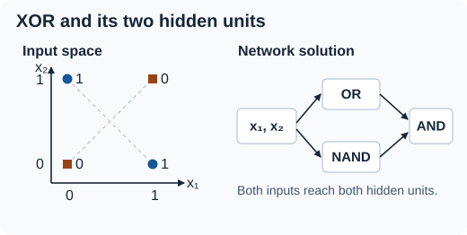

# Chapter 3. Artificial Neural Networks

[Contents](../readme.md)

## 3.1 From a threshold neuron to an MLP

A McCulloch–Pitts neuron uses a threshold on binary inputs. A perceptron adds a learning rule for its weights. A modern unit computes a weighted sum $z=w^Tx+b$ and an activation $a=g(z)$. The **activation function** $g$ determines how the score becomes an output. It can make a binary decision, produce a bounded value, or pass positive scores through. The vector $w$ is normal to the decision boundary $w^Tx+b=0$, and $b$ shifts that boundary.

| Activation | Formula                  | Use or limitation                                                                        |
| ---------- | ------------------------ | ---------------------------------------------------------------------------------------- |
| Step       | $\mathbf 1[z\ge0]$       | Binary threshold decision. The classical perceptron uses a mistake-driven update         |
| Sigmoid    | $\sigma(z)=1/(1+e^{-z})$ | Output in $(0,1)$. Derivative $\sigma(z)(1-\sigma(z))$ can become small                  |
| Tanh       | $\tanh(z)$               | Zero-centered output with derivative $1-\tanh^2(z)$                                      |
| ReLU       | $\max(0,z)$              | Common hidden activation with derivative 1 for positive inputs and 0 for negative inputs |

**Worked neuron.** For $x=(2,3)$, $w=(0.4,0.3)$, and $b=-0.5$, the pre-activation is $0.4(2)+0.3(3)-0.5=1.2$. A step unit returns 1 and a sigmoid unit returns about $0.769$. In two dimensions, for $w_2\ne0$, the boundary is $x_2=-(w_1/w_2)x_1-b/w_2$. This shows how the weights set the slope and how the bias changes the intercept.

A multilayer perceptron (MLP) stacks layers of learned units in a feedforward network. Each layer passes its output to the next without a recurrent connection. A deep MLP uses multiple hidden layers. Chapter 4 explains how to train it, and Chapter 6 applies the same ideas to deeper networks. Without nonlinear hidden activations, successive affine maps collapse into one affine map. Nonlinear hidden units allow several boundaries to combine.

### Early models and network topologies

The biological analogy supplies a vocabulary: dendrites receive signals, the cell body integrates them, and the axon transmits an output. An artificial unit summarizes this with inputs, weights, a bias, and an activation.

A **neuron model** describes how one unit computes or learns. A **network topology** describes how units or subnetworks connect.

| Model or topology | How it works | Example |
|---|---|---|
| McCulloch–Pitts unit | Applies a fixed threshold to binary inputs. | An AND unit activates only when both inputs are on. |
| Perceptron | Applies a threshold to a weighted sum and updates its weights after a classification mistake. | Learn a line that separates two classes. |
| ADALINE | Updates its weights using the squared error of the linear score before thresholding. | Adjust the score even when the predicted class is correct. |
| Single-layer feedforward network | Maps inputs directly to outputs in one learned layer. | Several output units can each score a different class. |
| Multilayer feedforward network | Passes inputs through nonlinear hidden layers to the output, with no feedback connections. | Two hidden units compute OR and NAND for XOR. |
| Recurrent neural network (RNN) | Combines the current input with the previous hidden state using the same weights at each step. | The state carries context so *good* can be interpreted differently in *not good* and *very good*. |
| Modular neural network (MNN) | Uses specialized subnetworks that exchange selected outputs. Modules can process separate inputs, combine lower-level results, or refine an earlier prediction. | Separate image and text modules contribute to a product classification. |

The early progression was from fixed logical units to Rosenblatt’s trainable perceptron and then to linear adaptive units. MADALINE combined several ADALINE units. Differentiable hidden layers and backpropagation made it practical to learn the internal representations of an MLP.

A binary sigmoid maps to $(0,1)$ and the bipolar sigmoid $2\sigma(z)-1$ maps to $(-1,1)$. The sign or step function gives a hard decision, while a piecewise-linear or smooth activation can preserve differences in input scores. Activations used with backpropagation need a derivative almost everywhere.

## 3.2 Perceptron learning and logic gates

For $0/1$ targets, predict $\hat y=\mathbf 1[w^Tx+b\ge0]$ and update a misclassified example by

$$
w\leftarrow w+\eta(y-\hat y)x,\qquad b\leftarrow b+\eta(y-\hat y).
$$

A false negative moves the boundary toward classifying the example positive. A false positive moves it the other way. On a finite linearly separable dataset, the classical perceptron converges after finitely many mistakes under its standard assumptions.

**Worked update.** With $x=(1,1)$, $w=(0.1,-0.2)$, $b=-0.2$, the score is $-0.3$ and prediction is 0. If the target is 1 and $\eta=0.1$, then $w'=(0.2,-0.1)$ and $b'=-0.1$.

| Gate | Weights | Bias |
|---|---|---:|
| AND | $(1,1)$ | $-1.5$ |
| OR | $(1,1)$ | $-0.5$ |
| NAND | $(-1,-1)$ | $1.5$ |
| NOT | $-1$ | $0.5$ |

For AND, the threshold on the weighted sum before adding the bias must accept 2 and reject 0 and 1. With unit weights, choosing $b=-1.5$ does exactly that. For OR, use a threshold between 0 and 1. This method derives the parameters from the truth table and works for other linearly separable gates.

### Worked NAND gate

Use one perceptron with weights $w_1=w_2=-1$, bias $b=1.5$, and output $1$ when $z\ge 0$. Then $z=1.5-x_1-x_2$.

| $x_1$ | $x_2$ | Score $z$ | NAND output |
|---:|---:|---:|---:|
| 0 | 0 | 1.5 | 1 |
| 0 | 1 | 0.5 | 1 |
| 1 | 0 | 0.5 | 1 |
| 1 | 1 | −0.5 | 0 |

Only the input $(1,1)$ pushes the score below zero. NAND can also serve as one of the hidden units in a network for XOR.

**XOR.** The two positive corners and the two negative corners each lie on crossing diagonals. One line cannot separate the classes. Use OR and NAND as two hidden units, then take their AND at the output. On input $(1,1)$ the hidden outputs are $(1,0)$, so the output is 0.

The two class diagonals cross. The hidden units supply two intermediate decisions that the final AND combines.

### Several outputs and expressive power

With multiple outputs, row $j$ of $W$ computes $w_j^Tx+b_j$ and defines a separate boundary. One-hot class targets turn the problem into learning one output per class. A single layer of threshold units can combine its outputs only through an additional decision rule or layer.

For binary inputs, a hidden threshold unit can detect one exact input pattern. An output OR can combine detectors for all positive patterns, so a network can represent any finite Boolean function. This construction may use exponentially many detectors. For continuous inputs, a sufficiently wide hidden layer with a suitable nonlinearity can approximate continuous functions on a compact domain. The approximation result does not guarantee a small network or successful training.

### Learning rules in context

| Rule | What drives the update |
|---|---|
| Perceptron or error correction | The labeled target differs from the predicted class. |
| Delta rule | A residual on a differentiable or linear score drives a gradient step. |
| Hebbian learning | Co-active units strengthen their connection under a basic correlation rule. Chapter 5 uses this idea for associative recall. |
| Competitive learning | Units compete and the winner, or its neighborhood, moves toward the current input. |

## Practice

- **3A.** Starting with $w=(0,0)$ and $b=-0.5$, update once for $x=(1,0),y=1,\eta=0.2$. Is the same example classified correctly immediately?
- **3B.** Draw the two-hidden-unit XOR network and verify all four rows.

## Answer checks

| Exercise | Answer |
|---|---|
| 3A | $w'=(0.2,0)$ and $b'=-0.3$. The new score is $-0.1$, so the next prediction on the same input is still 0. |
| 3B | For inputs $00,01,10,11$, the OR and NAND pairs are $(0,1),(1,1),(1,1),(1,0)$. Their AND gives $0,1,1,0$. |

[Chapter sources](../readme.md#3-artificial-neural-networks)

---

[← Chapter 2](../02%20-%20Evaluation%20and%20Bayes/Evaluation%20and%20Bayes.md) · [Contents](../readme.md) · [Chapter 4 · Feedforward Networks →](../04%20-%20Feedforward%20and%20Graphical%20Models/Feedforward%20Networks/Feedforward%20Networks.md)
