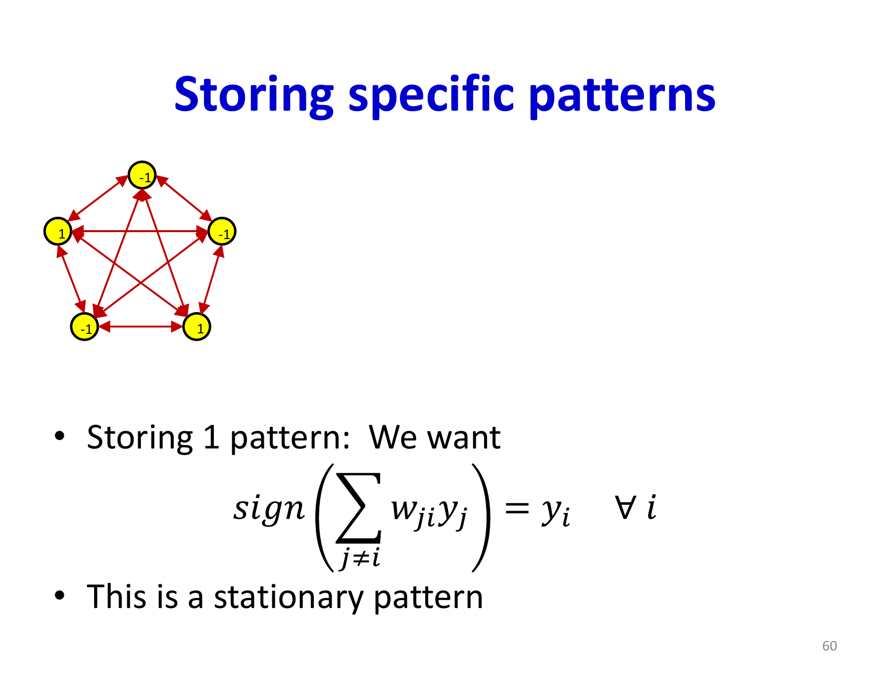
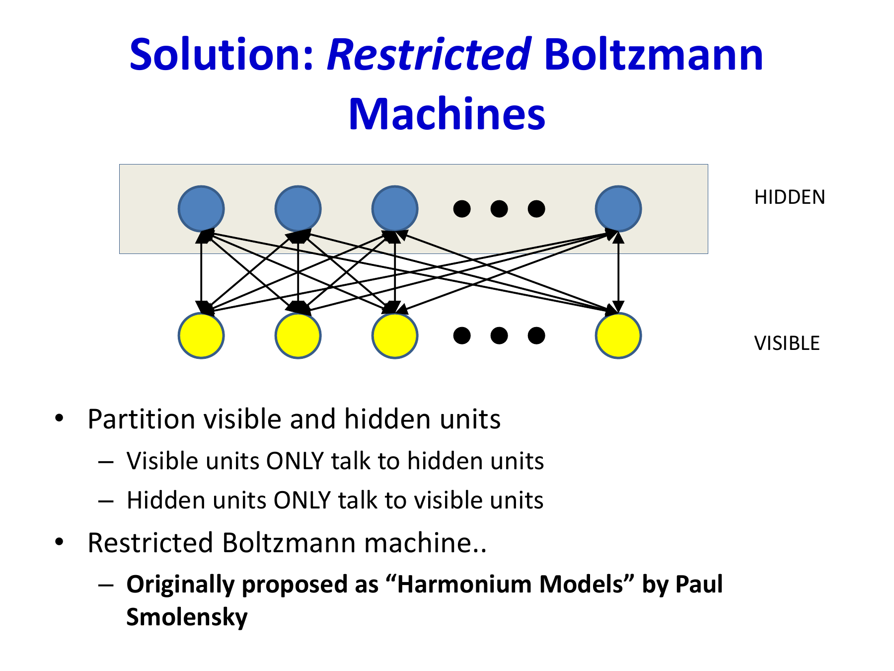
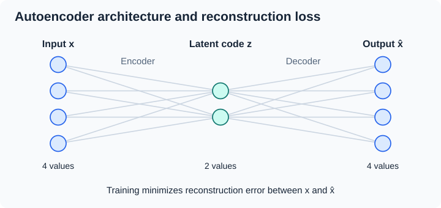
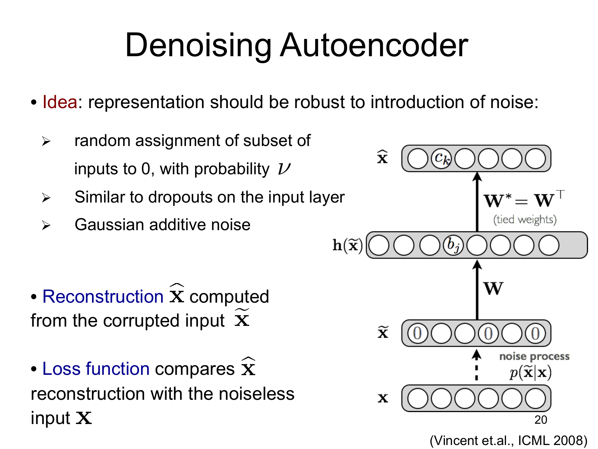

# Chapter 5. Probabilistic Neural Networks

[Contents](../readme.md)

[Hopfield](#51-hopfield-networks-and-associative-recall) · [Boltzmann and RBM](#52-boltzmann-machines-and-restricted-boltzmann-machines) · [Sigmoid and autoencoders](#53-sigmoid-networks-and-autoencoders) · [Exercises](#exercises)

A neural network transforms numbers using adjustable connection strengths called **weights**. This chapter studies three tasks: recovering a damaged pattern, learning which patterns are likely, and compressing an input while retaining enough information to reconstruct it.

A pattern such as $x=(1,0,1,0)$ can represent four black/white pixels. Weights control how neurons influence one another; biases shift their activation tendencies. Training changes these parameters, while recall or inference uses them to compute outputs.

## 5.1 Hopfield networks and associative recall

A **Hopfield network** retrieves a complete pattern from a damaged version, like recognizing a familiar symbol despite a missing stroke. This is **associative memory**: the input's content acts as the cue.

| Property | Meaning |
|---|---|
| Bipolar state | Each neuron holds $+1$ or $-1$. |
| Recurrent connections | Neurons feed back to one another; the state changes repeatedly until it settles. |
| Symmetric weights | $w_{ij}=w_{ji}$; the connections encode the memories. |
| No self-connections | $w_{ii}=0$. |

**Hebbian learning.** For one stored pattern, use $w_{ij}=p_ip_j$.

| Stored signs | Weight | Relationship encouraged |
|---|---:|---|
| Equal | $+1$ | Agreement |
| Opposite | $-1$ | Disagreement |

For $(p_1,p_2,p_3)=(1,1,-1)$, this gives $w_{12}=1$ and $w_{13}=-1$. For several memories, add their pairwise contributions.

For bipolar stored patterns $p^{(\mu)}\in\{-1,+1\}^N$, the unscaled Hebbian rule and recall field are

$$
\begin{aligned}
w_{ij}&=\sum_\mu p_i^{(\mu)}p_j^{(\mu)}, && i\ne j,\\
h_i&=\sum_{j\ne i}w_{ij}s_j+b_i.
\end{aligned}
$$

The pattern index $\mu$ distinguishes stored memories $p^{(\mu)}$ from the current recall state $s$. The **local field** $h_i$ combines the other neurons' weighted influences: a positive field favors $+1$, and a negative field favors $-1$.

**Recall procedure**

1. Calculate one neuron's local field using the latest states.
2. Set its state to the field's sign; retain the old state when the field is zero.
3. Repeat across neurons until no state changes.

A neuron flips only when its state opposes its field. **Weights stay fixed during recall.** The fully connected network has $N(N-1)/2$ undirected edges.

*A stored pattern is stable when each local field agrees with its neuron. The slide uses y for the states denoted s here.*

### Energy and convergence

**Meaning.** Energy measures how well the states satisfy the learned relationships; it is a mathematical score.

- **Pair contribution:** $-w_{ij}s_is_j$. Positive weights favor equal states; negative weights favor opposite states.
- **Bias contribution:** $-b_is_i$. A bias favors alignment with its sign.

In matrix form, $E=-\frac12s^TWs-b^Ts$. The factor $1/2$ compensates for counting every symmetric connection twice. During one update, only terms involving neuron $i$ change. Writing its old and new states as $s_i$ and $s_i'$ gives

$$
\Delta E=-(s_i'-s_i)h_i.
$$

**Why recall settles.** A flip aligns the state with its field, so $\Delta E=-2|h_i|<0$. Recall reaches a fixed point when:

- weights are symmetric;
- updates are asynchronous and revisit every neuron;
- zero-field ties keep the old state.

**Limits.** Simultaneous updates do not have this same single-bit convergence argument. Discrete models may use binary or bipolar states; continuous Hopfield models use continuous activations.

### Worked example Pattern storage and recall

For the single stored pattern $p=(1,1,-1,1,-1)^T$, the **outer product** $pp^T$ lists every product $p_ip_j$ in a matrix. Replacing the diagonal by zero removes self-connections:

$$
W=\begin{bmatrix}
0&1&-1&1&-1\\
1&0&-1&1&-1\\
-1&-1&0&-1&1\\
1&1&-1&0&-1\\
-1&-1&1&-1&0
\end{bmatrix}.
$$

**One-bit recovery.** The matrix is symmetric and has $5(5-1)/2=10$ undirected connections. With zero biases:

| Step | Calculation or result |
|---|---|
| Noisy input | $(1,-1,-1,1,-1)$ |
| Field at neuron 2 | $h_2=1+1+1+1=4$ |
| Update | Neuron 2 flips from $-1$ to $+1$. |
| Energy | $-2\to-10$, so $\Delta E=-8$. |
| Final state | $(1,1,-1,1,-1)$; every field is $4p_i$, agreeing with its state. |

**Two-bit recovery.** Start from $(1,-1,1,1,-1)$.

1. Update neuron 2: $h_2=1-1+1+1=2$, restoring it to $+1$.
2. Using that new state, update neuron 3: $h_3=-1-1-1-1=-4$, restoring it to $-1$.

**Limitation.** A zero-bias single-pattern network also stabilizes $-p$; arbitrary corruption need not recover the intended memory.

### Interference between stored patterns

Each Hebbian outer product favors states that align with its stored pattern. When several patterns contribute to the same weights, their effects add. For two bipolar patterns, their dot product measures overlap. Orthogonal patterns have zero dot product, while highly overlapping patterns can introduce cross-talk. The network can converge to a mixture or another spurious minimum. Consequently, recall need not return the nearest stored pattern.

## 5.2 Boltzmann machines and restricted Boltzmann machines

A noisy observation may have several plausible explanations. A probabilistic model assigns each possible pattern a probability instead of selecting a single fixed outcome immediately. A **configuration** is one complete assignment of unit states; three binary units have $2^3=8$ configurations.

A **Boltzmann machine** models a distribution over binary $0/1$ configurations. Visible units represent observed data; hidden units represent latent dependencies. For symmetric weights and temperature $T>0$,

$$
\begin{aligned}
E(x)&=-\sum_{i<j}w_{ij}x_ix_j-\sum_i b_ix_i,\\
P(x)&=\frac{e^{-E(x)/T}}{Z},\qquad Z=\sum_xe^{-E(x)/T}.
\end{aligned}
$$

**From energy to probability**

1. **Count pairs once:** the energy sum uses $i<j$.
2. **Assign a positive weight:** $e^{-E/T}$ gives lower-energy configurations larger weights.
3. **Normalize:** divide by the partition function $Z$ so all probabilities sum to 1.

For energies 0 and $-2$ at $T=1$, the weights are 1 and $e^2$; the second configuration is about 7.39 times as likely.

Lower-energy configurations have higher probability. A unit turns on with conditional probability $\sigma(h_i/T)$, where $\sigma(z)=1/(1+e^{-z})$. Sampling draws $r$ uniformly from $[0,1)$ and chooses state 1 when $r<p$. Clamping known visible bits and sampling the remaining units can complete a pattern.

**Temperature and exploration**

| Temperature | Effect |
|---|---|
| High | Conditional choices move closer to equally likely. |
| Low | Lower-energy choices become more likely. |
| Gradually decreasing | Simulated annealing explores first, then increasingly favors low energy. |

The result still depends on the cooling schedule and energy landscape.

| Model | Connections and update | Function |
|---|---|---|
| Discrete Hopfield network | Symmetric recurrent weights and deterministic asynchronous updates | Retrieval of a stable pattern from partial or noisy input |
| Full Boltzmann machine | Symmetric connections among units, with stochastic updates and optional hidden units | A distribution over patterns with hidden units that can model dependencies |
| Restricted Boltzmann machine | Visible-to-hidden connections only | Conditional independence within each layer and efficient alternating Gibbs steps |

### Worked example Configuration probabilities

For $0/1$ units, zero biases and weights $w_{12}=2,w_{13}=-1,w_{23}=-1$:

$$
E(x)=-2x_1x_2+x_1x_3+x_2x_3,\quad
P(x)=\frac{e^{-E(x)}}{Z}\quad(T=1).
$$

| State | Energy | Unnormalized weight | Probability |
|---|---:|---:|---:|
| 000 | 0 | 1 | 0.07619 |
| 001 | 0 | 1 | 0.07619 |
| 010 | 0 | 1 | 0.07619 |
| 011 | 1 | $e^{-1}$ | 0.02803 |
| 100 | 0 | 1 | 0.07619 |
| 101 | 1 | $e^{-1}$ | 0.02803 |
| 110 | $-2$ | $e^2$ | 0.56298 |
| 111 | 0 | 1 | 0.07619 |

**Normalization:** $Z=5+2e^{-1}+e^2\approx13.1248$. State 110 has the lowest energy and highest probability, about 0.563 rather than 1.

**Sampling:** With $x_1=1,x_3=0$, unit 2 has field $h_2=2$ and activation probability $\sigma(2)\approx0.8808$.

| Random draw | Sampled state |
|---|---:|
| $0.72<0.8808$ | 1 |
| $0.95>0.8808$ | 0 |

Weights and biases determine the probabilities; the random draw selects an outcome.

In $P(x_i=1\mid x_{-i})$, $x_{-i}$ denotes all other units' current states. Sampling realizes the conditional probability: if $p=0.8$, the interval $r<0.8$ occupies 80% of possible uniform draws. Repeated draws therefore turn the unit on about 80% of the time.

### Learning from correlations

Training increases the probability of observed data. For binary units, $x_ix_j=1$ only when both are on; its average measures coactivation frequency. Brackets $\langle\cdot\rangle$ denote that average.

| Data coactivation compared with model | Weight adjustment |
|---|---|
| More frequent | Increase the weight. |
| Less frequent | Decrease the weight. |
| Equal | No adjustment from that pair statistic. |

This gives the **data average minus model average** rule. The learning rate $\eta$ sets the update size.

**Worked update.** Suppose the data consist of pattern 110, with all three units observed. Data pair correlations are $(1,0,0)$ for pairs $(12,13,23)$. Under the current model:

$$
\langle x_1x_2\rangle_{\rm model}=P(110)+P(111)\approx0.63918,
$$

$$
\langle x_1x_3\rangle_{\rm model}=P(101)+P(111)\approx0.10422,
\quad \langle x_2x_3\rangle_{\rm model}\approx0.10422.
$$

**Update rule at $T=1$**

$$
w_{ij}'=w_{ij}+\eta\left(\langle x_ix_j\rangle_{\rm data}-\langle x_ix_j\rangle_{\rm model}\right).
$$

At $\eta=0.1$, the three weights become approximately $(2.03608,-1.01042,-1.01042)$, using expectations from the old parameters.

- **Bias update:** $\Delta b_i=\eta(\langle x_i\rangle_{\rm data}-\langle x_i\rangle_{\rm model})$.
- **Hidden units:** positive-phase averages include their distribution conditioned on visible data.

### Restricted Boltzmann machines

Fully connected hidden units make the probability calculations expensive. An RBM simplifies the connections so each layer can be updated in parallel once the other layer is known. Its hidden activations provide a learned representation of the visible pattern; reconstructing the visible layer tests which patterns those features tend to generate.

An **RBM** has visible units $v$ and hidden units $h$ with connections only across the layers. Given one layer, the other layer's units can be sampled independently. At unit temperature, with visible bias $a$, hidden bias $b$, and $W$ shaped visible by hidden, use

$$
P(h_j=1\mid v)=\sigma(b_j+(W^Tv)_j),\qquad
P(v_i=1\mid h)=\sigma(a_i+(Wh)_i).
$$

**Energy:** $E(v,h)=-a^Tv-b^Th-v^TWh$. Summing the joint distribution over hidden states gives the visible distribution.

**Learning phases**

- **Positive phase:** data-conditioned coactivations favor training patterns.
- **Negative phase:** model coactivations offset patterns already generated too often.
- **Approximation:** contrastive divergence replaces a slow equilibrium calculation with a short chain. The restricted connections make each Gibbs step efficient.

Visible units have no connections to one another, and neither do hidden units. The layer sizes are unrestricted; a smaller hidden layer illustrates compression.

The learning procedure alternates conditional samples: $v^0\to h^0\to v^1\to h^1$, from the data pair to a reconstructed pair. This is one alternating **Gibbs sampling** step. **Contrastive divergence with one step**, or CD-1, compares the original pair with the reconstructed pair. The outer product $vh^T$ contains every visible–hidden coactivation product.

*Every connection crosses between the two layers; units within one layer are conditionally independent given the other.*

For a sampled CD-1 step, compute all states with the current parameters, then use

$$
\begin{aligned}
\Delta W&=\eta[v^0(h^0)^T-v^1(h^1)^T],\\
\Delta a&=\eta(v^0-v^1),\\
\Delta b&=\eta(h^0-h^1).
\end{aligned}
$$

These are one-sample estimates; averages over a batch or hidden probabilities can also estimate the terms. Positive-phase associations come from the data; negative-phase associations come from reconstruction. Learning changes the parameters, whereas a Gibbs reconstruction step alone samples states.

**Worked CD-1 update.** Use two visible bits and one hidden bit, weights $(1,1)$, zero biases, and training pattern $v^0=(1,0)$.

1. Compute $P(h^0=1\mid v^0)=\sigma(1)\approx0.731$. A draw of $0.6$ gives $h^0=1$.
2. Both visible probabilities are now $\sigma(1)$. Draws $0.3,0.4$ give a reconstruction $v^1=(1,1)$.
3. Compute $P(h^1=1\mid v^1)=\sigma(2)\approx0.881$. A draw of $0.8$ gives $h^1=1$.
4. For the second weight, $v_2^0h^0-v_2^1h^1=0-1=-1$. A sampled CD-1 update with $\eta=0.1$ takes $w_2$ from 1 to $0.9$. This reduces the model's tendency to activate the second visible bit with that hidden state.

CD-1 uses reconstructed coactivations to approximate the equilibrium model expectation. Hidden activation probabilities may replace sampled hidden states in the correlation estimates. [Hinton’s RBM training guide](https://www.cs.toronto.edu/~hinton/absps/guideTR.pdf)

## 5.3 Sigmoid networks and autoencoders

### Sigmoid networks

A hard threshold changes abruptly from off to on. The **sigmoid** $\sigma(z)=1/(1+e^{-z})$ provides a smooth alternative: $\sigma(0)=0.5$, positive scores approach 1 and negative scores approach 0. Smoothness lets training estimate how a small weight change affects the loss.

A sigmoid network applies $h^{(l)}=\sigma(W^{(l)}h^{(l-1)}+b^{(l)})$ layer by layer. Sigmoid is bounded, nonlinear and differentiable, with $\sigma'(z)=\sigma(z)[1-\sigma(z)]$. Its continuous output differs from a hard-threshold perceptron's state. Sampling a binary state from that output is a separate stochastic operation.

**Worked forward pass.** For $x=(1,0)$,

$$
\begin{aligned}
z_1&=2x_1-x_2-0.5=1.5, & h_1&=0.8176,\\
z_2&=-x_1+2x_2=-1, & h_2&=0.2689,\\
\hat y&=\sigma(2h_1-h_2-0.5)\approx0.7040.
\end{aligned}
$$

**Learning the weights**

- **Loss:** $L$ measures prediction error.
- **Gradient:** $\partial L/\partial w$ measures sensitivity to a weight change.
- **Update:** $w\leftarrow w-\eta\,\partial L/\partial w$.
- **Backpropagation:** the chain rule multiplies sensitivities along each path and adds contributions from different paths.

For target 1 and loss $\frac12(\hat y-1)^2$, the output-score gradient is $(\hat y-1)\hat y(1-\hat y)\approx-0.0617$. The gradient of the weight from $h_1$ is approximately $-0.0504$; learning rate 0.1 increases that weight from 2 to about 2.0050.

### Autoencoders

An **autoencoder** learns to reproduce its input through a code that retains useful structure.

| Component | Operation | Role |
|---|---|---|
| Encoder | $z=f_\theta(x)$ | Builds the latent representation. |
| Decoder | $\hat x=g_\phi(z)$ | Reconstructs the input. |
| Reconstruction loss | Compares $x$ and $\hat x$ | Trains both components jointly. |

**Applications:** compression, denoising and anomaly detection through unusually high reconstruction error relative to the training distribution.

**Why a bottleneck helps.** A two-value code forces a four-value input to be represented through shared structure. Compression is approximate and may lose detail.

**Training target.** The input itself supplies the target; no separate class labels are needed. MSE averages squared reconstruction errors, preventing positive and negative errors from cancelling. Binary cross-entropy is another choice for Bernoulli targets with sigmoid outputs.

**Worked reconstruction.** For input $x=(1,0,1,0)$, encoder pre-activations $(1,0.6)$ give $z\approx(0.7311,0.6457)$. Apply sigmoid to each decoder score.

The complete encoder is

$$
W_e=\begin{bmatrix}0.5&0.2&0.4&0.1\\0.1&0.6&0.3&0.5\end{bmatrix},\quad
b_e=\begin{bmatrix}0.1\\0.2\end{bmatrix},\quad z=\sigma(W_ex+b_e).
$$

Its scores are $0.5+0.4+0.1=1$ and $0.1+0.3+0.2=0.6$. These are illustrative starting parameters, not weights inferred from the single input. The decoder parameters are the coefficients and biases in the following table.

| Output | Decoder score | Activation |
|---|---|---:|
| 1 | $0.8z_1+0.2z_2+0.1$ | $0.6930$ |
| 2 | $0.1z_1+0.7z_2-0.1$ | $0.6047$ |
| 3 | $0.6z_1+0.4z_2$ | $0.6675$ |
| 4 | $0.2z_1+0.9z_2-0.2$ | $0.6289$ |

The decoder predicts four values from a two-value code:

The reconstruction loss is

$$
\operatorname{MSE}\approx\frac{(-0.3070)^2+0.6047^2+(-0.3325)^2+0.6289^2}{4}\approx0.2415.
$$

**Reconstruction gradient.** Let $\delta_i$ be the loss derivative with respect to decoder score $i$. The chain rule separates into:

| Factor | Source |
|---|---|
| $2(\hat x_i-x_i)/4$ | MSE derivative |
| $\hat x_i(1-\hat x_i)$ | Sigmoid derivative |
| $z_j$ | Input to decoder weight $W_{d,ij}$ |

Thus

$$
\delta_i=\frac24(\hat x_i-x_i)\hat x_i(1-\hat x_i),\qquad
\frac{\partial L}{\partial W_{d,ij}}=\delta_i z_j.
$$

**One weight update:** $\delta_1\approx-0.03266$, so $\partial L/\partial W_{d,11}\approx-0.02388$. At learning rate 0.1, $W_{d,11}$ changes from 0.8 to approximately 0.80239.

**Encoder gradient:** $\delta_{e,j}=z_j(1-z_j)\sum_iW_{d,ij}\delta_i$; its weight gradients are $\delta_{e,j}x_k$. The sum combines contributions from all decoder outputs. Evaluate both sets of gradients before applying the joint update.

| Variant | Constraint |
|---|---|
| Undercomplete | Fewer latent coordinates than input coordinates |
| Sparse | Penalty encourages few active latent units |
| Denoising | Encode a corrupted input and reconstruct the clean input |
| Contractive | Penalize sensitivity of the encoder to small input changes |

Denoising reconstructs the clean input from a corrupted version, such as a vector with randomly masked entries. A contractive autoencoder instead adds $\lambda\|\partial f_\theta(x)/\partial x\|_F^2$, penalizing changes in the code under small changes in the input. A sparse autoencoder can add a penalty on latent activations. These constraints have different effects even if the same reconstruction loss is used.

*Noise changes the input supplied to the encoder, while the reconstruction target remains clean. Tied decoder weights are one possible design.*

### What the latent space preserves

An undercomplete linear autoencoder with squared reconstruction error can learn the principal subspace spanned by PCA, although its learned coordinates need not be the PCA axes. Nonlinear encoders can learn curved low-dimensional structure. An overcomplete network can simply learn the identity unless the training objective constrains what it represents.

| Extension | What changes |
|---|---|
| Tied weights and stacked autoencoders | A decoder can use the transpose of the encoder weights. Stacking encoders allows progressively deeper representations, which can be fine-tuned jointly. |
| Stochastic encoder or decoder | The model produces a distribution instead of a single code or reconstruction. A variational autoencoder fits a probabilistic latent model with a reconstruction term and a KL term that regularizes the latent distribution. |
| Predictive sparse decomposition | Train an encoder to predict a sparse code that can reconstruct the input. |
| Compression, retrieval, and metric learning | Use codes for low-dimensional storage or similarity search. Reconstruction preserves useful variation, but labels or a similarity objective may be needed if semantic neighbors matter. |

## 5.4 Related neural architectures

| Model | Mechanism and use |
|---|---|
| Backpropagation network (BPN) | A feedforward network trained by the gradient procedure in Chapter 4 §4.2. |
| Counterpropagation network (CPN) | A competitive Kohonen layer selects a prototype. A supervised Grossberg layer maps that winner to a target. Too few prototypes give a coarse approximation. |
| Bidirectional associative memory (BAM) | Recalls paired patterns across two layers. With $W$ mapping $X$ to $Y$, alternate $y\gets\operatorname{sign}(Wx)$ and $x\gets\operatorname{sign}(W^Ty)$ until the pair settles. |
| Adaptive resonance theory (ART) | Selects a category and checks its match against a vigilance threshold. A failed check triggers a reset and a search for another category. Higher vigilance produces finer categories. ART-1 uses binary inputs and ART-2 supports continuous inputs. |
| Self-organizing map (SOM) | Finds the closest prototype on a grid. It moves the winner and its neighbors toward the input, $w_j\gets w_j+\eta h_{bj}(x-w_j)$. Shrinking the neighborhood supports a map that preserves local relationships. |
| Learning vector quantization (LVQ) | Uses labeled prototypes for classification. Move the closest prototype toward the input for a correct label and away from it for a wrong label. |
| Cascade-correlation network | Starts with input and output units. It adds a hidden unit trained to correlate with residual errors, freezes its incoming weights, then refits the output weights. |
| Probabilistic neural network (PNN) | Uses Gaussian responses around training examples to estimate class densities. Combine the class density with its prior to choose a label. This is a specific classifier within the broader family of neural models. |
| General regression neural network (GRNN) | Predicts a Gaussian-weighted average of observed targets. Nearby training points carry more weight, and validation can select the kernel width. |

### Applications of the related architectures

BAM recalls paired patterns, such as a noisy code and its associated symbol. Competitive models such as SOM and ART group similar vectors, while LVQ attaches labels to prototypes. In character recognition, a bitmap can be flattened into a binary vector. The model compares or transforms that vector and returns a class code.

## Exercises

- **5A.** Store $(1,-1,1)$ with unscaled Hebbian weights. Starting from $(1,1,1)$, update neuron 2 and compute the energy change.
- **5B.** Distinguish what gets updated during Hopfield recall, an RBM Gibbs step, and autoencoder training.
- **5C.** In the CD-1 example, change the second visible draw from $0.4$ to $0.9$. With the same hidden draws, find the new reconstruction and second-weight update.
- **5D.** Reproduce the eight-state Boltzmann table and calculate all three weight updates for data pattern 110 at learning rate 0.1.
- **5E.** Recompute the autoencoder code and MSE; derive and update decoder weight $W_{d,11}$ at learning rate 0.1.

## Answers

| Exercise | Answer |
|---|---|
| 5A | The field is $-2$, so the bit flips from $+1$ to $-1$. $\Delta E=-(-2)(-2)=-4$. |
| 5B | Hopfield recall changes states deterministically. An RBM Gibbs step samples states. Autoencoder training changes weights by backpropagating reconstruction error. |
| 5C | The reconstruction becomes $(1,0)$. The final hidden draw $0.8$ gives 0 since $\sigma(1)\approx0.731$. Both second-bit products are zero, so the sampled update is zero. |
| 5D | $Z=13.1248$, $P(110)=0.56298$; updated weights $(2.03608,-1.01042,-1.01042)$, approximately. |
| 5E | Code $(0.73106,0.64566)$, MSE $0.24149$, gradient $-0.02388$ and updated weight $0.80239$. |

[Chapter sources](../readme.md#5-probabilistic-neural-networks)

---

[← Graphical Models](../04%20-%20Feedforward%20and%20Graphical%20Models/Graphical%20Models/Graphical%20Models.md) · [Contents](../readme.md) · [Chapter 6 →](../06%20-%20Deep%20Learning/Deep%20Learning.md)
