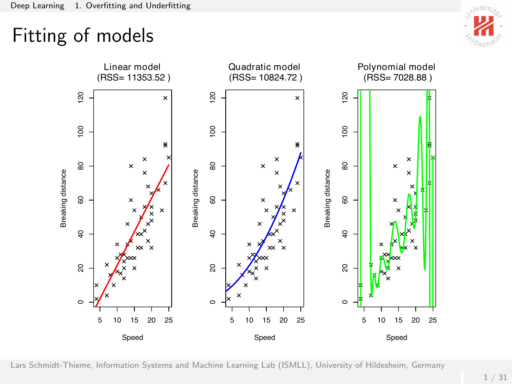
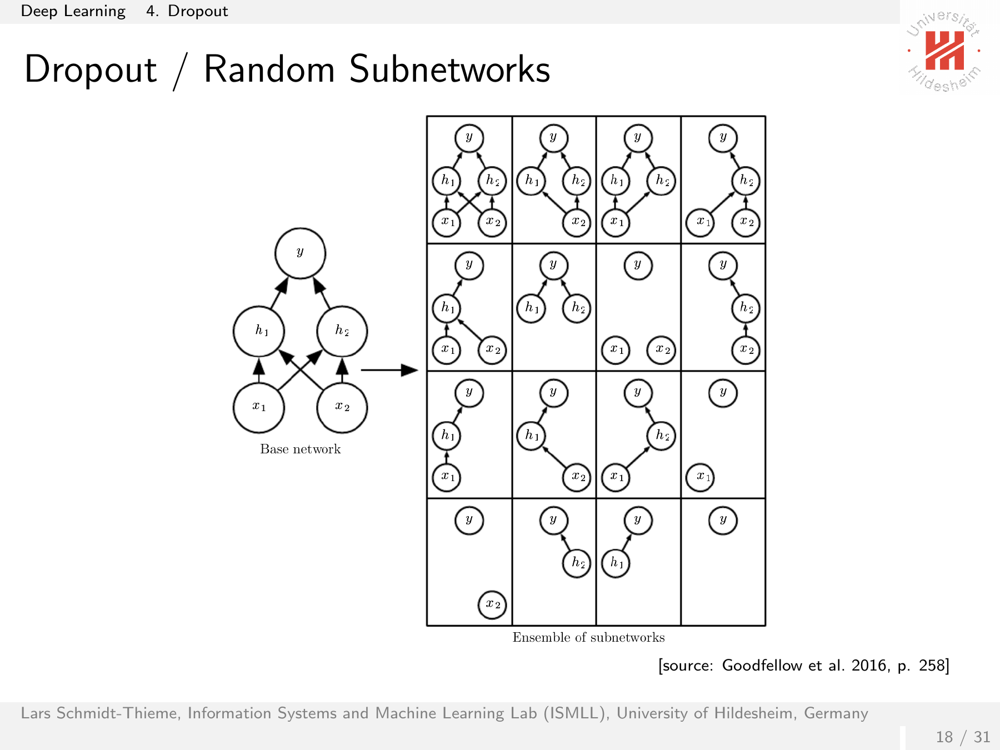
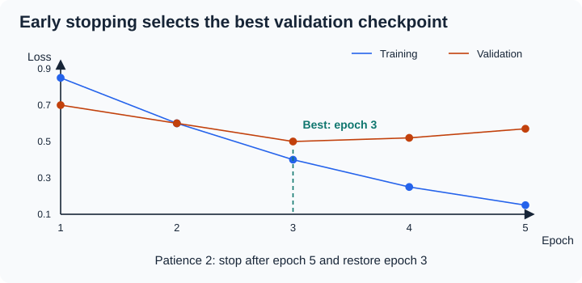
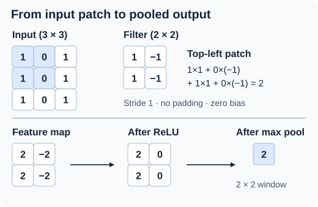
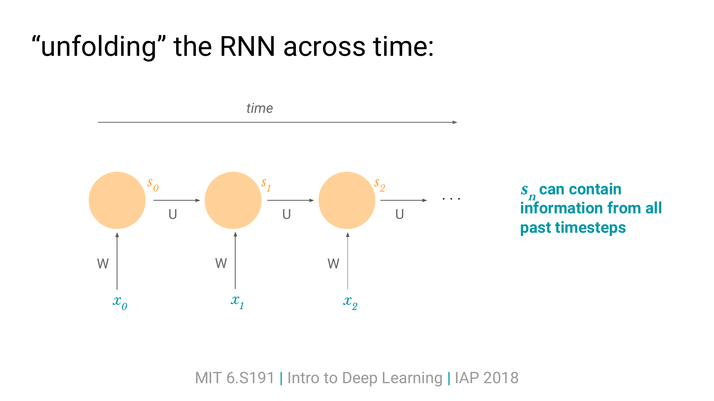

# Chapter 6. Modern Practical Deep Networks

[Contents](../readme.md)

[Architecture](#61-architecture-and-training) · [Training](#62-batch-size-loss-curves-and-regularization) · [CNN](#63-convolutional-networks) · [RNN](#64-recurrent-and-recursive-networks) · [Exercises](#exercises)

## 6.1 Architecture and training

Suppose an image must be classified as a cat or a dog. The input is a list of pixel values, and the desired output is a class. A neuron combines inputs with weights, adds a bias and applies an activation function. A **layer** computes several such outputs; a **hidden layer** lies between input and final prediction.

A **deep feedforward network** stacks hidden layers. Each calculates weighted sums plus biases, then applies a nonlinear activation. “Feedforward” means information moves toward the output without recurrent feedback. Forward propagation produces a prediction; backpropagation differentiates the loss; an optimizer updates the parameters. Depth supports hierarchical representations but increases computation and can make gradients unstable.

Layer $l$ computes $h^{(l)}=\phi(W^{(l)}h^{(l-1)}+b^{(l)})$, starting from input $h^{(0)}$ and applying activation $\phi$. Nonlinearity matters: stacking only linear maps still produces a linear map.

**Training cycle**

1. **Forward pass:** compute prediction $\hat y$.
2. **Loss:** compare $\hat y$ with target $y$ using $L$.
3. **Backward pass:** backpropagation calculates parameter gradients.
4. **Update:** the optimizer adjusts the parameters.

**Inference** uses fixed learned parameters to make predictions.

Deep models became practical as larger labeled datasets, faster parallel hardware, and improved optimization supported more layers and parameters. The same design choices create tradeoffs in training cost, interpretability, and the amount of data needed.

### Perspectives and practical issues

| Perspective | Interpretation |
|---|---|
| Neural network | Stack learned affine transformations and nonlinearities: $h^{(l)}=\phi(W^{(l)}h^{(l-1)}+b^{(l)})$. Depth alone does not guarantee quality. |
| Representation learning | Earlier image layers may detect edges, intermediate layers combine shapes, and later layers support object recognition. Features are learned jointly. |
| Optimization | A loss defines the training objective; backpropagation computes gradients and an optimizer changes parameters. |
| Computation | Matrix operations benefit from parallel hardware, while data size, parameter count and batch size affect time and memory. |
| Applications and transfer | Learned representations support vision, speech and language tasks. Pretrained features may be adapted to a new task. |

**Practical issues:** overfitting, biased or insufficient data, computation and energy cost, interpretability and unstable gradients.

| Split | Purpose | Example from 10,000 records |
|---|---|---:|
| Training | Fit parameters | 7,000 |
| Validation | Select settings and checkpoints | 1,500 |
| Test | Evaluate the selected model | 1,500 |

A model can fit training data well while generalizing poorly.

### Capacity, initialization, and normalization

| Choice | Why it matters |
|---|---|
| Shallow versus deep | A wide hidden layer can approximate many functions. Depth can represent hierarchies more efficiently when the task naturally composes small features, such as edges into shapes. |
| Xavier and He initialization | Scale weights using layer sizes to keep signals and gradients from shrinking or growing too quickly. Xavier suits many tanh-like layers, and He is designed for ReLU-like layers. |
| Batch normalization | Normalize batch activations, then apply a learned scale and shift. Inference usually uses statistics accumulated during training. This differs from scaling raw inputs once in preprocessing. |
| Hyperparameter search | Grid search tries a fixed grid, random search samples combinations, and validation determines the choice. Tune on validation data and reserve the test set for final evaluation. |

## 6.2 Batch size, loss curves, and regularization

Training uses input–target pairs $(x_i,y_i)$ to predict, measure error and update parameters. **Batch size** is the number of examples used to estimate one update. A **hyperparameter**, such as batch size or learning rate, is chosen outside these parameter updates.

An **epoch** is one pass through the training data. With 1,000 examples and batch size 64, retaining the last partial batch gives 16 updates.

| Method | Examples used per update | Updates per epoch |
|---|---|---|
| Batch GD (BGD) | Entire training set | 1 |
| Stochastic GD (SGD) | One example | $N$ |
| Mini-batch GD | A subset of size $B$ | $\lceil N/B\rceil$ when the partial batch is kept |

Mini-batches balance gradient noise against computational efficiency.

Gradient descent takes a small step opposite the loss's slope. If increasing a weight increases loss, the slope is positive and the weight decreases. The learning rate $\eta>0$ controls the step: very large steps can overshoot; very small steps learn slowly. For $\hat y=wx$, the chain rule gives

$$
\frac{\partial \ell}{\partial w}
=\frac{\partial\ell}{\partial\hat y}\frac{\partial\hat y}{\partial w}
=(\hat y-y)x.
$$

For $\ell_i=\frac12(wx_i-y_i)^2$, the gradient is $g_i=(wx_i-y_i)x_i$, and gradient descent uses $w\leftarrow w-\eta g$. The factor $1/2$ merely cancels the 2 from differentiation. Batch gradients below are means, and every new gradient uses the latest parameter values.

### Worked example One training epoch

Use data $(1,2),(2,4),(3,6)$, prediction $\hat y=wx$, no bias, $w_0=0$, learning rate 0.1 and per-example loss $\ell=\frac12(wx-y)^2$.

**BGD:** At the same old weight 0, the three gradients are $-2,-8,-18$. Their mean is $-28/3$, giving one update $w'=0-0.1(-28/3)=0.93333$.

**SGD:** Recompute after each sample in the stated order:

| Sample | Current weight | Gradient | New weight |
|---|---:|---:|---:|
| $(1,2)$ | 0 | $-2$ | 0.2 |
| $(2,4)$ | 0.2 | $(0.4-4)2=-7.2$ | 0.92 |
| $(3,6)$ | 0.92 | $(2.76-6)3=-9.72$ | 1.892 |

**Mini-batch updates**

1. First two examples at $w=0$: mean gradient $(-2-8)/2=-5$, giving $w=0.5$.
2. Last one-example batch: gradient $(1.5-6)3=-13.5$, giving $w=1.85$.

| Method | Weight after this epoch | Updates |
|---|---:|---:|
| BGD | 0.93333 | 1 |
| SGD | 1.892 | 3 |
| Mini-batch | 1.85 | 2 |

**Interpretation:** these are different optimization paths; a larger first-epoch weight does not imply a better method. SGD updates frequently but noisily; mini-batches use parallel hardware efficiently. For 100 examples, batch sizes 20 and 50 give five and two updates per epoch.

### Optimization methods

| Optimizer | What changes from plain gradient descent |
|---|---|
| Momentum | A moving average of gradients carries a direction across updates and can damp oscillation. |
| Nesterov momentum | Estimates the gradient at a look-ahead point along the momentum direction before correcting the update. |
| AdaGrad | Accumulated squared gradients shrink steps on frequently updated coordinates. Steps can become too small later in training. |
| RMSProp | A moving average of squared gradients scales each coordinate and gradually forgets old gradients. |
| Adam | Uses moving averages of gradients and squared gradients, with bias correction near initialization. |

**Optimization difficulties**

- **Nonconvex loss:** initialization and learning-rate schedules affect the solution.
- **Saddle points:** the gradient can be small although both ascent and descent directions remain.
- **Exploding gradients:** clipping bounds large gradient norms, especially in recurrent models.

**Adaptive step sizes**

- **AdaGrad:** $s_t=s_{t-1}+g_t^2$ accumulates squared gradients.
- **RMSProp:** $s_t=\beta s_{t-1}+(1-\beta)g_t^2$ gradually forgets older gradients.
- **Both:** divide the current gradient by $\sqrt{s_t}+\epsilon$ coordinatewise.
- **Adam:** uses an averaged gradient in the numerator and averaged squared gradients in the denominator, correcting both for initialization bias.

Momentum retains some previous update direction rather than responding only to the current slope. In Adam, $m_t$ tracks the average gradient and $v_t$ tracks squared gradients; these adjust direction and step scale separately for each parameter. The coefficients $\beta,\beta_1,\beta_2\in[0,1)$ control how much history is retained; $\epsilon>0$ prevents division by zero.

One momentum convention is $u_t=\beta u_{t-1}+g_t$, $w_t=w_{t-1}-\eta u_t$. A moving-average convention instead includes $(1-\beta)$ in the gradient term. Adam uses

$$
\begin{aligned}
m_t&=\beta_1m_{t-1}+(1-\beta_1)g_t,\\
v_t&=\beta_2v_{t-1}+(1-\beta_2)g_t^2.
\end{aligned}
$$

$$
\begin{aligned}
\hat m_t&=\frac{m_t}{1-\beta_1^t}, & \hat v_t&=\frac{v_t}{1-\beta_2^t},\\
w_t&=w_{t-1}-\eta\frac{\hat m_t}{\sqrt{\hat v_t}+\epsilon}.
\end{aligned}
$$

Operations are coordinatewise. For a first scalar gradient $g_1=2$ and zero initial moments, bias correction gives $\hat m_1=2$, $\hat v_1=4$; with $\eta=0.1$ the first step is approximately $-0.1$ when $\epsilon$ is negligible.

### Regularization and generalization

Training loss measures fit on training examples; validation loss supports model selection. High losses on both sets suggest underfitting or failed optimization. Falling training loss with rising validation loss suggests overfitting. Regularization restricts effective model complexity.



*A more flexible fit can lower training error while introducing sharp oscillations; held-out data are needed to assess generalization.*

A network can memorize training details that do not recur in new examples. Weight penalties discourage overly sensitive fits; their strength $\lambda\ge0$ controls the tradeoff between fitting the data and restricting weights. L1 grows with absolute weight size and can produce exact zeros; L2 grows quadratically, so large weights cost disproportionately more. Dropout trains with randomly missing activations, reducing dependence on particular combinations.

| Method | Mechanism |
|---|---|
| L1 | Add $\lambda\sum_i\lvert w_i\rvert$; encourages sparse solutions. |
| L2 | Add $\frac\lambda2\sum_iw_i^2$; shrinks weights and adds $\lambda w_i$ to the gradient. |
| Elastic net | Combine L1 and L2 penalties. |
| Max-norm | Constrain a weight vector's norm. |
| Early stopping | Restore the checkpoint with the lowest validation loss. |
| Dropout | Randomly remove activations during training. |
| Data augmentation | Transform training examples while preserving their labels. |

**Penalty calculation.** For $w=(2,-1,0.5)$ and $\lambda=0.1$, the L1 penalty is $0.1(2+1+0.5)=0.35$; the L2 penalty is $0.05(4+1+0.25)=0.2625$. Each is added to the data loss.



*Different masks select different subnetworks during training, all sharing the original learned parameters.*

**Inverted dropout.** With drop probability $p$, mask $m_i\sim\operatorname{Bernoulli}(1-p)$ and activation vector $a$,

$$
\tilde a=\frac{m\odot a}{1-p}.
$$

The binary mask retains each activation with probability $1-p$. Dividing retained activations by $1-p$ preserves their expected contribution.

For $a=(0.8,0.4,0.9,0.2)$, $m=(1,0,1,0)$ and $p=0.5$, the result is $(1.6,0,1.8,0)$. Scaling preserves each activation in expectation. Ordinary inference uses unmasked activations with no extra scaling. The alternative original convention leaves training activations unscaled and scales them at inference.

**Early stopping.** Validation losses $(0.70,0.60,0.50,0.52,0.57)$ have their minimum at epoch 3. With patience 2 and validation each epoch, training stops after epoch 5 and restores epoch 3. The test set does not select the checkpoint.



Augmentation may use crops, shifts, flips or color changes when these preserve the task's label. Transfer learning initializes from pretrained representations, replaces the task head and fine-tunes selected layers. Shared representations in multitask learning can also constrain a model when the tasks are related.

## 6.3 Convolutional networks

Images contain spatial structure: neighboring pixels form edges and textures. A **convolutional neural network**, or CNN, looks for small local patterns and reuses the same detector across the image. A grayscale image has one intensity value per pixel; an RGB image has three **channels**, one per color component. A **filter** or kernel is a small array of learned weights.

A convolutional layer slides learned filters across an input, sums elementwise products over all input channels and adds a bias per filter. Each filter produces a feature map. Shared filter weights detect a pattern at different locations.

```text
Image -> Convolution -> ReLU -> Pooling -> Flatten -> Dense -> Softmax
         local features       smaller maps        scores    probabilities
```

Pooling reduces spatial size; flattening reshapes the maps without removing entries. Global average pooling is an alternative readout. Filters and dense layers learn weights; pooling and flattening do not.

At each location, the filter and image patch are multiplied entry by entry and summed. A large response means that patch matches the filter's preferred pattern. **Stride** is the distance between successive positions. **Padding** adds border values so filters can also cover boundary regions. **ReLU**, $\max(0,z)$, keeps positive responses and replaces negative ones with zero.

**Worked filter.** Take a $3\times3$ image with every row $(1,0,1)$ and a $2\times2$ filter with both rows $(1,-1)$. With stride 1, no padding, and zero bias, the first patch scores $1+1=2$ and the next patch scores $-1-1=-2$. Both feature-map rows are $(2,-2)$. ReLU gives rows $(2,0)$ and a $2\times2$ max pool gives 2.



The output-size rule counts valid filter positions. After padding, a dimension has length $H+2P$; subtracting the filter length gives the available travel distance, division by stride counts moves, and adding 1 includes the starting position. The floor symbol $\lfloor\cdot\rfloor$ rounds down.

**Output dimensions and parameter count**

With unit dilation, output height is

$$
H_{\rm out}=\left\lfloor\frac{H+2P-K_h}{S}\right\rfloor+1.
$$

Width follows the same rule. Each filter has $K_hK_wC_{\rm in}$ weights and one bias, so the layer learns $(K_hK_wC_{\rm in}+1)C_{\rm out}$ parameters.

| Stage | Example shape or count |
|---|---|
| Input | $32\times32\times3$ |
| Convolution | 16 filters, $3\times3$, stride 1, padding 1 → $32\times32\times16$ |
| Pooling | $2\times2$ window, stride 2 → $16\times16\times16$ |
| Flattening | 4,096 values |
| Learned convolution parameters | $(3\cdot3\cdot3+1)16=448$ |

The filter weights are reused at every spatial position.

**Activation choices**

| Function | Effect |
|---|---|
| ReLU | Replaces negative values by zero. |
| Leaky ReLU | Retains a small negative-side slope. |
| Sigmoid and tanh | Can saturate at large input magnitudes. |
| Softmax | Converts class logits into mutually exclusive probabilities. |

### Worked example From image to class

Consider the image and filter below. The filter slides as written, without reversal:

$$
I=\begin{bmatrix}1&1&1&0&0\\1&1&1&0&0\\1&1&1&0&0\\0&0&0&1&1\\0&0&0&1&1\end{bmatrix},\quad
K=\begin{bmatrix}1&0&-1\\1&0&-1\\1&0&-1\end{bmatrix}.
$$

At stride 1, zero bias and no padding, the first patch gives $(1-1)+(1-1)+(1-1)=0$. The next patch gives $(1-0)+(1-0)+(1-0)=3$. Continuing gives

$$
F=\begin{bmatrix}0&3&3\\0&1&1\\0&-1&-1\end{bmatrix}
\xrightarrow{\rm ReLU}
A=\begin{bmatrix}0&3&3\\0&1&1\\0&0&0\end{bmatrix}.
$$

**Pooling and flattening.** Use a $2\times2$ window, stride 1 and no padding.

| Operation | Output |
|---|---|
| Max pooling | $\begin{bmatrix}3&3\\1&1\end{bmatrix}$ |
| Average pooling | $\begin{bmatrix}1&2\\0.25&0.5\end{bmatrix}$ |
| Row-major flattening of max pool | $q=(3,3,1,1)$ |

At stride 2, max pooling instead gives a single value. The pooling stride therefore changes the result.

A **dense layer** combines every flattened feature into a score, or **logit**, for each class. Softmax converts logits to positive probabilities that sum to 1:

$$
P(k)=\frac{e^{z_k}}{\sum_j e^{z_j}}.
$$

Larger logits receive larger probabilities. The class with the largest probability is the prediction.

**Dense layer and prediction.** With zero biases and illustrative weights:

| Class | Weights | Logit | Softmax probability |
|---|---|---:|---:|
| A | $(0.5,0,0.5,0)$ | 2 | 0.7311 |
| B | $(0,0,0.5,0.5)$ | 1 | 0.2689 |

The prediction is **A**. The convolution filter detects a brightness transition; reversing its sign reverses the response.

### CNN design choices

The sliding operation above is cross-correlation, commonly called convolution in neural networks. Pooling or strided convolution reduces spatial resolution. Max pooling retains the strongest response, average pooling summarizes a region, and min pooling retains its smallest value.

| Architecture | Design |
|---|---|
| LeNet and AlexNet | LeNet illustrates convolution, subsampling, and a classifier for digits. AlexNet scales the pattern to larger images and uses ReLU and dropout. |
| VGG | Repeats small $3\times3$ kernels to build a larger receptive field through depth. |
| Inception or GoogLeNet | Runs parallel operations at different spatial scales. $1\times1$ convolutions can reduce channel cost. |
| ResNet | Learns a residual $F(x)$ and adds a shortcut, $y=x+F(x)$, when dimensions match. Use a projection if the shortcut needs a different shape. |

A typical image pipeline resizes and normalizes input, uses training augmentation, then trains a stack of filters and a classification head. Validate accuracy and loss with a consistent split. For expensive models, also compare parameter count and inference cost.

## 6.4 Recurrent and recursive networks

For a sequence, order changes meaning: “good” and “not good” should produce different predictions. A **recurrent neural network** carries a running summary, its **hidden state**, from one input to the next. Each step combines the current input with that previous summary.

A simple recurrent neural network (RNN) reuses $h_t=\tanh(W_xx_t+W_hh_{t-1}+b_h)$ at each time step. The current state carries information from earlier tokens. Unrolling the recurrence gives a computation graph. **Backpropagation through time** sums contributions to shared weights. Repeated Jacobian products can lead to vanishing or exploding gradients.

The recurrent term $W_hh_{t-1}$ carries the previous state into the current computation. The activation $\tanh$ maps a score smoothly into $(-1,1)$ while preserving its sign. Output scores are formed from the new state and converted into a prediction. In BPTT, repeatedly multiplying small or large sensitivities can make gradients vanish or explode, making long-range learning difficult.

**Worked RNN update.** Let the current word “good” have input $x_t=0.3$, with $h_t=\tanh(x_t+0.8h_{t-1})$ and output $\sigma(2h_t)$.

| Previous hidden state | New hidden state | Output |
|---|---:|---:|
| $0$ | $0.291$ | $0.642$ |
| $-0.762$ from negative context | $-0.300$ | $0.354$ |

The unrolled computation shares input and recurrent weights across time:

```text
x1          x2          x3
| W_x       | W_x       | W_x
v           v           v
h1 --W_h--> h2 --W_h--> h3    forward states

h1 <------- h2 <------- h3    backward gradients
```



*The slide labels hidden states $s$, input weights $W$ and recurrent weights $U$; these correspond to $h$, $W_x$ and $W_h$ in the equations here.*

### Worked example Context changes the prediction

**Inputs:** “not” $=-1$, “good” $=0.3$, initial state $h_0=0$.

1. **Process “not”:** $h_1=\tanh(-1)=-0.76159$.
2. **Process “good” with context:** $h_2=\tanh(0.3+0.8(-0.76159))=-0.29978$.
3. **Predict:** $\sigma(2h_2)=0.35445$.

**Comparison:** “good” alone gives $\sigma(2\tanh(0.3))=0.64167$. The previous state changes the prediction. These inputs and weights are chosen to illustrate context dependence.

**Sequence modeling**

- **Next-word prediction:** learned scores $z=W_yh_t+b_y$ pass through softmax over the vocabulary. Context can make a completion after “a cup of” more likely; it is not a hard-coded allowed-word list.
- **Input representation:** one-hot vectors identify vocabulary entries but do not themselves encode meaning.
- **Depth versus time:** unrolled time steps reuse weights; stacked recurrent layers are a separate design choice.
- **Bidirectional context:** both directions are available for a known sequence. Causal generation cannot use unavailable future tokens.

### Recursive composition

A recursive network combines child representations in a tree, using the same composition function at each internal node. Recurrent computation instead advances through time.

```text
       h_root
       /    \
     h_P    h_3
    /   \
  h_L   h_R
```

**Worked composition**

1. **Combine two children:** $h_L=0.2$, $h_R=0.4$ give $h_P=\tanh(0.5h_L+h_R)=\tanh(0.5)\approx0.46212$.
2. **Combine with a third child:** using the same rule with child value 0.1 gives $\tanh(0.5(0.46212)+0.1)\approx0.31947$.

Shared composition follows a tree rather than time. Training propagates gradients backward through the composition operations.

### Sequence outputs and gated recurrence

| Output pattern | Example |
|---|---|
| One input to a sequence | Image captioning |
| A sequence to one output | Sentiment classification |
| One output per input step | Token tagging |
| Input and output sequences of different lengths | Translation with an encoder and decoder |

Next-token training compares vocabulary probabilities with the observed next token. Generation feeds selected or sampled tokens back as subsequent inputs.

A **long short-term memory network** (LSTM) adds a cell state $c_t$ and learned gates with values between 0 and 1. Multiplication by a gate controls how much information passes: 0 blocks it and 1 preserves it. Its state updates are

$$
c_t=f_t\odot c_{t-1}+i_t\odot\tilde c_t,\qquad
h_t=o_t\odot\tanh(c_t).
$$

| Component | Role |
|---|---|
| LSTM forget gate $f_t$ | Retains part of the previous cell state. |
| LSTM input gate $i_t$ and candidate $\tilde c_t$ | Control what new information enters the cell. |
| LSTM output gate $o_t$ | Exposes part of the state as $h_t=o_t\odot\tanh(c_t)$. |
| GRU | Uses reset and update gates with a single recurrent state. |
| Truncated BPTT | Limits how far gradients are propagated through a long sequence, even if state is carried forward. |
| Recursive network | Uses the same composition rule across tree nodes, such as combining child phrases into a parent phrase. |

Character-level language models predict one character at a time. An $n$-gram baseline has a fixed context, whereas an RNN can carry earlier information in its state. Compare models on held-out next-character loss and probe specific long dependencies, such as closing a brace that opened many characters earlier. Plots of cell activations can reveal sensitivity to quotes or positions in a line, but such patterns are qualitative evidence.

### Related representation and generative models

| Topic | Core idea |
|---|---|
| PCA, manifolds, and metric learning | PCA projects onto high-variance axes. Isomap approximates distances along a neighborhood graph, and methods such as LLE preserve local relationships. Metric learning trains a distance or representation to reflect useful similarity. |
| Spatial transformer | Predicts a spatial transform inside a model and resamples a feature map so the network can learn alignment. |
| Generative versus discriminative | A discriminative model predicts labels from inputs. A generative model describes how inputs are distributed and may generate new samples. |
| Generative adversarial network (GAN) | The generator transforms latent noise into samples. The discriminator learns to distinguish generated from real samples. Conditioning can guide generation, while mode collapse occurs when the generator covers too few types of samples. |
| Autoencoder and GAN hybrids | A reconstruction objective links a code to a specific input. An adversarial objective can encourage more realistic outputs or regularize latent codes. |
| Other examples | ImageNet supplies labeled images for benchmarking and pretraining. Word2Vec learns distributional word vectors. WaveNet generates audio with causal convolutions. CNNs can also predict keypoint locations, such as joints. |

## Exercises

- **6A.** For 130 examples and batch size 32, find updates per epoch when the partial batch is kept. For validation losses $0.70,0.60,0.50,0.52,0.57$, select a checkpoint.
- **6B.** For a $28\times28\times1$ input and eight $3\times3$ filters with stride 1, no padding, and one bias per filter, find the output shape and parameter count.
- **6C.** Explain how two identical current inputs can produce different RNN outputs, and how a tree-structured recursive model differs.
- **6D.** Reproduce the complete BGD/SGD/mini-batch epoch, including each intermediate gradient.
- **6E.** Reproduce the $5\times5$ CNN example through max pooling at stride 1, flattening and softmax. Repeat pooling at stride 2.
- **6F.** Trace the two recursive composition steps and explain how the computation differs from unrolling an RNN.

## Answers

| Exercise | Answer |
|---|---|
| 6A | Five updates with the partial batch kept. Restore epoch 3. |
| 6B | The output is $26\times26\times8$. There are $(3\cdot3+1)\cdot8=80$ parameters. |
| 6C | $W_hh_{t-1}$ contributes to the new hidden state. A recursive network combines children of a tree node instead of advancing through one time index. |
| 6D | Final weights: BGD $0.93333$, SGD $1.892$, mini-batch $1.85$. |
| 6E | Stride-1 max pool has rows $(3,3),(1,1)$; flattened $(3,3,1,1)$; softmax $(0.73106,0.26894)$. Stride-2 max pool is a single value 3. |
| 6F | First parent $0.46212$; final parent $0.31947$. Composition follows a tree rather than time. |

[Chapter sources](../readme.md#6-modern-practical-deep-networks)

---

[← Chapter 5](../05%20-%20Probabilistic%20Networks/Probabilistic%20Networks.md) · [Contents](../readme.md) · [Chapter 7 →](../07%20-%20Classification/Classification.md)
