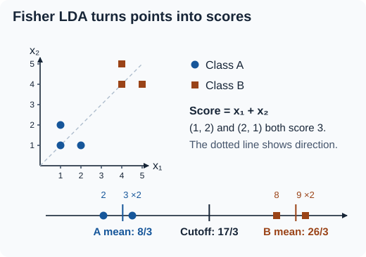

# Chapter 7. Classification and Clustering

[Contents](../readme.md)

**CT2 reading order:** §§7.1–7.6 cover the supplied Module 7 outline, including Lecture 29. Work through the calculations before the comparison tables. [CT2 guide and checklist](../CT2%20Guide.md).

## 7.1 Linear classification and logistic regression

A linear classifier uses the sign of $f(x)=w^Tx+b$. For $w\ne0$, the normal is $w$ and the signed distance to the boundary is $f(x)/\lVert w\rVert$. Logistic regression uses $p=\sigma(f(x))$, so the log-odds equal $f(x)$. Here the binary target is coded as $y\in\{0,1\}$. At probability threshold $0.5$, the boundary is $f(x)=0$. Linear regression predicts an unrestricted real value and commonly fits squared error.

For a Bernoulli target $y$, the likelihood of one example is $p^y(1-p)^{1-y}$. Its negative log is

$$
\ell=-y\ln p-(1-y)\ln(1-p).
$$

The gradients for a single example are $(p-y)x$ and $p-y$ with respect to $w$ and $b$. The optimizer fits both parameters and thereby learns the boundary. At $x=2,y=1,w=b=0$, $p=0.5$ and the gradients are $(-1,-0.5)$. One step at $\eta=0.1$ gives $(w,b)=(0.1,0.05)$ and shifts the one-dimensional boundary to $x=-0.5$.

At initialization $w=b=0$, all scores are zero and there is no unique separating boundary. After the stated update, solve $0.1x+0.05=0$ for $x=-0.5$. One example's update does not establish a useful boundary for the entire dataset. Batch training averages $(p_i-y_i)x_i$ and $p_i-y_i$ over the batch, then updates both parameters. A model $z=2x-7$ has boundary $x=3.5$; at $x=4.5$, $p=\sigma(2)=0.8808$. A linear regressor predicting marks might instead use $\hat m=10x+20$, giving 65 marks at 4.5 hours. The targets differ.

**Worked log-loss calculation.** For $(y,p)=(1,0.9),(0,0.2),(1,0.3)$, the losses are $0.1054,0.2231,1.2040$. Their mean is $0.5108$. The last example contributes the most because it gives the lowest probability to the correct class.

### Thresholds, features, and model selection

A threshold $\tau$ predicts positive when $p\ge\tau$, equivalent to a score threshold $\ln[\tau/(1-\tau)]$. Raising the threshold usually trades recall for precision. With false-positive cost $C_{\mathrm{FP}}$ and false-negative cost $C_{\mathrm{FN}}$, predict positive if a calibrated $p$ exceeds $C_{\mathrm{FP}}/(C_{\mathrm{FP}}+C_{\mathrm{FN}})$.

- **Interactions and nonlinear transforms:** Adding $x_1x_2$ or $x_1^2$ lets the boundary curve in the original coordinates while staying linear in the expanded features.
- **Regularization:** Tune penalty strength using validation or cross-validation. Scale inputs where the penalty or optimizer is sensitive to their units.
- **Multiple classes:** Softmax regression estimates one probability distribution over mutually exclusive classes. One-versus-rest fits separate binary classifiers.

## 7.2 Fisher LDA and Gaussian LDA

Fisher's linear discriminant projects classes to directions with large separation between class means and small scatter within classes. Compute each class mean $\mu_k$ and scatter $S_k=\sum_{x\in k}(x-\mu_k)(x-\mu_k)^T$. With $S_W=S_A+S_B$ and $d=\mu_B-\mu_A$,

$$
J(w)=\frac{(w^Td)^2}{w^TS_Ww},\qquad w\propto S_W^{-1}d
$$

when $S_W$ is invertible. The solution is a direction. Scaling it by a positive constant scales the projected scores and the decision threshold together. The multiclass version uses generalized eigenvectors and at most $C-1$ discriminant directions for $C$ classes.

**Worked Fisher projection.** Take $A=\{(1,1),(2,1),(1,2)\}$ and $B=\{(4,4),(5,4),(4,5)\}$. The means are $(4/3,4/3)$ and $(13/3,13/3)$. Each class scatter has diagonal $2/3$ and off-diagonal $-1/3$. For class A the deviations are $(-1,-1)/3$, $(2,-1)/3$, and $(-1,2)/3$. Sum their outer products to obtain $S_A$.

$$
S_A=\frac19\left[
\begin{pmatrix}1&1\\1&1\end{pmatrix}+
\begin{pmatrix}4&-2\\-2&1\end{pmatrix}+
\begin{pmatrix}1&-2\\-2&4\end{pmatrix}
\right]=
\begin{pmatrix}2/3&-1/3\\-1/3&2/3\end{pmatrix}.
$$

B is a translation of A, so $S_B=S_A$.

$$
S_W=\begin{bmatrix}4/3&-2/3\\-2/3&4/3\end{bmatrix},
\qquad
S_W^{-1}d=\begin{bmatrix}4.5\\4.5\end{bmatrix}.
$$

Use the equivalent direction $(1,1)$. The projected means are $8/3$ and $26/3$. With equal priors and equal projected variances, the midpoint threshold is $17/3$. Predict B when $x_1+x_2>17/3$.

Different points can receive the same score. The bottom axis shows the sum $x_1+x_2$, so the midpoint of the two class means is $17/3$.

Gaussian LDA models each class with a Gaussian mean, a shared covariance $\Sigma$, and prior $\pi_k$. It selects the largest score $x^T\Sigma^{-1}\mu_k-\frac12\mu_k^T\Sigma^{-1}\mu_k+\log\pi_k$. The common quadratic term cancels, producing linear boundaries. Unequal priors can shift the threshold.

### How LDA compares with nearby methods

| Method | What it uses | What to watch |
|---|---|---|
| PCA | Unlabeled feature variance | A high-variance direction may not separate classes. |
| Fisher LDA | Labels and within-class versus between-class scatter | Center points at their own class means for $S_W$. If $S_W$ is singular, consider shrinkage or reducing dimension. |
| Gaussian LDA | Class means, priors, and shared covariance | Unequal priors move the boundary. Class-specific covariances generally give a quadratic boundary. |
| Logistic regression | Conditional class probability fitted directly | Does not require Gaussian features. It assumes linear log-odds in the chosen features. |
| Least-squares discriminant | Fits numeric class codes and classifies using the fitted scores | Squared error treats deviations in class codes as numeric residuals. Scores need not be probabilities. |

For $C$ classes, define $S_B=\sum_k n_k(\mu_k-\mu)(\mu_k-\mu)^T$. Fisher directions solve $S_Bw=\lambda S_Ww$. Select directions with large generalized eigenvalues. The rank of $S_B$ is at most $C-1$.

### Fisher direction derivation

Let $d=\mu_B-\mu_A$ and use $S_{\rm between}=dd^T$ up to a positive constant. This avoids confusing between-class scatter with the class-B scatter matrix also denoted $S_B$ above. Since Fisher's ratio is unchanged by rescaling $w$, maximize $(w^Td)^2$ subject to $w^TS_Ww=1$. With multiplier $\lambda$,

$$
\mathcal L=(w^Td)^2-\lambda(w^TS_Ww-1),\qquad
\nabla_w\mathcal L=2dd^Tw-2\lambda S_Ww=0.
$$

Thus $(w^Td)d=\lambda S_Ww$, so a nondegenerate solution has $w\propto S_W^{-1}d$ when $S_W$ is invertible. Large within-class variation reduces a direction's usefulness. For $S_W=\operatorname{diag}(100,1)$ and $d=(1,1)^T$, $w\propto(0.01,1)^T$: the noisy first coordinate receives less weight.

For the worked example,

$$
S_W^{-1}=\begin{bmatrix}1&1/2\\1/2&1\end{bmatrix},\quad
S_W^{-1}(3,3)^T=(4.5,4.5)^T.
$$

With direction $(1,1)$, class A projects to $(2,3,3)$ and B to $(8,9,9)$. The midpoint of their means is $17/3$. A new point $(2,3)$ scores 5 and is assigned A. A valid separating hyperplane such as $x_1+x_2=6$, an LDA threshold $17/3$, and an SVM boundary 5.5 can all separate these training points while coming from different selection rules.

## 7.3 Support vector machines

The SVM convention here uses labels $y_i\in\{-1,+1\}$. The score $f(x)$ determines the side of the boundary. The product $y_if(x_i)$ is the signed score relative to the true label.

| Model | Objective and constraints |
|---|---|
| Hard margin | Minimize $\frac12\lVert w\rVert^2$ with $y_i(w^Tx_i+b)\ge1$ |
| Soft margin | Minimize $\frac12\lVert w\rVert^2+C\sum_i\xi_i$ with $y_i(w^Tx_i+b)\ge1-\xi_i,\;\xi_i\ge0$ |

To derive the width, move a distance $d$ along the unit normal $w/\lVert w\rVert$. The score increases by $d\lVert w\rVert$. Going from $f(x)=-1$ to $f(x)=1$ requires a score change of 2, hence $d=2/\lVert w\rVert$. Maximizing that distance gives the hard-margin objective.

For soft margin, the smallest feasible slack is $\xi_i=\max(0,1-y_if(x_i))$, the hinge loss. If $y_if(x_i)=0.4$, the point is correctly classified but incurs slack $0.6$. If $y_if(x_i)=-0.4$, the point is misclassified and incurs slack $1.4$. Larger $C$ penalizes violations more strongly.

**Worked maximum-margin boundary.** Two apples lie at $(1,2)$ and $(2,1)$, and the nearest orange is at $(4,4)$. The apple hull touches the margin on the segment joining those apples. The nearest point on that segment to the orange is $(1.5,1.5)$. The line between these two hull points has direction $(1,1)$, so write $w=(a,a)$. The margin equations are $3a+b=-1$ and $8a+b=1$. Subtracting gives $a=0.4$ and then $b=-2.2$.

The center line is $x_1+x_2=5.5$. The margin lines are $x_1+x_2=3$ and $x_1+x_2=8$, and their separation is $2/\sqrt{0.32}\approx3.54$. In general, solve the constrained optimization. In the dual solution, points with positive multipliers $\alpha_i$ are support vectors and contribute to $w=\sum_i\alpha_i y_ix_i$.

The arrow spans the two margin lines along the direction of $w$. The center line lies halfway between them.

A kernel evaluates a feature-space inner product without explicitly constructing the feature vector. Prediction uses $f(x)=\sum_i\alpha_i y_i K(x_i,x)+b$. An RBF kernel is $K(x,z)=\exp(-\gamma\lVert x-z\rVert^2)$. Use $\gamma>0$ for the RBF kernel. Its decision boundary can be curved in the original space. Soft margin can also be used with a kernel.

**Worked nonlinear boundary.** For XOR, map $(x_1,x_2)$ to $(x_1,x_2,x_1x_2)$. The linear score in this space is $2x_1+2x_2-4x_1x_2-1$. It gives $(-1,+1,+1,-1)$ on $(0,0),(1,0),(0,1),(1,1)$. The interaction term changes the score only when both inputs are 1, which a linear score on the original inputs cannot do.

### Full mapped XOR derivation and KKT verification

Take $(0,0),(0,1),(1,0),(1,1)$ with labels $(-1,+1,+1,-1)$ and map to $z=(x_1,x_2,x_1x_2)$. Hard-margin feasibility gives

$$
b\le-1,\quad w_2+b\ge1,\quad w_1+b\ge1,\quad w_1+w_2+w_3+b\le-1.
$$

Use the Lagrangian

$$
\mathcal L=\frac12(w_1^2+w_2^2+w_3^2)
+\alpha_1(1+b)+\alpha_2(1-w_2-b)
+\alpha_3(1-w_1-b)+\alpha_4(1+w_1+w_2+w_3+b).
$$

The first term is $\alpha_1(1+b)$; the saved teacher chat prints $\alpha_1(b-1)$ there, which does not represent the first constraint. Stationarity gives

$$
w_1=\alpha_3-\alpha_4,\quad w_2=\alpha_2-\alpha_4,\quad
w_3=-\alpha_4,\quad \alpha_1-\alpha_2-\alpha_3+\alpha_4=0.
$$

Try the candidate with all four constraints tight: $b=-1$, $w_1=w_2=2$, $w_3=-4$. The stationarity equations give $\alpha_4=4$, $\alpha_2=\alpha_3=6$, $\alpha_1=8$. Verify rather than assume optimality:

- All constraints hold with equality, and all multipliers are nonnegative.
- Stationarity holds, including $-8+6+6-4=0$, the sum $\sum_i\alpha_i y_i$.
- Complementary slackness $\alpha_i[1-y_if(z_i)]=0$ holds for every point.

These KKT conditions certify the optimum of the convex hard-margin problem. The resulting function is $f(x)=2x_1+2x_2-4x_1x_2-1$, with scores $(-1,+1,+1,-1)$. Margin width is $2/\sqrt{2^2+2^2+(-4)^2}=2/\sqrt{24}=0.40825$ in this feature space. Using a different feature scaling or kernel changes that geometry.

### Common kernels and a prediction calculation

| Kernel | Formula and interpretation |
|---|---|
| Linear | $K(x,z)=x^Tz$ |
| Polynomial | $K(x,z)=(\gamma x^Tz+r)^d$; common valid choices use integer $d\ge1$ and $\gamma,r\ge0$ |
| RBF | $K(x,z)=e^{-\gamma\|x-z\|^2}$, $\gamma>0$ |
| Sigmoid | $K(x,z)=\tanh(\gamma x^Tz+r)$; validity depends on parameters and the input domain |

For illustrative support points $x_1=0,y_1=-1$, $x_2=2,y_2=+1$, coefficients $\alpha_1=\alpha_2=1$, bias 0 and RBF $\gamma=1$, the score at $x=1.5$ is $-e^{-2.25}+e^{-0.25}\approx0.67340$, predicting +1. Coefficients and bias are supplied for this inference exercise; training must solve the optimization to learn them. The raw score is not a class probability.

Soft margin permits margin violations. A nonlinear feature map or kernel permits a nonlinear boundary in the original coordinates. For concentric data, adding $z_3=x_1^2+x_2^2$ makes a circular boundary $x_1^2+x_2^2=R^2$ a plane $z_3=R^2$. Keep radius and squared-radius thresholds consistent.

### Training and interpreting SVMs

The soft-margin objective equals a squared weight penalty plus $C$ times the sum of hinge losses. For a point with $y_if(x_i)<1$, the hinge subgradient with respect to $w$ is $-y_ix_i$. For $y_if(x_i)>1$ it is zero. At equality, either endpoint or a convex combination is valid. Include the regularizer’s gradient when updating the weights.

The dual chooses multipliers with $\alpha_i\ge0$ and $\sum_i\alpha_i y_i=0$. The soft-margin case adds $\alpha_i\le C$. It uses only inner products, which the kernel replaces. For a soft-margin support vector with $0<\alpha_i<C$, solve $y_if(x_i)=1$ to recover the bias. A support vector at the upper bound can lie inside the margin.

Written explicitly, the dual maximizes $\sum_i\alpha_i-\frac12\sum_{i,j}\alpha_i\alpha_jy_iy_jK(x_i,x_j)$ under the constraints above. For a linear kernel, the fitted normal is $\sum_i\alpha_i y_ix_i$. For a nonlinear kernel, evaluate the score using the support vectors. Examples with $\alpha_i=0$ do not contribute to this score.

| Decision | How to make it |
|---|---|
| Tune $C$ and RBF $\gamma$ | Use validation after scaling. Large $\gamma$ makes similarity fall off quickly. Large $C$ makes violations more expensive. |
| Extend to several classes | Fit one-versus-rest models or one-versus-one pairwise models and combine their scores or votes. |
| Estimate probabilities | The raw margin is a score. Platt scaling fits a sigmoid to out-of-sample scores so the resulting probability can be evaluated for calibration. |
| Compare feature subsets | Tune the feature selection and SVM together. For a linear model on comparable scales, coefficients can help rank features. Evaluate the selected subset on held-out data. |

## 7.4 K nearest neighbors

KNN is a supervised lazy learner. Store labeled training data; for a query, calculate distances, sort, take the K nearest and vote. Lazy means that most prediction work is deferred until a query arrives. Small K can be sensitive to noise; very large K can blur local class structure. Choose K with validation and scale numeric features when units differ.

$$
d_E(x,z)=\sqrt{\sum_j(x_j-z_j)^2},\quad d_M(x,z)=\sum_j|x_j-z_j|,
$$

$$
d_p(x,z)=\left(\sum_j|x_j-z_j|^p\right)^{1/p}\quad(p\ge1).
$$

Minkowski with $p=1$ is Manhattan and $p=2$ is Euclidean. Hamming counts mismatched categorical/binary coordinates. Odd K avoids an unweighted two-class vote tie, but not every multiclass or distance tie; state a tie rule if needed.

**Worked KNN prediction.** Query $q=(1,1)$, with training points:

| Point | Label | Squared Euclidean distance to q |
|---|---|---:|
| $(0,0)$ | A | 2 |
| $(0,2)$ | A | 2 |
| $(2,0)$ | A | 2 |
| $(5,5)$ | B | 32 |
| $(6,5)$ | B | 41 |
| $(5,6)$ | B | 41 |

Taking square roots does not change distance order. At K=3 all neighbors vote A. At K=6 the vote ties 3–3, so another rule is required. Distance calculation alone is not the final answer: name the selected neighbors and predicted class.

## 7.5 K means clustering

K-means groups unlabeled points into K clusters. Initialize centers, assign each point to its nearest center using squared Euclidean distance, recompute each center as the assigned points' arithmetic mean, and repeat. Stop when assignments stabilize, center changes become small or an iteration limit is reached.

$$
\mu_k=\frac1{|C_k|}\sum_{x\in C_k}x,\qquad
J=\operatorname{WCSS}=\sum_k\sum_{x\in C_k}\|x-\mu_k\|^2.
$$

Each standard assignment/mean-update cycle cannot increase this objective, but it can settle at a local solution. Initialization, K, feature scaling and outliers matter. An empty cluster needs a stated reinitialization rule. KNN's K counts neighbors; K-means' K counts clusters.

**Worked two-iteration calculation.** Use the six points from the KNN example without labels. Start at $\mu_1=(0,0)$, $\mu_2=(5,5)$:

| Point | Squared distance to initial center 1 | Squared distance to initial center 2 | Assignment |
|---|---:|---:|---|
| $(0,0)$ | 0 | 50 | 1 |
| $(0,2)$ | 4 | 34 | 1 |
| $(2,0)$ | 4 | 34 | 1 |
| $(5,5)$ | 50 | 0 | 2 |
| $(6,5)$ | 61 | 1 | 2 |
| $(5,6)$ | 61 | 1 | 2 |

Update to $\mu_1=(2/3,2/3)$ and $\mu_2=(16/3,16/3)$. In the next assignment pass:

| Point | Squared distance to updated center 1 | Squared distance to updated center 2 | Assignment |
|---|---:|---:|---|
| $(0,0)$ | $8/9$ | $512/9$ | 1 |
| $(0,2)$ | $20/9$ | $356/9$ | 1 |
| $(2,0)$ | $20/9$ | $356/9$ | 1 |
| $(5,5)$ | $338/9$ | $2/9$ | 2 |
| $(6,5)$ | $425/9$ | $5/9$ | 2 |
| $(5,6)$ | $425/9$ | $5/9$ | 2 |

Assignments are unchanged, so the next mean update leaves both centers unchanged. Final WCSS is $(8+20+20)/9+(2+5+5)/9=20/3\approx6.6667$. Initial WCSS was $4+4+1+1=10$. Use squared distances for WCSS, not ordinary distances.

## 7.6 Decision trees

A decision tree tests features at internal nodes and predicts at leaves. Training chooses splits that improve class purity; prediction follows the query's feature values from root to leaf. ID3 chooses the largest information gain. For class proportions $p_c$:

$$
H(S)=-\sum_c p_c\log_2p_c,\quad
IG(S,A)=H(S)-\sum_v\frac{|S_v|}{|S|}H(S_v).
$$

Treat $0\log_2 0$ as zero. Pure nodes have entropy zero. Use base-2 logs for entropy, and weight child entropies by child sizes.

**Worked root selection.** Ten examples have seven Yes and three No labels, so $H(S)=-0.7\log_2 0.7-0.3\log_2 0.3=0.88129$ bits.

| Candidate | Child label counts | Weighted child entropy | Information gain |
|---|---|---:|---:|
| A | $(4Y,0N)$ and $(3Y,3N)$ | $(4/10)0+(6/10)1=0.6$ | 0.28129 |
| B | $(5Y,0N)$ and $(2Y,3N)$ | $(5/10)0+(5/10)0.97095=0.48548$ | 0.39582 |

Choose B. Its first branch is a Yes leaf. The second branch remains mixed, so examine remaining attributes on that subset. For a concrete continuation, suppose a remaining binary feature C separates that subset into $(2Y,0N)$ for C=1 and $(0Y,3N)$ for C=0. Both leaves are pure; the final rules are: first B branch → Yes; second B branch with C=1 → Yes; second B branch with C=0 → No. The C counts are supplied for this illustrative continuation, not inferred from the root table. A new example taking the second B branch and C=0 is classified No.

Other split criteria are

$$
\operatorname{Gini}(S)=1-\sum_c p_c^2,\quad
\operatorname{SplitInfo}(A)=-\sum_v\frac{|S_v|}{|S|}\log_2\frac{|S_v|}{|S|},
$$

$$
\operatorname{GainRatio}(A)=\frac{IG(S,A)}{\operatorname{SplitInfo}(A)}
$$

when split information is nonzero. Parent Gini is $1-0.7^2-0.3^2=0.42$. Weighted Gini after A is 0.30 and after B is 0.24, so their reductions are 0.12 and 0.18. A's split information is 0.97095 and B's is 1, giving gain ratios about 0.28971 and 0.39582. Information gain can favor attributes with many outcomes; gain ratio adjusts by split information. Actual tree algorithms can apply additional selection rules.

A deep tree can memorize training examples. Pre-pruning limits depth, minimum leaf size or split improvement; post-pruning removes branches when their complexity does not improve validation performance. Numeric features may use tests such as $x\le t$. Trees do not require Euclidean feature scaling for their split tests.

## Practice

- **7A.** For $z=\ln3$ and target 0, calculate the logistic probability and loss.
- **7B.** Reproduce the two scatter matrices in the Fisher example. Explain why changing the sign of $w$ reverses the threshold inequality.
- **7C.** For $f(x)=3x_1+4x_2-2$ in canonical SVM scaling, give the unit normal, both margin equations, and total width.
- **7D.** Redo the KNN vote and K-means tables with the query changed to $(4,4)$. Keep clustering data and initial centers unchanged.
- **7E.** Recompute the decision-tree gains, then trace an example taking the second B branch with C=1.
- **7F.** Write and verify all four mapped XOR KKT conditions.

## Answer checks

| Exercise | Answer |
|---|---|
| 7A | $p=0.75$, so $L=-\ln(1-0.75)\approx1.3863$. |
| 7B | Both class scatter matrices have diagonal $2/3$ and off-diagonal $-1/3$. Negating $w$ and the threshold negates both sides of the comparison, reversing the inequality. |
| 7C | Unit normal $(3/5,4/5)$. The margins are $3x_1+4x_2-2=\pm1$. Full width $2/5$. |
| 7D | KNN predicts B; K-means is unchanged because its input data and centers are unchanged. Final WCSS is $20/3$. |
| 7E | Choose B, then C=1 predicts Yes in the illustrative continuation. |
| 7F | The XOR example gives $w=(2,2,-4),b=-1$, multipliers $(8,6,6,4)$; all margins equal 1 and KKT holds. |

[Chapter sources](../readme.md#7-classification-and-clustering)

---

[← Chapter 6](../06%20-%20Deep%20Learning/Deep%20Learning.md) · [Contents](../readme.md) · [Chapter 8 →](../08%20-%20Reinforcement%20Learning/Reinforcement%20Learning.md)
