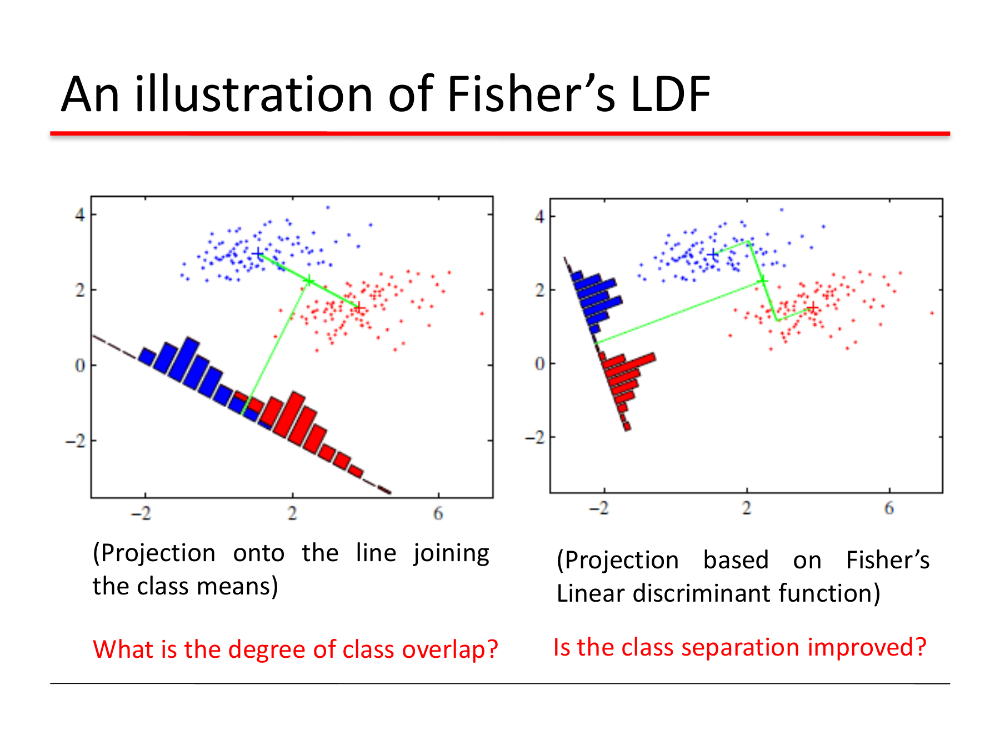
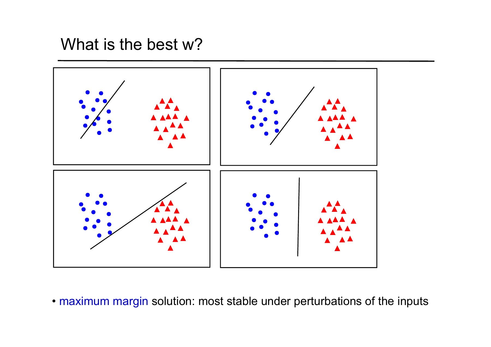
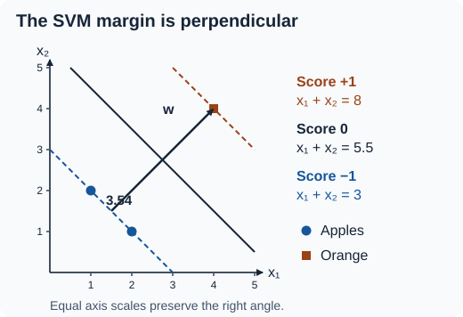
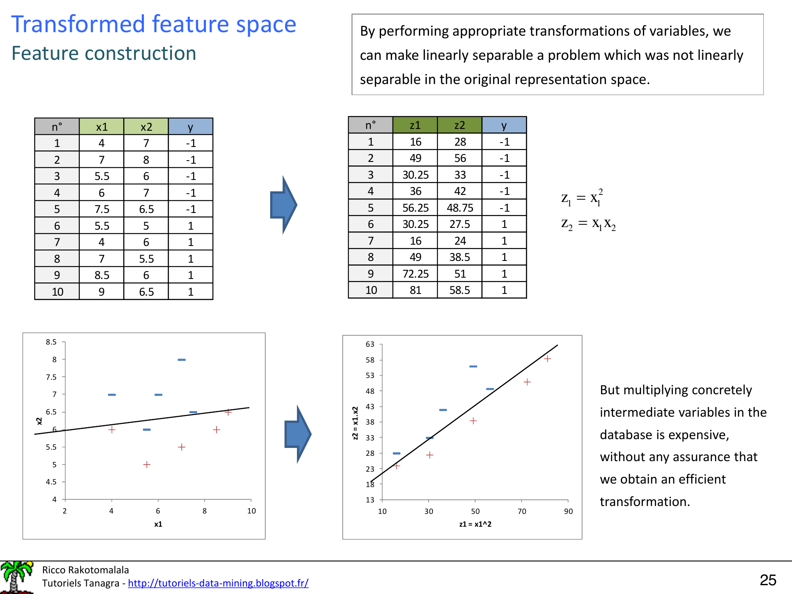
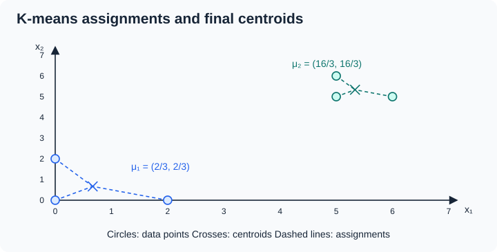
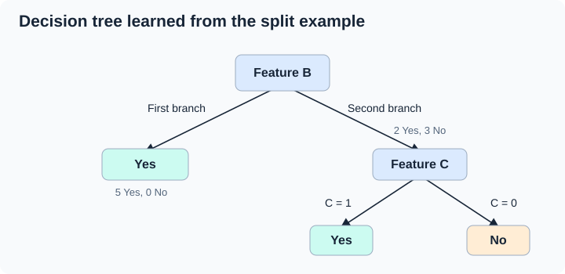

# Chapter 7. Classification and Clustering

[Contents](../readme.md)

[Logistic regression](#71-linear-classification-and-logistic-regression) · [LDA](#72-fisher-lda-and-gaussian-lda) · [SVM](#73-support-vector-machines) · [KNN](#74-k-nearest-neighbors) · [K-means](#75-k-means-clustering) · [Trees](#76-decision-trees) · [Exercises](#exercises)

Examples are represented by **features**, such as study hours and attendance. In **supervised learning**, examples also have known targets $y$: classification predicts a category, whereas regression predicts a numerical quantity. **Clustering** instead groups unlabeled examples by similarity.

A linear score $w^Tx+b$ combines the features using learned weights and a bias. For example, $w=(1,0.5)$, $x=(2,3)$ and $b=-2$ give score $2+1.5-2=1.5$. Training learns weights from examples; prediction applies the learned rule to new inputs.

## 7.1 Linear classification and logistic regression

A **decision boundary** separates predicted classes. A weighted sum changes sign at $w^Tx+b=0$: this is a point in one dimension, a line in two, a plane in three and a **hyperplane** in higher dimensions. The vector $w$ points perpendicular to that boundary. Its length, or norm, is $\|w\|=\sqrt{\sum_jw_j^2}$. Data are linearly separable when some such boundary separates the classes without mistakes.

**From score to prediction**

| Model | Output | Decision rule |
|---|---|---|
| Linear classifier | $f(x)=w^Tx+b$ | Use the score's sign. |
| Logistic regression | $p=\sigma(f(x))$ | Predict class 1 at $p\ge0.5$; labels are $0/1$. |
| Linear regression | Unrestricted real-valued prediction | Fit a numeric target, commonly with squared loss. |

For $w\ne0$, signed distance from the boundary is $f(x)/\|w\|$. Logistic regression has linear log-odds and boundary $f(x)=0$ at threshold 0.5.

Logistic regression turns a score into a probability with sigmoid, $\sigma(z)=1/(1+e^{-z})$. Score 0 gives probability 0.5, so thresholding at 0.5 uses the same zero-score boundary. A **Bernoulli target** has two values, 0 and 1. The probability assigned to the observed answer is $p$ when $y=1$ and $1-p$ when $y=0$.

Multiplying these probabilities across examples gives their likelihood; training seeks a large likelihood. Taking its negative logarithm produces an additive loss and heavily penalizes confidently wrong answers.

For a Bernoulli target $y$, the likelihood of one example is $p^y(1-p)^{1-y}$. Its negative log is

$$
\ell=-y\ln p-(1-y)\ln(1-p).
$$

### Worked example Logistic learning

For one logistic example, differentiating sigmoid and log loss gives $(p-y)x$ for $w$ and $p-y$ for $b$. Gradient descent subtracts the gradient times a positive learning rate $\eta$. The optimizer fits both parameters and thereby learns the boundary. At $x=2,y=1,w=b=0$, $p=0.5$ and the gradients are $(-1,-0.5)$. One step at $\eta=0.1$ gives $(w,b)=(0.1,0.05)$ and shifts the one-dimensional boundary to $x=-0.5$.

At $w=b=0$, every point has score zero. The first update produces a boundary but need not separate the full dataset. Batch training averages both parameter gradients over the current batch. A model $z=2x-7$ has boundary $x=3.5$; at $x=4.5$, $p=\sigma(2)=0.8808$. A linear regressor predicting marks might instead use $\hat m=10x+20$, giving 65 marks at 4.5 hours. The targets differ.

**Log loss**

| Target $y$ | Predicted probability $p$ | Loss |
|---:|---:|---:|
| 1 | 0.9 | 0.1054 |
| 0 | 0.2 | 0.2231 |
| 1 | 0.3 | 1.2040 |

Mean loss is **0.5108**. The last prediction contributes most because it assigns the lowest probability to the correct class.

### Thresholds, features, and model selection

A threshold $\tau$ predicts positive when $p\ge\tau$, equivalent to a score threshold $\ln[\tau/(1-\tau)]$. Raising the threshold usually trades recall for precision. With false-positive cost $C_{\mathrm{FP}}$ and false-negative cost $C_{\mathrm{FN}}$, predict positive if a calibrated $p$ exceeds $C_{\mathrm{FP}}/(C_{\mathrm{FP}}+C_{\mathrm{FN}})$.

- **Interactions and nonlinear transforms:** Adding $x_1x_2$ or $x_1^2$ lets the boundary curve in the original coordinates while staying linear in the expanded features.
- **Regularization:** Tune penalty strength using validation or cross-validation. Scale inputs where the penalty or optimizer is sensitive to their units.
- **Multiple classes:** Softmax regression estimates one probability distribution over mutually exclusive classes. One-versus-rest fits separate binary classifiers.

## 7.2 Fisher LDA and Gaussian LDA

Two classes may overlap when viewed along one feature but separate when features are combined. **Projection** replaces a point $x$ by one number $z=w^Tx$: for $w=(1,1)$, point $(2,3)$ becomes 5. LDA chooses a direction that keeps class centers far apart while keeping each class's projected points tightly grouped.

Fisher's linear discriminant projects classes to directions with large separation between class means and small scatter within classes. Compute each class mean $\mu_k$ and scatter $S_k=\sum_{x\in k}(x-\mu_k)(x-\mu_k)^T$. With $S_W=S_A+S_B$ and $d=\mu_B-\mu_A$,

$$
J(w)=\frac{(w^Td)^2}{w^TS_Ww},\qquad w\propto S_W^{-1}d
$$

when $S_W$ is invertible. The solution is a direction. Scaling it by a positive constant scales the projected scores and the decision threshold together. The multiclass version uses generalized eigenvectors and at most $C-1$ discriminant directions for $C$ classes.

**Reading Fisher's criterion**

- **Class mean:** $\mu_k$ is the coordinatewise average.
- **Within-class scatter:** deviations from that mean measure spread. In $(x-\mu_k)(x-\mu_k)^T$, diagonal entries are squared deviations; off-diagonal entries capture joint variation.
- **Numerator of $J(w)$:** squared separation of projected means.
- **Denominator:** projected within-class scatter.

A larger ratio indicates cleaner separation.

The inverse $S_W^{-1}$ compensates for spread and dependence between features. For a diagonal scatter matrix, it divides each mean difference by the corresponding scatter. The general matrix operation also accounts for features varying together.

*Fisher projection accounts for within-class scatter, reducing overlap that remains when projecting along the line between class means.*

### Fisher direction derivation

Let $d=\mu_B-\mu_A$ and use $S_{\rm between}=dd^T$ up to a positive constant. Since Fisher's ratio is unchanged by rescaling $w$, maximize $(w^Td)^2$ subject to $w^TS_Ww=1$. A Lagrange multiplier $\lambda$ incorporates that constraint into an expression that can be differentiated:

$$
\mathcal L=(w^Td)^2-\lambda(w^TS_Ww-1),\qquad
\nabla_w\mathcal L=2dd^Tw-2\lambda S_Ww=0.
$$

Thus $(w^Td)d=\lambda S_Ww$, so a nondegenerate solution has $w\propto S_W^{-1}d$ when $S_W$ is invertible. Large within-class variation reduces a direction's usefulness. For $S_W=\operatorname{diag}(100,1)$ and $d=(1,1)^T$, $w\propto(0.01,1)^T$: the noisy first coordinate receives less weight.

**Worked Fisher projection.** Take $A=\{(1,1),(2,1),(1,2)\}$ and $B=\{(4,4),(5,4),(4,5)\}$. The means are $(4/3,4/3)$ and $(13/3,13/3)$. Each class scatter has diagonal $2/3$ and off-diagonal $-1/3$. For class A the deviations are $(-1,-1)/3$, $(2,-1)/3$, and $(-1,2)/3$. Sum their outer products to obtain $S_A$.

$$
S_A=\frac19\left[
\begin{pmatrix}1&1\\1&1\end{pmatrix}+
\begin{pmatrix}4&-2\\-2&1\end{pmatrix}+
\begin{pmatrix}1&-2\\-2&4\end{pmatrix}
\right]=
\begin{pmatrix}2/3&-1/3\\-1/3&2/3\end{pmatrix}.
$$

B is a translation of A, so $S_B=S_A$.

$$
S_W=\begin{bmatrix}4/3&-2/3\\-2/3&4/3\end{bmatrix}.
$$

Inverting $S_W$ and applying it to the mean difference gives

$$
S_W^{-1}=\begin{bmatrix}1&1/2\\1/2&1\end{bmatrix},\quad
S_W^{-1}(3,3)^T=(4.5,4.5)^T.
$$

Use the equivalent direction $(1,1)$. The projected means are $8/3$ and $26/3$. With equal priors and equal projected variances, the midpoint threshold is $17/3$. Predict B when $x_1+x_2>17/3$.

**Projection results**

| Quantity | Result |
|---|---|
| Class A scores | $(2,3,3)$ |
| Class B scores | $(8,9,9)$ |
| New point $(2,3)$ | Score 5 → class A |

The boundaries $x_1+x_2=6$ (a valid separator), $17/3$ (this LDA threshold) and 5.5 (the SVM solution) all separate the training points. Their selection rules differ.

Gaussian LDA models each class with a Gaussian mean, a shared covariance $\Sigma$, and prior $\pi_k$. It selects the largest score $x^T\Sigma^{-1}\mu_k-\frac12\mu_k^T\Sigma^{-1}\mu_k+\log\pi_k$. The common quadratic term cancels, producing linear boundaries. Unequal priors can shift the threshold.

### Comparison with related methods

| Method | Basis | Interpretation |
|---|---|---|
| PCA | Unlabeled feature variance | A high-variance direction may not separate classes. |
| Fisher LDA | Labels and within-class versus between-class scatter | Center points at their own class means for $S_W$. If $S_W$ is singular, consider shrinkage or reducing dimension. |
| Gaussian LDA | Class means, priors, and shared covariance | Unequal priors move the boundary. Class-specific covariances generally give a quadratic boundary. |
| Logistic regression | Conditional class probability fitted directly | Does not require Gaussian features. It assumes linear log-odds in the chosen features. |
| Least-squares discriminant | Fits numeric class codes and classifies using the fitted scores | Squared error treats deviations in class codes as numeric residuals. Scores need not be probabilities. |

For $C$ classes, define $S_{\rm between}=\sum_k n_k(\mu_k-\mu)(\mu_k-\mu)^T$. Fisher directions solve $S_{\rm between}w=\lambda S_Ww$; the largest eigenvalues select the directions. The rank is at most $C-1$.

## 7.3 Support vector machines

Many lines may separate two classes. A **support vector machine** chooses the separator with the widest clear gap to the nearest training points. This **margin** makes the decision less sensitive to small input changes. The points that determine the fitted separator are **support vectors**. Hard margin requires perfect separation; soft margin allows violations at a cost.

The SVM convention here uses labels $y_i\in\{-1,+1\}$. The score $f(x)$ determines the side of the boundary. The product $y_if(x_i)$ is the signed score relative to the true label.

Multiplying all score parameters by a positive constant leaves the class predictions unchanged. SVM fixes that arbitrary scaling by placing the margin planes at scores $+1$ and $-1$. Then $y_if(x_i)\ge1$ means example $i$ is on the correct side and beyond its margin. The objective $\frac12\|w\|^2$ is the quantity minimized; the constraints state which solutions are allowed. In soft margin, $\xi_i\ge0$ records a shortfall from the margin and $C>0$ sets its cost.

*Compare the candidate boundaries: maximum margin favors the separator with the largest minimum distance to the training points.*

| Model | Objective and constraints |
|---|---|
| Hard margin | Minimize $\frac12\lVert w\rVert^2$ with $y_i(w^Tx_i+b)\ge1$ |
| Soft margin | Minimize $\frac12\lVert w\rVert^2+C\sum_i\xi_i$ with $y_i(w^Tx_i+b)\ge1-\xi_i,\;\xi_i\ge0$ |

To derive the width, move a distance $d$ along the unit normal $w/\lVert w\rVert$. The score increases by $d\lVert w\rVert$. Going from $f(x)=-1$ to $f(x)=1$ requires a score change of 2, hence $d=2/\lVert w\rVert$. Maximizing that distance gives the hard-margin objective.

For soft margin, the smallest feasible slack is $\xi_i=\max(0,1-y_if(x_i))$, the hinge loss. If $y_if(x_i)=0.4$, the point is correctly classified but incurs slack $0.6$. If $y_if(x_i)=-0.4$, the point is misclassified and incurs slack $1.4$. Larger $C$ penalizes violations more strongly.

**Worked maximum-margin boundary.** Two apples lie at $(1,2)$ and $(2,1)$, and the nearest orange is at $(4,4)$. The apple hull touches the margin on the segment joining those apples. The nearest point on that segment to the orange is $(1.5,1.5)$. The line between these two hull points has direction $(1,1)$, so write $w=(a,a)$. The margin equations are $3a+b=-1$ and $8a+b=1$. Subtracting gives $a=0.4$ and then $b=-2.2$.

The center line is $x_1+x_2=5.5$. The margin lines are $x_1+x_2=3$ and $x_1+x_2=8$, and their separation is $2/\sqrt{0.32}\approx3.54$. In general, solve the constrained optimization. In the dual solution, points with positive multipliers $\alpha_i$ are support vectors and contribute to $w=\sum_i\alpha_i y_ix_i$.

The arrow spans the two margin lines along the direction of $w$. The center line lies halfway between them.

A curved pattern can become separable after adding useful features. For example, $(x_1,x_2)$ may be expanded to $\phi(x)=(x_1,x_2,x_1x_2)$, using a feature map $\phi$. Kernel methods calculate the transformed dot product directly, often avoiding a large explicit feature vector.

A kernel evaluates a feature-space inner product without explicitly constructing the feature vector. Prediction uses $f(x)=\sum_i\alpha_i y_i K(x_i,x)+b$. An RBF kernel is $K(x,z)=\exp(-\gamma\lVert x-z\rVert^2)$. Use $\gamma>0$ for the RBF kernel. Its decision boundary can be curved in the original space. Soft margin can also be used with a kernel.

*This separate example uses z₁ = x₁² and z₂ = x₁x₂. Its transformed coordinates allow a linear separator; the XOR example below uses a different map.*

### Worked example Mapped XOR

Take $(0,0),(0,1),(1,0),(1,1)$ with labels $(-1,+1,+1,-1)$ and map to $z=(x_1,x_2,x_1x_2)$. Hard-margin feasibility gives

$$
b\le-1,\quad w_2+b\ge1,\quad w_1+b\ge1,\quad w_1+w_2+w_3+b\le-1.
$$

XOR assigns opposite-corner points to the same class. The added product is 1 only at $(1,1)$, allowing that corner's score to change independently of the other three. Each inequality above comes from substituting one labeled point into $y_if(x_i)\ge1$.

**Constrained optimization.** Introduce nonnegative Lagrange multipliers $\alpha_i$, one per constraint. The Lagrangian combines the objective with those weighted constraints.

| KKT condition | Required check |
|---|---|
| Stationarity | Lagrangian derivatives are zero. |
| Primal feasibility | Original constraints are satisfied. |
| Dual feasibility | Multipliers are nonnegative. |
| Complementary slackness | Each multiplier–constraint product is zero. |

A nonzero multiplier therefore requires a tight margin constraint.

Use the Lagrangian

$$
\begin{aligned}
\mathcal L={}&\frac12(w_1^2+w_2^2+w_3^2)\\
&+\alpha_1(1+b)+\alpha_2(1-w_2-b)\\
&+\alpha_3(1-w_1-b)+\alpha_4(1+w_1+w_2+w_3+b).
\end{aligned}
$$

Stationarity gives

$$
\begin{aligned}
w_1&=\alpha_3-\alpha_4, & w_2&=\alpha_2-\alpha_4,\\
w_3&=-\alpha_4, & \alpha_1-\alpha_2-\alpha_3+\alpha_4&=0.
\end{aligned}
$$

Setting all four constraints to equality gives the candidate $b=-1$, $w_1=w_2=2$, $w_3=-4$. The stationarity equations give $\alpha_4=4$, $\alpha_2=\alpha_3=6$, $\alpha_1=8$. The candidate satisfies the KKT conditions:

- All constraints hold with equality, and all multipliers are nonnegative.
- Stationarity holds, including $-8+6+6-4=0$, the sum $\sum_i\alpha_i y_i$.
- Complementary slackness $\alpha_i[1-y_if(z_i)]=0$ holds for every point.

These KKT conditions certify the optimum of the convex hard-margin problem. The resulting function is $f(x)=2x_1+2x_2-4x_1x_2-1$, with scores $(-1,+1,+1,-1)$. Margin width is $2/\sqrt{2^2+2^2+(-4)^2}=2/\sqrt{24}=0.40825$ in this feature space. Using a different feature scaling or kernel changes that geometry.

### Common kernels and a prediction calculation

| Kernel | Formula and interpretation |
|---|---|
| Linear | $K(x,z)=x^Tz$ |
| Polynomial | $K(x,z)=(\gamma x^Tz+r)^d$; common valid choices use integer $d\ge1$ and $\gamma,r\ge0$ |
| RBF | $K(x,z)=e^{-\gamma\|x-z\|^2}$, $\gamma>0$ |
| Sigmoid | $K(x,z)=\tanh(\gamma x^Tz+r)$; validity depends on parameters and the input domain |

**Kernel prediction example**

- **Support points:** $x_1=0,y_1=-1$ and $x_2=2,y_2=+1$.
- **Supplied parameters:** $\alpha_1=\alpha_2=1$, bias 0, RBF $\gamma=1$.
- **Query:** $x=1.5$.
- **Score:** $-e^{-2.25}+e^{-0.25}\approx0.67340$ → class $+1$.

The coefficients are supplied for this inference exercise; training learns them by optimization. The raw score is not a class probability.

Soft margin permits margin violations. A nonlinear feature map or kernel permits a nonlinear boundary in the original coordinates. For concentric data, adding $z_3=x_1^2+x_2^2$ makes a circular boundary $x_1^2+x_2^2=R^2$ a plane $z_3=R^2$. Keep radius and squared-radius thresholds consistent.

### Training and interpreting SVMs

The soft-margin objective equals a squared weight penalty plus $C$ times the sum of hinge losses. For a point with $y_if(x_i)<1$, the hinge subgradient with respect to $w$ is $-y_ix_i$. For $y_if(x_i)>1$ it is zero. At equality, either endpoint or a convex combination is valid. Include the regularizer’s gradient when updating the weights.

The dual chooses multipliers with $\alpha_i\ge0$ and $\sum_i\alpha_i y_i=0$. The soft-margin case adds $\alpha_i\le C$. It uses only inner products, which the kernel replaces. For a soft-margin support vector with $0<\alpha_i<C$, solve $y_if(x_i)=1$ to recover the bias. A support vector at the upper bound can lie inside the margin.

Written explicitly, the dual maximizes $\sum_i\alpha_i-\frac12\sum_{i,j}\alpha_i\alpha_jy_iy_jK(x_i,x_j)$ under the constraints above. For a linear kernel, the fitted normal is $\sum_i\alpha_i y_ix_i$. For a nonlinear kernel, evaluate the score using the support vectors. Examples with $\alpha_i=0$ do not contribute to this score.

| Decision | How to make it |
|---|---|
| Tune $C$ and RBF $\gamma$ | Use validation after scaling. Large $\gamma$ makes similarity fall off quickly. Large $C$ makes violations more expensive. |
| Extend to several classes | Fit one-versus-rest models or one-versus-one pairwise models and combine their scores or votes. |
| Estimate probabilities | The raw margin is a score. Platt scaling fits a sigmoid to out-of-sample scores so the resulting probability can be evaluated for calibration. |
| Compare feature subsets | Tune the feature selection and SVM together. For a linear model on comparable scales, coefficients can help rank features. Evaluate the selected subset on held-out data. |

## 7.4 K nearest neighbors

**KNN prediction procedure**

1. Store the labeled training examples.
2. Calculate distances from the query and sort them.
3. Select the K nearest examples.
4. Predict their majority class.

KNN is a **lazy learner** because most work is deferred until prediction. Small K is noise-sensitive; very large K blurs local structure. Choose K with validation.

Distance compares feature vectors. For $(1,1)$ and $(0,2)$, Euclidean distance is $\sqrt{1^2+(-1)^2}=\sqrt2$; Manhattan distance is $|1|+|-1|=2$. Numeric features should be put on comparable scales, or a large-unit feature can dominate proximity.

$$
d_E(x,z)=\sqrt{\sum_j(x_j-z_j)^2},\quad d_M(x,z)=\sum_j|x_j-z_j|,
$$

$$
d_p(x,z)=\left(\sum_j|x_j-z_j|^p\right)^{1/p}\quad(p\ge1).
$$

Minkowski with $p=1$ is Manhattan and $p=2$ is Euclidean. Hamming counts mismatched categorical/binary coordinates. Odd K avoids an unweighted two-class vote tie; multiclass votes and boundary distances may still require a tie rule.

**Worked KNN prediction.** Query $q=(1,1)$, with training points:

| Point | Label | Squared Euclidean distance to q |
|---|---|---:|
| $(0,0)$ | A | 2 |
| $(0,2)$ | A | 2 |
| $(2,0)$ | A | 2 |
| $(5,5)$ | B | 32 |
| $(6,5)$ | B | 41 |
| $(5,6)$ | B | 41 |

Taking square roots does not change distance order. At K=3 all neighbors vote A. At K=6 the vote ties 3–3, so another rule is required.

## 7.5 K means clustering

**K-means procedure**

1. **Initialize:** choose K centers for unlabeled data.
2. **Assign:** put each point in its nearest center's cluster using squared Euclidean distance.
3. **Update:** replace each center by its assigned points' mean.
4. **Repeat:** stop when assignments stabilize, center changes become small or the iteration limit is reached.

The **centroid** $\mu_k$ is the mean of the points assigned to cluster $C_k$. WCSS adds each point's squared distance from its own center, measuring cluster compactness. The mean is used because it minimizes squared distances for a fixed group; for one-dimensional points 2 and 4, center 3 gives total squared distance 2, while center 2 gives 4.

$$
\mu_k=\frac1{|C_k|}\sum_{x\in C_k}x,\qquad
J=\operatorname{WCSS}=\sum_k\sum_{x\in C_k}\|x-\mu_k\|^2.
$$

**Convergence and limitations**

- **Objective:** each standard assignment/mean-update cycle cannot increase WCSS.
- **Local solution:** another initialization may produce a better grouping.
- **Sensitivity:** K, initialization, scaling and outliers affect the result.
- **Empty cluster:** its center can be reinitialized.

K counts clusters here; in KNN it counts neighbors.

**Worked two-iteration calculation.** Use the six points from the KNN example without labels. Start at $\mu_1=(0,0)$, $\mu_2=(5,5)$. Distances in both tables are squared:

| Point | To initial center 1 | To initial center 2 | Cluster |
|---|---:|---:|---|
| $(0,0)$ | 0 | 50 | 1 |
| $(0,2)$ | 4 | 34 | 1 |
| $(2,0)$ | 4 | 34 | 1 |
| $(5,5)$ | 50 | 0 | 2 |
| $(6,5)$ | 61 | 1 | 2 |
| $(5,6)$ | 61 | 1 | 2 |

Update to $\mu_1=(2/3,2/3)$ and $\mu_2=(16/3,16/3)$. In the next assignment pass:

| Point | To updated center 1 | To updated center 2 | Cluster |
|---|---:|---:|---|
| $(0,0)$ | $8/9$ | $512/9$ | 1 |
| $(0,2)$ | $20/9$ | $356/9$ | 1 |
| $(2,0)$ | $20/9$ | $356/9$ | 1 |
| $(5,5)$ | $338/9$ | $2/9$ | 2 |
| $(6,5)$ | $425/9$ | $5/9$ | 2 |
| $(5,6)$ | $425/9$ | $5/9$ | 2 |

Assignments are unchanged, so the next mean update leaves both centers unchanged. Final WCSS is $(8+20+20)/9+(2+5+5)/9=20/3\approx6.6667$. Initial WCSS was $4+4+1+1=10$. WCSS uses squared distances.

## 7.6 Decision trees

A decision tree classifies through questions such as “attendance above 75%?” followed by “study hours above 3?”.

| Part | Function |
|---|---|
| Root | First question |
| Internal node | Further feature test |
| Leaf | Predicted class |

Training selects questions that improve class purity; prediction follows the tests from root to leaf.

**ID3 split selection.** Choose the attribute with the largest information gain.

**Why information gain works**

- **Purity:** all records at a pure node have the same class.
- **Entropy:** measures class uncertainty; a 50–50 binary mix has 1 bit, while a pure node has 0.
- **Information gain:** uncertainty before a question minus the remaining weighted uncertainty.

For a split on $A$, $p_c$ are class proportions in node $S$, and $S_v$ are the child subsets. Weight each child's entropy by its fraction of records.

$$
H(S)=-\sum_c p_c\log_2p_c,\quad
IG(S,A)=H(S)-\sum_v\frac{|S_v|}{|S|}H(S_v).
$$

Treat $0\log_2 0$ as zero. Pure nodes have entropy zero. Use base-2 logs for entropy, and weight child entropies by child sizes.

**Worked root selection.** Ten examples have seven Yes and three No labels, so $H(S)=-0.7\log_2 0.7-0.3\log_2 0.3=0.88129$ bits.

| Candidate | Child label counts | Weighted child entropy | Information gain |
|---|---|---:|---:|
| A | $(4Y,0N)$ and $(3Y,3N)$ | $(4/10)0+(6/10)1=0.6$ | 0.28129 |
| B | $(5Y,0N)$ and $(2Y,3N)$ | $(5/10)0+(5/10)0.97095=0.48548$ | 0.39582 |

B has the higher information gain, so it becomes the root. Its first branch is pure Yes; the second remains mixed. Suppose feature C separates that mixed subset into $(2Y,0N)$ for C=1 and $(0Y,3N)$ for C=0. These additional counts produce the tree:

An example taking the second B branch with C=0 is classified No. Further splits are chosen using only records reaching the current node.

Other split criteria are

$$
\operatorname{Gini}(S)=1-\sum_c p_c^2,\quad
\operatorname{SplitInfo}(A)=-\sum_v\frac{|S_v|}{|S|}\log_2\frac{|S_v|}{|S|},
$$

$$
\operatorname{GainRatio}(A)=\frac{IG(S,A)}{\operatorname{SplitInfo}(A)}
$$

Gain ratio requires nonzero split information. For the worked example, parent Gini is $1-0.7^2-0.3^2=0.42$.

| Criterion | Split A | Split B |
|---|---:|---:|
| Weighted child Gini | 0.30 | 0.24 |
| Gini reduction | 0.12 | 0.18 |
| Split information | 0.97095 | 1 |
| Gain ratio | 0.28971 | 0.39582 |

Information gain can favor attributes with many outcomes; gain ratio adjusts by split information. Actual algorithms may apply further selection rules.

**Controlling overfitting**

- **Pre-pruning:** limit depth, minimum leaf size or split improvement.
- **Post-pruning:** remove branches whose complexity fails to improve validation performance.
- **Numeric features:** tests can take the form $x\le t$; Euclidean feature scaling is unnecessary for these split tests.

Without such controls, a deep tree can memorize training records.

## Exercises

- **7A.** For $z=\ln3$ and target 0, calculate the logistic probability and loss.
- **7B.** Reproduce the two scatter matrices in the Fisher example. Explain why changing the sign of $w$ reverses the threshold inequality.
- **7C.** For $f(x)=3x_1+4x_2-2$ in canonical SVM scaling, give the unit normal, both margin equations, and total width.
- **7D.** Redo the KNN vote and K-means tables with the query changed to $(4,4)$. Keep clustering data and initial centers unchanged.
- **7E.** Recompute the decision-tree gains, then trace an example taking the second B branch with C=1.
- **7F.** Write and verify all four mapped XOR KKT conditions.

## Answers

| Exercise | Answer |
|---|---|
| 7A | $p=0.75$, so $L=-\ln(1-0.75)\approx1.3863$. |
| 7B | Both class scatter matrices have diagonal $2/3$ and off-diagonal $-1/3$. Negating $w$ and the threshold negates both sides of the comparison, reversing the inequality. |
| 7C | Unit normal $(3/5,4/5)$. The margins are $3x_1+4x_2-2=\pm1$. Full width $2/5$. |
| 7D | KNN predicts B; K-means is unchanged because its input data and centers are unchanged. Final WCSS is $20/3$. |
| 7E | Choose B, then C=1 predicts Yes in the illustrative continuation. |
| 7F | The XOR example gives $w=(2,2,-4),b=-1$, multipliers $(8,6,6,4)$; all margins equal 1 and KKT holds. |

[Chapter sources](../readme.md#7-classification-and-clustering)

---

[← Chapter 6](../06%20-%20Deep%20Learning/Deep%20Learning.md) · [Contents](../readme.md) · [Chapter 8 →](../08%20-%20Reinforcement%20Learning/Reinforcement%20Learning.md)
